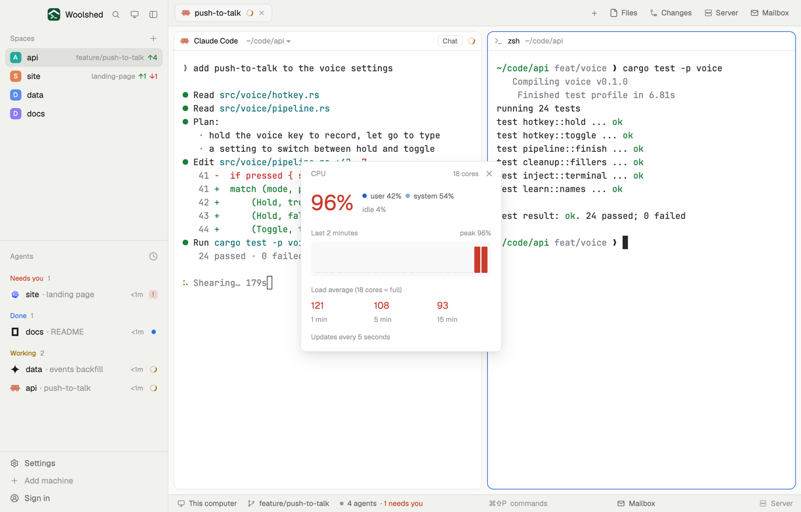

# CPU meter

How hard this computer is working while your agents build and test: CPU use split into user and system, the load average, and a two-minute sparkline, in a small window you can leave open. In a layout block it becomes a one-line strip.

## What you see

A window 320 px wide on the `popover` color:

- **Header**, 38 px: "CPU" in 11.5 px `dim`, the core count ("18 cores") at the right, and ✕.
- **Now**: the CPU in use, "37%", in 34 px semibold (the `blocked` color from 85% up); beside it, in 11.5 px, a dot and "user 20%", a lighter dot and "system 17%", and "idle 63%" in `dim`.
- **Last 2 minutes**: an 11 px `dim` label with "peak 92%" at the right, over 24 bars 44 px tall on a faint panel (the `foreground` color at 3%), oldest at the left. Bars are the `accent` color, `blocked` from 85%; slots not sampled yet are flat 1 px lines.
- **Load average**: "Load average (18 cores = full)", then the 1, 5 and 15 minute loads in 15 px semibold, each in the `blocked` color when it's above the core count.
- "Updates every 5 seconds" in 11 px `dim`.

While the first reading is on its way it says "Measuring…"; errors show in `blocked`.

In a layout block it's a strip: "CPU", the use in semibold, a 72 px sparkline of the last minute (12 bars, 14 px) and the 1-minute load; under 180 px wide only "CPU 37%". Hovering it shows the three loads.

## How it behaves

- It samples every 5 seconds, never twice at once, and keeps the last 24 samples (two minutes) in memory. Closing the window forgets them.
- macOS: `top -l 2 -n 0 -s 1` (the second sample's "CPU usage" and "Load Avg" lines; the first is since boot) and `sysctl -n hw.ncpu` once. Linux: `cat /proc/stat /proc/loadavg`; use is the change in the `cpu` line's ticks between two readings (iowait counts as idle), so the first number appears on the second sample, 5 seconds in.
- Windows: "The CPU meter isn't on Windows yet."
- Nothing to click but ✕; it never changes anything.

## Built from

- `mods/cpu-meter/main.js` and `parse.js` (`parseTop`, `parseProcStat`, `usage`; pure, tested on real `top` output and a Linux `/proc/stat`).
- `woolshed` functions: `exec`, `theme`, `props`, `closeOverlay`, `window` (for the platform).
- `mod.json`: a kept window (`kind: "window"`, `key: "cpu-meter"`, `keep: true`), opened with `mod.open:cpu-meter`. No keys.
- The bars are plain `div`s with heights; no timer redraws except the 5-second sample.

## Watch out

- `top -l 2 -s 1` takes about a second, longer on a loaded machine; the read has a 15-second limit.
- macOS reports load averages far above the core count on a busy machine; that's real, not a parsing error.
- A strip in a hidden block keeps sampling (mods keep running while hidden), so leave it out of layouts you don't look at.
- `preview.png` is a screenshot of Woolshed in light mode, running example agents.

## Done when

- `woolshed check` passes on this folder and `woolshed do mod.open --name cpu-meter` opens the window.
- Within 5 seconds it shows a percentage and the three loads; after a minute about half the sparkline is filled.
- Running `yes > /dev/null` in a terminal raises the bars; stopping it brings them down.
