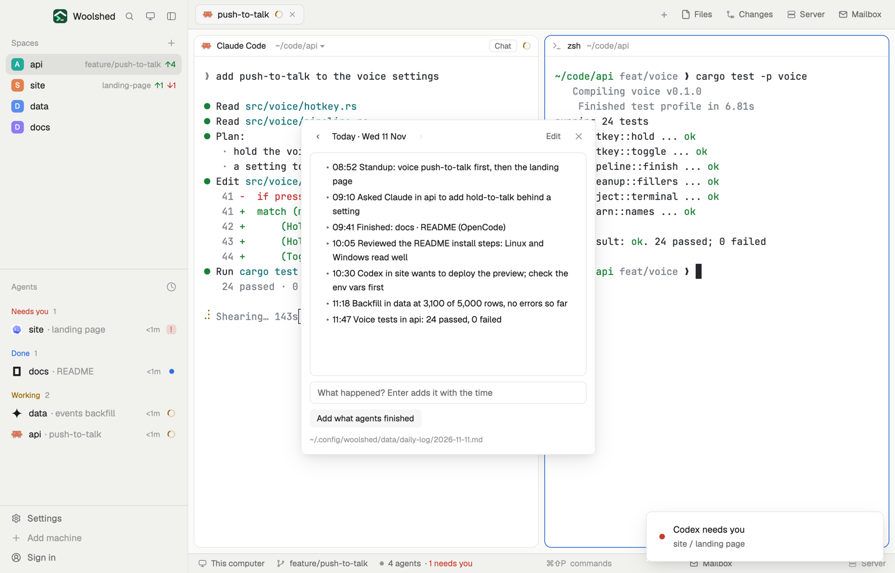

# Daily log

What happened today, one timestamped line at a time. Type a line and press Enter, or click "Add what agents finished" to log each agent that's done, so the end of the day writes itself. Earlier days are a click away. Each day is a plain markdown file that you or an agent can read and add to.

## What you see

A window 420 px wide on the `popover` color, or a block in a layout (on `chrome`):

- **Header**, 30 px: ‹ and › (24 px, `muted`; in the `border` color when there's no earlier or later day), "Today · Wed 11 Nov" in semibold ("Tue 10 Nov" on another day), then "Today" (only on another day), "Edit" and ✕.
- **The day**: a 320 px box on the `background` color with a `border` line, the day's lines rendered as markdown in 12.5 px (the file's own heading left out, since the header names the day), scrolling when long. "Nothing logged today yet." or "Nothing was logged this day." when empty.
- **Edit**: the box becomes a text box with the whole file, and Cancel and a `solid` Save below it.
- **Today only**: a 32 px field, "What happened? Enter adds it with the time", and a `raised` button, "Add what agents finished".
- **Footer** in 11 px: the day's file in `dim`; "Added 2 lines." or "Saved." in the `done` color; an error in `blocked`.

## How it behaves

- Enter adds `- 14:31 what you typed` to today's file (made with the heading `# Wednesday 11 November 2026` the first time).
- "Add what agents finished", only when clicked, adds `- 14:31 Finished: docs · README (OpenCode)` for each agent that is done or idle (an unnamed tab is "tab 2"), leaving out ones whose line is in today's log already. With none: "Nothing new to add: those agents are in the log." or "No agent is done or idle right now."
- ‹ and › step through the days that have a file; "Today" comes back. Lines are always added to the day it is now, even after midnight with the window open.
- Every add reads the file fresh and writes only if it's still as read, else it reads again and retries (three times). Edit's Save writes only over the text it opened; if the day changed meanwhile it says "The day changed somewhere else. Save again to replace it, or Cancel."
- Lines written to the files elsewhere (an agent logging what it did) show up at once.

## Built from

- `mods/daily-log/main.js` and `mods/daily-log/parse.js` (day names, entries, appending, which finished agents are new; pure functions). `gpui-base`: `InputState`, `Input`, `TextareaState`, `Textarea`, `TextView.markdown`. `woolshed` functions: `agents`, `exec`, `appHome`, `home`, `readTextFile`, `writeTextFile` (with the text it expects to replace), `watchFolder`, `theme`, `props`, `closeOverlay`; `readdir` from `fs/promises` to list the days.
- Storage: `data/daily-log/YYYY-MM-DD.md` under the app folder. No network. It runs `ls -1` on that folder only when the app folder is outside the home folder (mods can list only the home folder).
- `mod.json`: a kept window (`key: "daily-log"`). No keys: open it with `mod.open:daily-log`.

## Watch out

- "Finished" means done or idle now: an agent that sat idle all day counts too. Only the click adds anything.
- Days are by this computer's clock and date.
- Editing an earlier day is allowed; adding lines is for today only.
- `preview.png` is a screenshot of Woolshed in light mode, running example agents.

## Done when

- `woolshed check` passes on this folder and `mod.open:daily-log` opens today.
- Typing a line and Enter adds `- HH:MM line` to `data/daily-log/<today>.md`.
- With the docs agent done, "Add what agents finished" adds one line; clicking again adds nothing and says so.
- ‹ shows yesterday's file when there is one; "Today" comes back.
