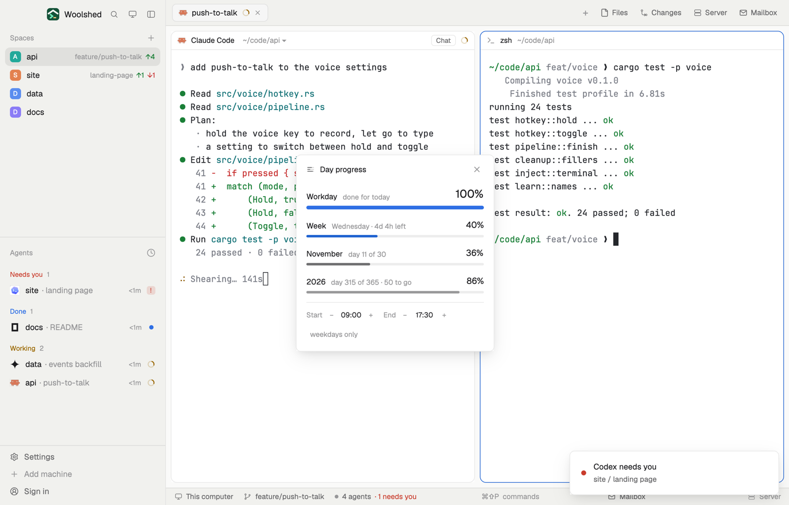

# Day progress

How far through the working day you are, and the week, the month and the year, as thin bars with percentages and what's left: "Workday 62% · 3h 15m left". Set your own hours. As a strip in a layout block it's three tiny bars you can glance at.

## What you see

A window 320 px wide on the `popover` color, opened with `mod.open day-progress`:

- **Header**: a bars icon, "Day progress" in semibold, and ✕.
- **Four rows**, each a name in semibold, a note in 11.5 px `dim` and the percentage at the right, over a bar:
  - **Workday**, 18 px percentage and a 6 px bar in the `working` color ("3h 15m left"; before it starts "starts in 1h 20m" with the percentage `dim`; after it "done for today" with the bar in `done`; on Saturday and Sunday "weekend: no working day").
  - **Week**, Monday 00:00 to the next Monday, bar in `accent`: "Wednesday · 4d 11h left".
  - **The month** by name, "November": "day 11 of 30".
  - **The year**, "2026": "day 315 of 365 · 50 to go". Month and year bars are a muted `foreground`; their percentages 14 px, bars 4 px.
- **Under a `border` line**: "Start − 09:00 +", "End − 17:30 +" and "weekdays only" (or "weekends too"), in 11.5 px.
- **As a strip** (a layout block): "Day", "Week" and "Year", each with a 44 × 4 px bar and its percentage; hover for all four with their notes, click to open the window.

## How it behaves

- − and + move the start or the end by 30 minutes, keeping at least an hour between them (from 00:00 to 24:00). The default day is 09:00 to 17:30.
- "weekdays only" switches to counting Saturday and Sunday as working days too.
- Percentages round down, so 100% means it's over.
- Spans are measured in real time, so on a daylight-saving day the working day and the week are their true length.
- It redraws once a minute, on the minute.

## Built from

- `mods/day-progress/parse.js`: the workday, week, month and year spans and labels (tested on its own, including a daylight-saving week).
- `mods/day-progress/main.js`: hours in shared `day-progress.settings` (`start`, `end` in minutes, `weekends`); `woolshed` functions `shared`, `setShared`, `theme`, `props`, `closeOverlay`, `run` (`mod.open`).
- `mod.json`: a kept window (`key: "day-progress"`, `keep: true`). Art: `progress.svg`. No keys, programs or network.

## Watch out

- One working day per day: a shift past midnight isn't supported (the end is at most 24:00).
- The week starts on Monday, whatever the calendar's setting.
- `preview.png` is a screenshot of Woolshed in light mode, running example agents.

## Done when

- `woolshed check` passes on this folder and `mod.open day-progress` opens the window.
- At 13:15 on a weekday with 09:00 to 17:30 the workday reads 50% and "4h 15m left".
- + on the end moves it to 18:00 and the percentage drops.
- On Wednesday at noon the week reads 35%.
