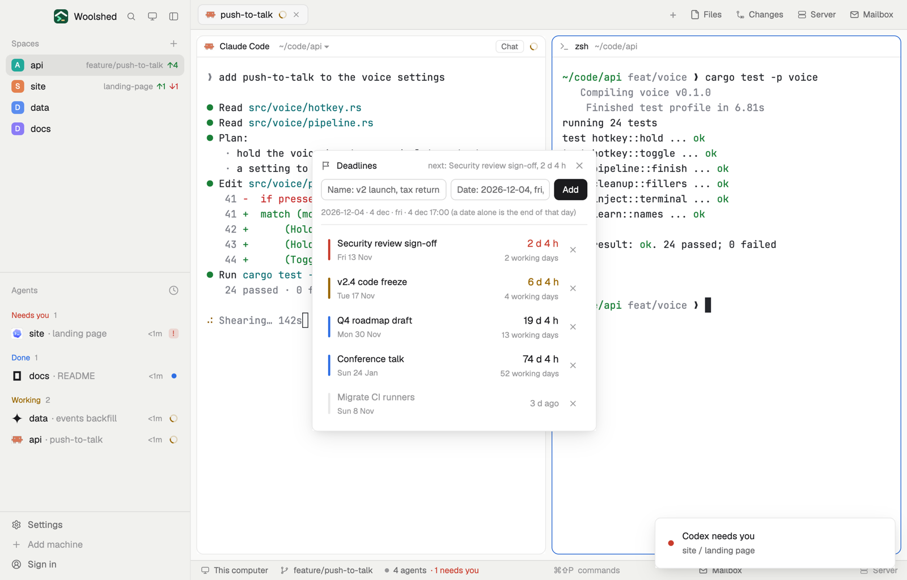

# Deadline

The dates you're working toward, with how long is left in days and hours and in working days (weekends skipped), soonest first. The ones two working days off or less turn red, the ones this week orange, and dates that have passed sink to the bottom, dimmed.

## What you see

A window 400 px wide (at most 600 px tall) on the `popover` color, opened with `mod.open deadline` (in a layout block it fills the block on `chrome`):

- **Header**: a flag, "Deadlines" in semibold, the next one in 11.5 px `dim` ("next: Security review sign-off, 1 d 9 h"), and ✕.
- **Rows**, soonest first: a 3 × 30 px stripe, the name in 13 px semibold with its date under it in 11 px `dim` ("Fri 13 Nov", "Fri 4 Dec 17:00", "1 Dec 2027"), and at the right the time left in 14 px semibold ("23 d 4 h", "5 h 12 m") over "16 working days" in 11 px `dim`, then ✕.
  - Two working days or less: the time and stripe in the `blocked` color; five or less: `working`; further: `foreground` with a `done` stripe.
  - Past: the name and "3 d ago" in `dim`, the stripe the `border` color, below the upcoming ones.
- **Empty**: "No deadlines yet" and "Name one and give its date, above."
- **The add row**, under the title and above the list: a name field, a 140 px date field and a solid Add; under it in 11 px the forms ("2026-12-04 · 4 dec · fri · 4 dec 17:00 (a date alone is the end of that day)"), what you typed as it will be read ("→ Fri 4 Dec"), or what's wrong in `blocked`.

## How it behaves

- Dates read: "2026-12-04", "4 dec", "Dec 4th 2027", a weekday ("fri": the next Friday), "today", "tomorrow", each with a time or not, and spans ("in 6d": the end of that day). A date alone is the end of that day (24:00); without a year it's the next one.
- Working days are the Mondays to Fridays after today, up to and including the deadline's day. Public holidays aren't known.
- Enter in the name field moves to the date; Enter there adds. Up to 30.
- It redraws once a minute.

## Built from

- `mods/deadline/main.js`: the list in shared `deadline.items` (`{ id, name, at, timed }`); `woolshed` functions `shared`, `setShared`, `theme`, `props`, `closeOverlay`, `appHome`, `readTextFile`; `InputState`/`Input`.
- `mods/deadline/parse.js`: reading dates, time left, working days, urgency, sorting and labels (tested on its own), in this computer's local time.
- `mod.json`: a kept window (`key: "deadline"`, `keep: true`). Art: `flag.svg`. No keys, programs or network.

## Watch out

- It has no reminders or toasts: it's a list to look at.
- An example list for a first look: `data/deadline/example.json` under the app folder, `{ "items": [{ "name", "when" } or { "name", "daysAgo" }] }`, replaces the list once each time that file changes. The preview uses it; nothing else writes it.
- `preview.png` is a screenshot of Woolshed in light mode, running example agents.

## Done when

- `woolshed check` passes on this folder and `mod.open deadline` opens the window.
- On a Wednesday, "fri" shows the coming Friday and "2 working days" in red.
- A date a week away shows 5 working days and the `working` color; one a month away the `foreground`.
- "2026-02-30" says "There's no such date".
