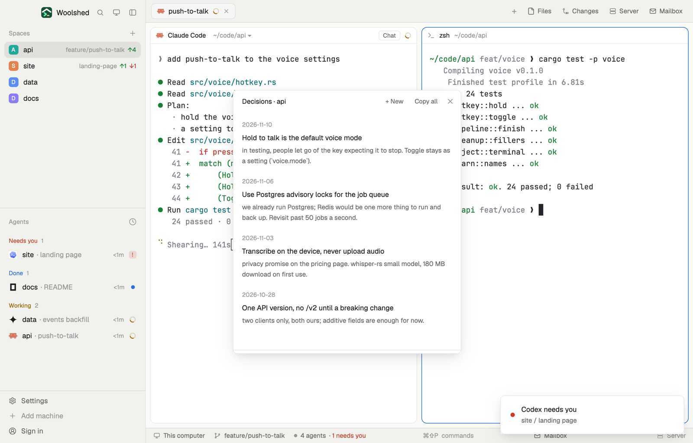

# Decisions

A log of what was decided in each project and why, so you and your agents stay on the same page. Record a decision in a few words, then copy it, or all of them, as a prompt to paste into an agent before it wanders off. The log is a markdown file in Woolshed's data folder, or in the project itself as `decisions.md` when you choose to keep it with the code.

## What you see

A window 420 px wide on the `popover` color, or a block in a layout (on `chrome`):

- **Header**, 40 px: "Decisions · api" in semibold, then "+ New", "Copy all" (once there's a decision) and ✕, in 11.5 px `muted`.
- **The form** (+ New): a 32 px "What was decided" field, a 96 px "Why: the reason, and what was ruled out" box, Cancel and a `solid` Save.
- **Rows**, newest first: the date in 11 px `dim`, the title in 13 px semibold `foreground`, and the reason below in 12 px `muted`, wrapped. On hover: "Copy as prompt" and "Delete"; Delete asks again with "Delete it" in the `blocked` color.
- **Footer** in 11 px `dim`: "Kept in Woolshed's data folder" with a "Save in the project" button, or "Kept in the project: ~/code/api/decisions.md". "Copied "Use Postgres advisory locks": paste it into an agent" in the `done` color for 6 seconds; errors in `blocked`.
- Empty: "No decisions yet for api. + New records one, so agents stay aligned."; with no space open, "Open a space to see its decisions."

## How it behaves

- It follows the shown space: one log per folder and machine, so a new space in the same folder finds the same log.
- Save adds `## 2026-11-11 · Title` and `Why: …` right after the log's `# Decisions · api` heading, so the file reads newest first too. A decision needs a title; the reason may be empty.
- "Copy as prompt" copies "We decided on 2026-11-10: Use Postgres advisory locks for the job queue. Why: … Keep to this unless I say otherwise." "Copy all" copies every decision as one list. Nothing is sent anywhere: you paste it.
- "Save in the project" (a space on this computer with a folder) writes the log to `<folder>/decisions.md` and removes the data folder's copy; from then on that file is the log, so it travels with the repository and agents find it there. If the project has a `decisions.md` already, it says so and shows that one.
- Every change reads the file fresh and writes only if it's still as read, else it reads again and retries (three times). Edits elsewhere show up: the data folder at once, a project file within 15 seconds.

## Built from

- `mods/decisions/main.js` and `mods/decisions/parse.js` (parse, add, remove, the prompts; pure functions). `gpui-base`: `InputState`, `Input`, `TextareaState`, `Textarea`. `woolshed` functions: `spaces`, `appHome`, `home`, `readTextFile`, `writeTextFile` (with the text it expects to replace; `null` for the new project file), `watchFolder` (the data folder), `theme`, `props`, `closeOverlay`; `unlink` from `fs/promises`; `cx.write_to_clipboard`.
- Storage: `data/decisions/<folder name>-<6-character hash>.md` under the app folder (the machine's name in front for a remote space), or `<folder>/decisions.md`. No programs and no network.
- `mod.json`: a kept window (`key: "decisions"`). No keys: open it with `mod.open:decisions`.

## Watch out

- A `decisions.md` already in the project wins over the data folder's log; the data copy then stays unused.
- Spaces on another machine keep their log on this computer: "Save in the project" isn't offered there, nor for a space without a folder.
- Headings the log reads: `## YYYY-MM-DD · Title` (also `-`, `–`, `—` or `:` after the date, or no date). Anything before the first decision is kept.
- `preview.png` is a screenshot of Woolshed in light mode, running example agents.

## Done when

- `woolshed check` passes on this folder and `mod.open:decisions` opens the shown space's log.
- + New and Save add a `## <today> · Title` section at the top of the file.
- "Copy as prompt" puts "We decided on …" on the clipboard.
- "Save in the project" creates `<folder>/decisions.md` with the same text, the footer says "Kept in the project", and the data file is gone.
