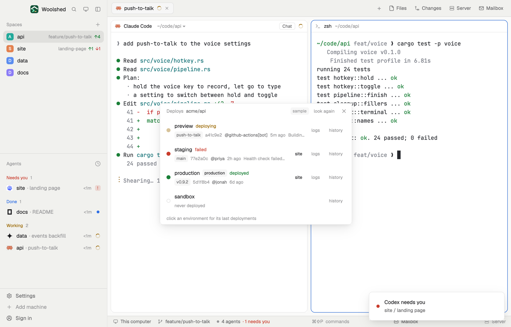

# Deploys

What's live where: each GitHub environment of the repo you're in with its latest deployment, the branch or tag and commit it shipped, who started it, when, and whether it worked. Links go to the site and the deploy's logs, and a click shows the deployments before it.

## What you see

A window 480 px wide on the `popover` color (`mod.open:deploys`), or a block in a layout:

- **Header**, 38 px: "Deploys" in 11.5 px `dim`, the repo in `muted`, "sample" in sample mode, "look again", ✕.
- **Environments**, the most recently deployed first: a 10 px dot for the latest status (`ansi2` deployed, `blocked` failed or errored, `working` deploying and pulsing, a ring while queued or pending, `dim` inactive; an empty ring when it was never deployed); the name in 13 px semibold, a "production" tag, and the status word in its color; under it the ref in a tag ("v0.9.2", "main"), the short sha, "@jonah", the age and the status's description ("Health check failed: /healthz returned 503"). At the right, "site" (when the deploy gave a URL), "logs" and "history".
- Clicked, an environment shows up to five earlier deployments in 11 px `dim`: ref, sha, who, age.
- Environments that exist but were never deployed to come last, "never deployed".
- **Foot**: "click an environment for its last deployments".
- "No deployments or environments yet." with how they're made; problems as in the other GitHub mods.

## How it behaves

- It follows the shown space (noticed within 2.5 seconds) and looks again every 60 seconds while it's open, and on "look again".
- "site" opens the deployed URL, "logs" the deploy's log, "history" GitHub's page for that environment.
- Read-only: it never deploys, approves or changes an environment.

## Built from

- `mods/deploys/main.js`; `parse.js` (deployments, statuses, environments, grouping); `common.js` and `kit.js` (shared with the other GitHub and GitLab mods).
- Programs, read-only: the git reads of the space's repo; `gh api repos/<owner/repo>/deployments?per_page=50`, `gh api repos/<owner/repo>/environments`, and for each environment's latest deployment (at most 8, at once) `gh api repos/<owner/repo>/deployments/<id>/statuses?per_page=1`.
- `woolshed` functions: `spaces`, `panes`, `focused`, `exec`, `readTextFile`, `appHome`, `run` (`app.settings`), `theme`, `props`, `closeOverlay`.
- `mod.json`: a kept window (`key: "deploys"`). No keys.

## Watch out

- Only the last 50 deployments are read, so an environment deployed to long ago may show as "never deployed" in a busy repo.
- Statuses are read only for each environment's latest deployment; earlier ones show no status.
- Sample mode, a demo and preview aid: `data/deploys/sample.json` under the app's home (`{ "repo", "environments": [names], "deployments": [ …GitHub deployment objects… ], "statuses": { "<id>": { …a status… } } }`) is shown instead of GitHub, tagged "sample". Delete it to see your own.
- `preview.png` is a screenshot of Woolshed in light mode, running example agents.

## Done when

- `woolshed check` passes on this folder and `mod.open:deploys` opens it.
- In a repo that deploys with GitHub environments, each environment shows its latest deployment with the status github.com shows.
- Clicking an environment lists its earlier deployments; "site" and "logs" open the right pages.
