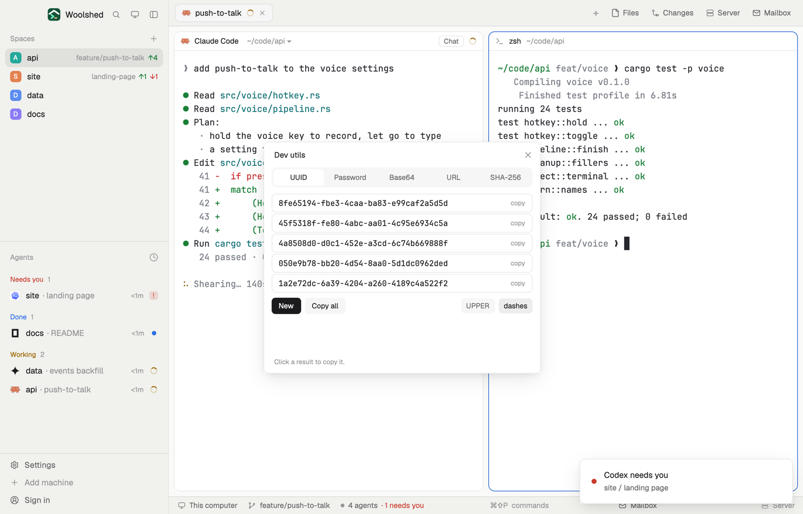

# Dev utils

A small toolbox in tabs for the things you'd otherwise search the web for: UUIDs, a random password, base64 and URL encoding both ways, and the SHA-256 of some text. Everything is worked out on this computer, nothing is sent anywhere, and every result copies with a click.

## What you see

A window 440 px wide on the `popover` color (at least 250 px of tab body, so it doesn't jump), or a block in a layout (on `chrome`):

- **Header**, 40 px: "Dev utils" in semibold and ✕.
- **Tabs**, a 32 px bar on `raised`: UUID, Password, Base64, URL, SHA-256; the chosen one on `background` in semibold.
- **UUID**: five v4 UUIDs, 30 px rows in the terminal font at 12.5 px on `background` with "copy" at the right (the border turns `accent` on hover); a solid New, Copy all, and chips "UPPER" and "dashes".
- **Password**: the password in the terminal font at 14 px on `background`; "≈ 128 bits · very strong" (`done` from 75 bits, `working` from 50, `blocked` below); a solid New and Copy; length chips 12, 16, 20, 24, 32, 64; chips A-Z, a-z, 0-9, symbols and "I l 1 O 0" (look-alikes, off by default); "Made here from the system's random source; not saved anywhere."
- **Base64**: chips Encode/Decode, URL-safe (encoding), "⇅ use result"; a 96 px box; the result below (`blocked` text and border for input that isn't base64; "Not text: 6 bytes, shown as hex." in `working` when the decoded bytes aren't UTF-8).
- **URL**: chips Encode/Decode and "one part"/"whole URL"; the box; the result; when decoding a URL with a query, "2 query parameters" and each name (`accent`) and decoded value, click to copy the value.
- **SHA-256**: the box; the hex digest in 11.5 px; "Of the text as UTF-8, exactly as typed (no newline added)." and "Copy as base64".
- Foot, 10.5 px: "Click a result to copy it." or "Copied the password."

Chips are 24 px: `selected` and semibold when on, `raised` and `muted` when off.

## How it behaves

- Random bytes come from `crypto.getRandomValues` (else `crypto.randomBytes`); passwords use rejection sampling so every character is equally likely, and contain at least one of each chosen kind.
- Length or a kind changed makes a new password at once. Turning every kind off turns a-z back on.
- Base64 encodes the text as UTF-8; decoding accepts the standard and URL-safe alphabets, with or without padding, and spaces and line breaks.
- URL "one part" is `encodeURIComponent` (escapes `/ ? & =`), "whole URL" is `encodeURI`; decoding turns `+` into a space.
- SHA-256 uses WebCrypto (`crypto.subtle.digest`); without it, `sh -c 'printf "%s" "$1" | shasum -a 256'` with the text as an argument.
- Remembered in this mod's `localStorage`: the tab and the options only, never a password or typed text.

## Built from

- `mods/dev-utils/main.js` and `parse.js` (UUID, password, base64, URL and query helpers; `Buffer` from `buffer` for UTF-8).
- `crypto` (`randomBytes` as a fallback), `globalThis.crypto` (`getRandomValues`, `subtle.digest`).
- `woolshed` functions: `exec` (only for the shasum fallback), `settings` (the terminal font), `theme`, `props`, `closeOverlay`.
- No network, no files.
- `mod.json`: a kept window (`key: "dev-utils"`). No keys.

## Watch out

- The window's height follows the tab (at least 250 px of body).
- Decoded base64 that isn't text shows as hex, not as a file.
- `preview.png` is a screenshot of Woolshed in light mode, running example agents.

## Done when

- `woolshed check` passes on this folder and `mod.open dev-utils` opens it.
- New makes five fresh UUIDs whose 15th character is 4; clicking one copies it.
- A 20-character password with all four kinds says about 128 bits.
- `héllo` encodes to `aMOpbGxv` and decodes back; the SHA-256 of `abc` is `ba7816bf…20015ad`.
