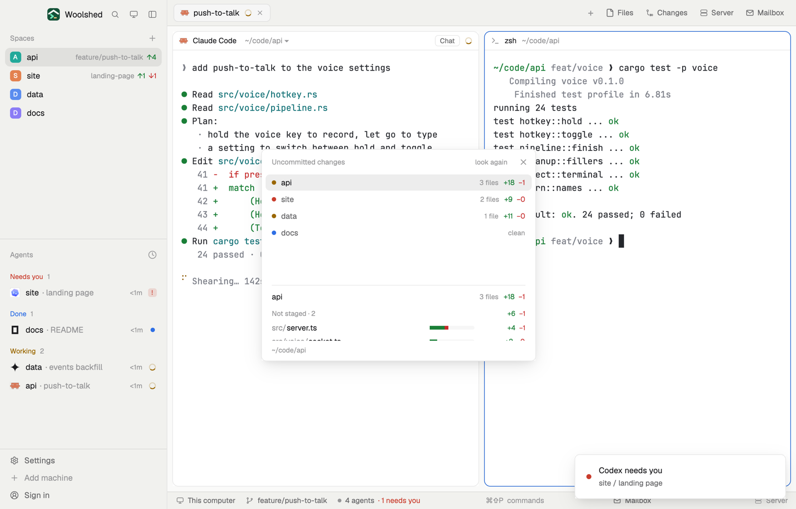

# Diff stat

What's changed and not committed yet, in lines. At the top, every space's totals, so you see at a glance what each agent has changed so far; below, the repository you're in, file by file (staged, not staged, new), each with a green and red bar of lines added and removed.

## What you see

A window 440 px wide (`ctrl-alt-c`) on the `popover` color, or a block in a layout (on `chrome`):

- **Header**, 40 px: "Uncommitted changes" in 11.5 px `dim`, "look again" and ✕.
- **Spaces**, 26 px rows (the list scrolls past 170 px): a 7 px dot in the space's status color (`working`, `blocked`, `done`, `idle`), the space's name (semibold and on `selected` for the one you're in), and at the right "4 files" in `dim` with "+27" in the green terminal color (`ansi2`) and "−2" in the red one (`ansi1`); "clean", "not a repo" or "can't read" when so.
- **The repository you're in**, under a 1 px `border` line: its name in semibold with its file count and totals, then groups "Staged · 1", "Not staged · 2", "New files · 1" (11 px `dim`, their totals at the right). Each file is a 22 px row: the folder in `dim`, the file name in `foreground`, a 72 × 6 px bar on `raised` (green part for lines added, red for removed, scaled to the biggest change), and "+4 −0". Binary files say "binary". Up to 80 files a group.
- **Footer**: the folder in 11 px `dim`.

With nothing uncommitted: "Nothing uncommitted. Changes show here as they're made." Outside a repository: "Not a git repository"; without git, "git isn't installed on this machine…".

## How it behaves

- Clicking a space runs `space.select` for it; the lower part then follows.
- Each space's repository is where its first terminal is now (else its folder), read on the space's machine. Spaces in the same folder are read once.
- It reads every 20 seconds, four repositories at a time, when the focused folder changes (checked every 2.5 seconds) and on "look again". It only ever reads.
- New files count their lines with `wc -l`, up to 60 a repository; where `wc` can't run (Windows without Unix tools) they show as "new" without numbers.

## Built from

- `mods/diff-stat/main.js` and `parse.js` (`parseNumstat`, `parseZ`, `parseWc`, `totals`, `bar`, `split`, `explain`).
- Programs, read-only, with `--no-optional-locks -c core.fsmonitor=false -c diff.autoRefreshIndex=false -c color.ui=false -c core.quotePath=false` and a 10-second limit, per repository: `git rev-parse --show-toplevel`, `git diff --numstat -z`, `git diff --cached --numstat -z`, `git ls-files --others --exclude-standard -z`, `wc -l -- <new files>`.
- `woolshed` functions: `spaces`, `panes`, `focused`, `exec` (with `on`), `run` (`space.select`), `home`, `theme`, `props`, `closeOverlay`.
- `mod.json`: a kept window (`key: "diff-stat"`). `keys.json`: `"ctrl-alt-c": "mod.open:diff-stat"`.

## Watch out

- A file both staged and changed again shows in both groups; the totals count its lines in both but the file once.
- Renames count as the new path.
- `preview.png` is a screenshot of Woolshed in light mode, running example agents.

## Done when

- `woolshed check` passes on this folder and `ctrl-alt-c` opens it.
- Editing a file in a space's repository changes that space's totals and adds the file under "Not staged" within 20 seconds; `git add` moves it to "Staged".
- A new file shows under "New files" with its line count.
- Clicking another space's row goes to that space.
