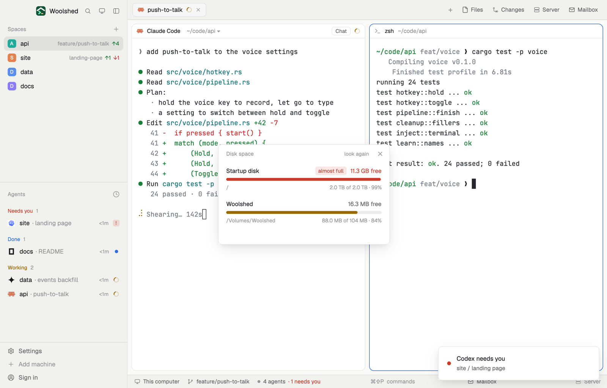

# Disk space

Every disk this computer has mounted, its free space and a bar, turning red under 10% free, so a build or a model download doesn't run the disk out from under your agents. One toast when a disk crosses that line while it's open; click a disk to open it.

## What you see

A window 360 px wide on the `popover` color:

- **Header**, 38 px: "Disk space" in 11.5 px `dim`, "look again" ("…" while reading) and ✕.
- **A row per disk**, rounded 8 px, `hover` on hover: the name in semibold ("Startup disk", a volume's own name under `/Volumes`, "System" for Linux's `/`), and at the right "126 GB free" in `muted`; a 6 px bar of the share used, `accent`, `working` above 80%, `blocked` under 10% free with an "almost full" tag (the `blocked` color on a faint wash); below, in 11 px `dim`, the mount point (or device) and "1.8 TB of 2.0 TB · 94%".
- "Updates every minute · click a disk to open it" in 11 px `dim`.
- Empty: "No disks to show."; errors in `blocked`.

In a layout block it's a strip: "Disk", the fullest disk's free space in semibold (`blocked` when low), a 64 px bar and its name; under 200 px only the free space. Hovering lists every disk's free space.

## How it behaves

- It runs `df -kP` every minute and on "look again", never twice at once.
- Free is what can still be written (`Available`); the share used is size minus free, which is right for APFS volumes that share one container.
- Left out: pseudo filesystems (devfs, tmpfs, overlay, squashfs, efivarfs, ...), on macOS `/dev`, `/System/Volumes/*`, `/private/var/*` and simulator images, on Linux `/dev`, `/run`, `/sys`, `/proc`, snaps, Docker's own mounts and `/boot/efi`. macOS volumes with the same size and free space are one container and show once, `/` first; Linux shows each device once.
- When a disk goes from 10% free or more to under 10% while it's open, a warning toast says "Startup disk is almost full" with the free space. Opening it on an already-full disk shows the red row but no toast.
- Clicking a disk opens it with `open` (Finder) or `xdg-open`.
- Windows: "Disk space isn't on Windows yet."

## Built from

- `mods/disk-space/main.js` and `parse.js` (`parseDf`, `volumes`, `size`; pure, tested on real macOS `df -kP` output and a Linux one with a mount point holding a space).
- `woolshed` functions: `exec`, `notify`, `theme`, `props`, `closeOverlay`, `window`.
- `mod.json`: a kept window (`key: "disk-space"`, `keep: true`), opened with `mod.open:disk-space`. No keys.

## Watch out

- Sizes are decimal (GB, TB), as Finder and disk makers count them.
- `df` exits 1 when one mount can't be read (a dead network share); the rest still shows.
- Network shares and disk images under `/Volumes` show like any disk.
- `preview.png` is a screenshot of Woolshed in light mode, running example agents.

## Done when

- `woolshed check` passes on this folder and `woolshed do mod.open --name disk-space` opens the window.
- The startup disk's free space matches Finder's (or `df -h`'s) within rounding.
- Plugging in a USB disk adds its row at the next minute or on "look again"; clicking it opens it.
