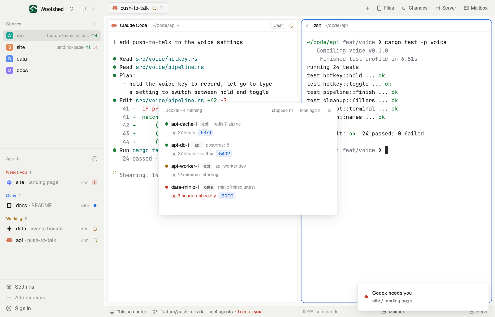

# Docker containers

The containers your agents started with Docker: which are up, healthy or crashing, their published ports and how long they've run. Start and Stop one, open a port in the browser, or open its logs in a new tab beside your agents. It says plainly when Docker isn't installed or isn't running.

## What you see

A window 460 px wide on the `popover` color:

- **Header**, 38 px: "Docker · 4 running" in 11.5 px `dim`, "stopped (1)" (or "running only") when there are stopped containers, "look again" ("…" while asking) and ✕.
- **A row per container**, rounded 8 px, `hover` on hover: a dot (`ansi2` running, `working` starting, restarting, paused or created, `blocked` unhealthy or exited with an error, `dim` stopped), the name in semibold, its Compose project in an 11 px tag on `raised`, the image in 11.5 px `dim`. Below: "up 27 hours · healthy" (or "exited 2 days ago") in `dim` (`blocked` when unhealthy) and up to four published ports as `accent` chips, ":5432", then "+2".
- On hover the row gets Logs and Stop (Start for a stopped one) buttons on `raised`; while it works the button reads "Stopping…" or "Starting…". A failed start or stop shows docker's message under the row in `blocked`.
- A footer: "Hover a container for Logs, Start and Stop · click a port to open it".
- Without Docker: "Docker isn't installed here. Install Docker Desktop, OrbStack or Colima, then look again." Not running (in `muted`): "Docker isn't running. Start Docker Desktop (or `colima start`), then look again." Linux without access: the docker group hint. Nothing yet: "No containers yet. When an agent runs `docker compose up`, they show here."

In a layout block it's a strip: "Docker", "4 running" in semibold, a dot per running container, and "1 unhealthy" in `blocked`; "not installed" or "not running" otherwise. Hovering lists the running containers and their uptime.

## How it behaves

- It runs `docker ps -a --format '{{json .}}'` every 10 seconds and on "look again", never twice at once, with a 10-second limit.
- Running containers come first, then by name; stopped ones are hidden until "stopped (n)", remembered per copy (`localStorage` `docker-ps.all`).
- Start and Stop run `docker start <id>` / `docker stop <id>` (60-second limit) and list again.
- Logs opens a tab named "logs: api-db-1" in the shown space running `docker logs -f --tail 200 <name>` (a new space "docker" when there's none). Close the tab to stop following.
- A port chip opens `http://localhost:<port>/` in the browser. Ports that aren't published on this computer aren't shown.

## Built from

- `mods/docker-ps/main.js` and `parse.js` (`parseDockerPs`, `upOf`, `portsOf`, `failure`; pure, tested on `docker ps` JSON lines, port ranges, IPv6 duplicates and docker's error messages).
- `woolshed` functions: `exec`, `run` (`tab.new`, `space.new`), `spaces`, `theme`, `props`, `closeOverlay`.
- `mod.json`: a kept window (`key: "docker-ps"`, `keep: true`), opened with `mod.open:docker-ps`. No keys.

## Watch out

- It talks to the Docker your shell's `docker` reaches (its current context), on this computer only.
- Stop has no confirmation: a stopped container keeps its data and Start brings it back.
- The preview runs against a stand-in `docker` that answers with example containers; on a real machine the rows are yours.
- `preview.png` is a screenshot of Woolshed in light mode, running example agents.

## Done when

- `woolshed check` passes on this folder and `woolshed do mod.open --name docker-ps` opens the window.
- With Docker stopped it says "Docker isn't running"; after starting it and "look again", the containers appear.
- `docker run -d -p 8080:80 nginx` shows a row with ":8080" within 10 seconds; the chip opens the page; Logs opens a tab following its log; Stop stops it.
