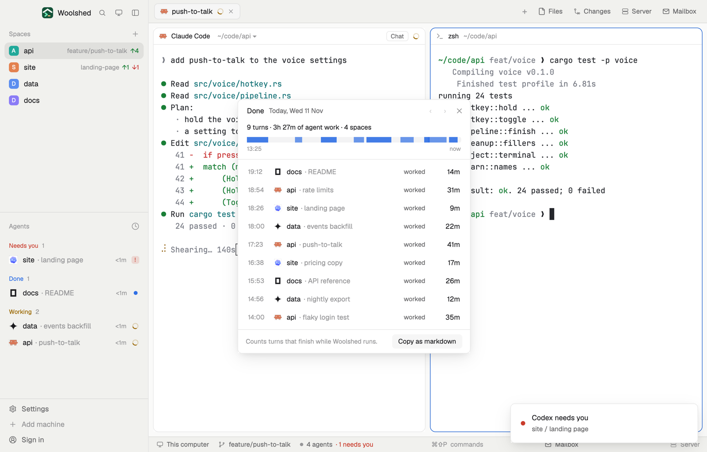

# Done today

Everything your agents finished today: each turn with its space, tab, when it finished and how long it worked, a bar of the day, and the total. Copy it as markdown for a stand-up or a log, and look back over the last two weeks.

## What you see

A window 420 px wide on the `popover` color (`mod.open done-today`), or a strip in a layout block:

- **Header**, 40 px: "Done" in 13 px semibold, "Today, Wed 11 Nov" in 12 px `muted` ("Yesterday, …", or the date), ‹ and › to step through days, and ✕.
- **Summary**, 12 px: "9 turns · 3h 27m of agent work · 4 spaces".
- **The day bar**: 10 px tall with 3 px corners on a faint `foreground` track; each turn a segment in the `done` color (alternating strengths) where it ran, from the day's first start to now. Under it the first start's time and "now" in 10.5 px `dim`.
- A 1 px `border` line, then a 32 px row per turn, newest first: the time it finished ("14:32") in 11.5 px `dim`, the program's 14 px icon, the space name (medium) and "· tab" in `dim` (or the program's name), "worked" in `muted` and the time in semibold, right-aligned ("23m", "1h 05m"). The rows scroll past 360 px.
- **Footer**: "Counts turns that finish while Woolshed runs." in `dim` (or "Copied 9 turns as markdown" in `done` for 4 seconds) and a "Copy as markdown" button, 26 px, off on an empty day.
- An empty day: "Nothing finished yet today. Each time an agent finishes a turn, it's added here."
- **The strip**: an 8 px `done` dot and "9 done today · 3h 27m" (or "Nothing done yet today"); a click opens the window.

## How it behaves

- A turn starts when an agent starts working and ends when it stops (done or idle); time it spent asking you is part of the turn. An agent already working when the mod starts takes its tab's `working_since` as the start.
- Each turn is filed under the day it ended and kept for 14 days. ‹ goes back a day while there are older ones; › comes forward to today.
- Click a row to go to that agent, while it's still running (`agent.focus`).
- Copy as markdown puts the shown day on the clipboard:
  `## Agent work, Wed 11 Nov 2026`, a line "9 agent turns, 3h 27m of work, in 4 spaces.", then `- 14:32 **api** · rate limits (Claude Code): worked 31m` per turn, oldest first.
- The list redraws every minute.

## Built from

- `mods/done-today/main.js`: with `props().overlay` the window, else the strip. `woolshed` functions `agents`, `spaces`, `theme`, `props`, `closeOverlay`, `shared`, `setShared`, `readTextFile`, `appHome`, `run`; `cx.write_to_clipboard`.
- `turns.js`: `follow` (turns from status changes), `addTurns` (filed by day, each once, 14 days kept), `markdown`.
- Shared state `done-today.days`: `{ "YYYY-MM-DD": [{ id, address, space, tab, program, start, end }] }`. A turn's id is its address and change number, so a window and a strip seeing the same turn add it once.
- `mod.json`: a kept window (`key: "done-today"`, `keep: true`). No keys, no programs.

## Watch out

- It records only while a copy runs and sees the change: keep the window open (it comes back on the next start) or put the strip in a layout, `{ "type": "block", "size": { "px": 28 }, "content": { "mod": "done-today" } }`. Turns that end while Woolshed is closed aren't counted.
- Days follow this computer's clock; a turn running past midnight belongs to the day it ended.
- If `data/done-today/example.json` exists (`{ "turns": [{ space, tab, program, start, end, address }] }`, times in ms), its turns are shown beside your own. The preview writes it; delete it to see only yours.
- `preview.png` is a screenshot of Woolshed in light mode, running example agents.

## Done when

- `woolshed check` passes on this folder and `mod.open done-today` opens the window.
- When an agent finishes a turn, a row appears with the time and how long it worked, and the summary and bar grow.
- Copy as markdown puts the day on the clipboard in the format above.
- After a restart, today's turns are still there.
