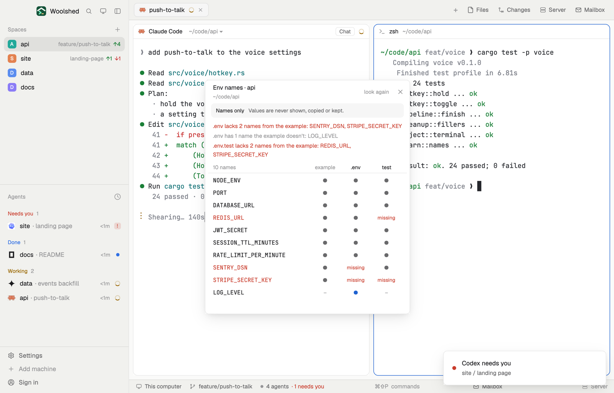

# Env names

The `.env` files of the project you're in, side by side, by the names of their variables only, never the values. Next to `.env.example` it shows which names your `.env` is missing and which it has extra, so a setting a teammate added doesn't catch you out. Click a name to copy it.

## What you see

A window on the `popover` color, 400 px wide or wider with more files (210 px for the names plus 64 px a file), or a block in a layout (on `chrome`):

- **Header**, 48 px: "Env names · api" in semibold, the folder below in 11 px `dim`; "look again" and ✕.
- **A note** on `raised`: "Names only" in semibold and "Values are never shown, copied or kept."
- **Summary lines**, 11.5 px: ".env lacks 2 names from the example: SENTRY_DSN, STRIPE_SECRET_KEY" in `blocked`; ".env has 1 name the example doesn't: LOG_LEVEL" in `dim`; "Every file sets every name the example has." in `done`; "No .env.example to compare with…" when there's none.
- **Column headings**, 24 px with a line under: "10 names", then one 64 px column per file: "example", ".env", "local", "test" (the example in `dim`).
- **Rows**, 26 px: the name in the terminal font at 12 px (`blocked` when a file misses it), then per file: ● in `muted` (set), ●● in `working` (set twice: the last wins), "missing" in `blocked` (the example has it, this file doesn't), ● in `accent` (not in the example), – in `dim` (not set). Each cell says so on hover.
- Foot, 10.5 px `dim`: "Click a name to copy it.", "Copied the name PORT.", or "2 more .env files not shown."
- Empty states: "No space open…", "This space is in your home folder…", "No .env files in this project."

## How it behaves

- It follows the space this window shows (at home, the focused pane's folder).
- Files: `.env` and `.env.<anything>` in the project folder (not `.envrc`, a shell script). The example is `.env.example`, else `.env.sample`, `.env.template`, `.env.dist`, `.env.defaults`. Columns: the example first, then `.env`, then the rest by name, at most 5.
- A name is what's before `=` on a line, after an optional `export`; comments and other lines are skipped, and a quoted value that runs over several lines is skipped whole.
- Each file's text is read, its names picked out and the text dropped at once: values are never shown, logged, copied or stored.
- It reads again when the space changes, every 30 seconds while open, and on "look again".

## Built from

- `mods/env-names/main.js` and `parse.js` (`envNames` returns names and counts only; `compare` builds the grid).
- `woolshed` functions: `spaces`, `focused`, `home`, `readTextFile` (with `on` for a remote space), `exec` (`ls -1A` on another machine only), `settings` (the terminal font), `theme`, `props`, `closeOverlay`. `fs/promises` `readdir` lists the folder here.
- No network. No files written.
- `mod.json`: a kept window (`key: "env-names"`). No keys.

## Watch out

- It reads only the project folder itself, not `.env` files in sub-folders (a monorepo's packages).
- A name set on two lines shows ●● in the file's column, since tools differ on which one wins.
- `preview.png` is a screenshot of Woolshed in light mode, running example agents.

## Done when

- `woolshed check` passes on this folder and `mod.open env-names` opens it.
- With `.env.example` naming `STRIPE_SECRET_KEY` and `.env` not, the row shows "missing" under `.env` and the summary names it.
- No value from any file appears anywhere in the window, its tooltips or the clipboard.
- Adding a line to `.env` shows the new name within 30 seconds (or at once with "look again").
