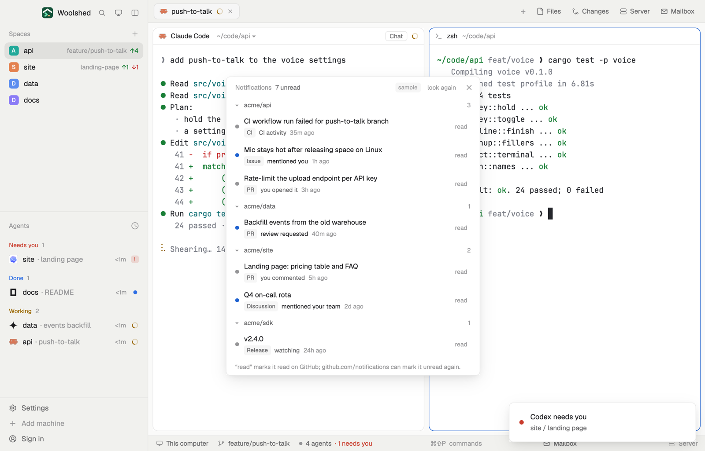

# GitHub notifications

Your unread GitHub notifications beside your agents, grouped by repository, each with why it came: a review requested, a mention, an assignment, CI. The ones that need you stand out; click to open, or mark one read without leaving Woolshed.

## What you see

A window 460 px wide on the `popover` color (`mod.open:gh-notifications`), or a block in a layout:

- **Header**, 38 px: "Notifications" in 11.5 px `dim`, "7 unread" in `muted`, "sample" in sample mode, "look again", ✕.
- **Groups**, the most recently active repo first: a 26 px line with ▾ (▸ folded), the repo in 11.5 px semibold `muted` and its count.
- **Rows**: a 7 px dot (`accent` for review requested, mentions, assignments, security alerts and approval requests; `dim` for the rest); the subject's title; a kind tag ("PR", "Issue", "Release", "Discussion", "CI", "Commit"), the reason ("review requested", "mentioned you", "assigned to you", "you commented", "CI activity", "watching", …; `foreground` when it needs you) and the age; "read" at the right.
- **Foot**: "“read” marks it read on GitHub; github.com/notifications can mark it unread again."
- "All caught up." when there are none. "gh's sign-in can't read notifications." with "Run gh auth refresh -s notifications in a terminal." when the sign-in lacks the scope; other problems as in the other GitHub mods.

## How it behaves

- It reads your unread notifications every 60 seconds while it's open (GitHub's own polling interval), and on "look again". It needs no space or repo.
- Clicking a row opens its page: the pull request, issue or commit, the repo's releases, discussions or Actions.
- "read" marks that one read on GitHub at once, without asking: it's undone on github.com/notifications (Mark as unread), as the foot says. It leaves the list straight away; if GitHub refuses, a toast says why and the list looks again.
- Clicking a repo's line folds or unfolds it.

## Built from

- `mods/gh-notifications/main.js`; `parse.js` (groups, reasons, the page for each subject); `common.js` and `kit.js` (shared with the other GitHub and GitLab mods).
- Programs: `gh api notifications?per_page=50` (read); on "read", `gh api -X PATCH notifications/threads/<id>`.
- `woolshed` functions: `exec`, `home`, `readTextFile`, `appHome`, `notify`, `run` (`app.settings`), `theme`, `props`, `closeOverlay`.
- `mod.json`: a kept window (`key: "gh-notifications"`). No keys.

## Watch out

- At most 50 notifications are read, unread ones only.
- Opening a notification's page on github.com marks it read there too (GitHub's own behavior).
- Sample mode, a demo and preview aid: `data/gh-notifications/sample.json` under the app's home (`{ "notifications": [ …GitHub notification objects… ] }`) is shown instead of GitHub, tagged "sample"; "read" only hides the row and toasts "nothing was run". Delete it to see your own.
- `preview.png` is a screenshot of Woolshed in light mode, running example agents.

## Done when

- `woolshed check` passes on this folder and `mod.open:gh-notifications` opens it.
- It shows the same unread notifications as github.com/notifications, grouped by repo.
- "read" removes one here and on github.com; the foot says how to undo it.
