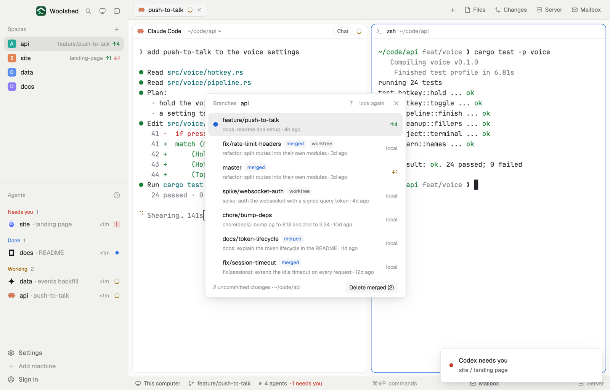

# Git branches

The local branches of the repository you're in, newest commit first: how far each is ahead of or behind its upstream, which are merged, and which is current. Switch to one with a click (it asks first when you have uncommitted changes), or delete the merged ones in one go (it asks first, and never deletes unmerged work).

## What you see

A window 420 px wide on the `popover` color, or a block in a layout (on `chrome`):

- **Header**, 40 px: "Branches" in 11.5 px `dim`, the repository's name in semibold, how many branches, "look again" and ✕.
- **Rows**, one per local branch by last commit date: a `accent` dot for the current branch, whose row sits on `selected` and whose name is semibold; the name, then small tags on `raised`: "merged" (`done` color, merged into the current branch) and "worktree" (`muted`, checked out in another worktree). Below, the last commit's subject and age in 11 px `dim`. At the right: "↑2" in the green terminal color (`ansi2`) and "↓1" in the `working` color against its upstream, "in sync", "local" (no upstream) or "upstream gone" (`blocked`). Hovering another branch shows a Switch button.
- **Footer**: "3 uncommitted changes · ~/code/api" (or just the folder) in 11 px `dim`, the result of the last action in its place (`blocked` when it failed), and "Delete merged (2)" when there are merged branches to delete.
- **Asking**: a bar on `raised` replaces the footer: "3 files have uncommitted changes. Switching takes them along, or stops if they clash with master." with Cancel and a solid "Switch anyway"; or "Delete 2 merged branches: docs/token-lifecycle, fix/session-timeout? Their commits stay in feature/push-to-talk." with Cancel and a solid Delete.

Outside a repository it says "Not a git repository"; without git, "git isn't installed on this machine…" in `blocked`.

## How it behaves

- It follows the focused pane's folder, on that space's machine. A new folder is noticed within 2.5 seconds; it reads again every 20 seconds, after every action and on "look again".
- Switch runs `git switch <branch>` at once on a clean tree (changes to tracked files; new files don't count); with changes it asks first. git's own refusal ("Your local changes … would be overwritten") shows in the footer.
- Delete merged offers branches merged into HEAD except the current one, ones checked out in another worktree, and `main`, `master`, `develop`, `dev`, `trunk`, `release`, `production`, `staging`. It runs `git branch -d`, which refuses anything unmerged.
- Ahead and behind are as of the last fetch; it never fetches.

## Built from

- `mods/git-branches/main.js` and `parse.js` (`parseBranches`, `parseTrack`, `dirtyCount`, `worktreeBranches`, `deletable`, `since`, `explain`).
- Reads, with `--no-optional-locks -c core.fsmonitor=false -c diff.autoRefreshIndex=false -c color.ui=false` and a 10-second limit: `git rev-parse --show-toplevel`, `git for-each-ref --sort=-committerdate --format=%(HEAD)%1f%(refname:short)%1f%(upstream:short)%1f%(upstream:track)%1f%(committerdate:unix)%1f%(subject)%1e refs/heads`, `git branch --merged HEAD --format=%(refname:short)`, `git status --porcelain=v1 -z --untracked-files=no`, `git worktree list --porcelain`, `git symbolic-ref --quiet --short HEAD`.
- Changes, only on a click (30-second limit): `git switch <branch>`, `git branch -d <branches…>`.
- `woolshed` functions: `spaces`, `panes`, `focused`, `exec` (with `on`), `home`, `theme`, `props`, `closeOverlay`.
- `mod.json`: a kept window (`key: "git-branches"`), opened with `mod.open:git-branches`; no keys of its own.

## Watch out

- Switching moves every agent working in that folder onto the other branch too: switch in a worktree when agents are busy.
- `git switch` needs git 2.23 or newer.
- `preview.png` is a screenshot of Woolshed in light mode, running example agents.

## Done when

- `woolshed check` passes on this folder and `mod.open:git-branches` opens it.
- The current branch is marked and on top when it has the newest commit; a branch one commit ahead of its upstream shows "↑1".
- Switch on a clean tree changes branch at once; with an edited file it asks first, and Cancel does nothing.
- With a branch merged into the current one, "Delete merged (1)" asks, then deletes it.
