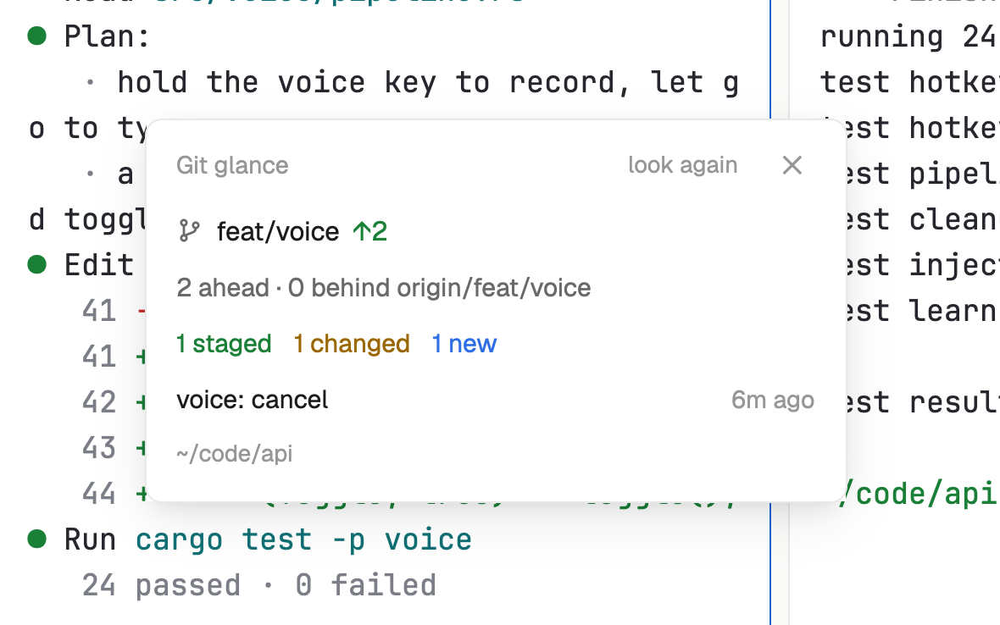

# Git glance

The branch you're in at a look: how far it is ahead of or behind its upstream, what's staged, changed, new or in conflict, the stash, and the last commit. It follows the pane you're in, on whichever machine it runs, and only ever reads.

## What you see

A window 330 px wide (`ctrl-shift-g`) on the `popover` color, or a block in a layout:

- **Header**: "Git glance" in 11.5 px `dim`, "look again" and ✕.
- **Branch**: a branch mark, the branch in 12.5 px semibold (or "detached a1b2c3d"), then "↑2" in the green terminal color (`ansi2`) and "↓1" in the `working` color when ahead or behind.
- "2 ahead · 1 behind origin/feature/login" (or "No upstream branch") in `muted`, and "· 1 stashed" when there's a stash.
- Counts as colored words: "1 conflict" (`blocked`), "1 staged" (`ansi2`), "3 changed" (`working`), "1 new" (`done`), or "clean".
- The last commit's subject, with how long ago at the right ("2h ago").
- The repository's folder in 11 px `dim` (`~` for your home).

In a block up to 64 px tall it's one line: branch, counts, last commit. Taller, it shows the card above. Outside a repository it says "Not a git repository".

## How it behaves

- It follows the focused pane's folder (or a focused terminal block's, or the space's folder). A new folder is noticed within 2.5 seconds; git runs again every 15 seconds, and when you click.
- Spaces on another machine are read on that machine.
- It never fetches, so ahead and behind are as of the last fetch.

## Built from

- `mods/git-glance/main.js` and `status.js` (reads `git status --porcelain=v2` output into numbers).
- Programs, all read-only and with fixed arguments, each with `--no-optional-locks -c core.fsmonitor=false -c diff.autoRefreshIndex=false` (they never write under `.git`) and a 10-second limit: `git rev-parse --show-toplevel`, `git status --porcelain=v2 --branch --show-stash --untracked-files=normal`, `git log -1 --format=%s%x1f%ct`.
- `woolshed` functions: `spaces`, `panes`, `focused`, `exec` (with `on` for another machine), `home`, `theme`, `props`, `closeOverlay`.
- `mod.json`: a kept window (`key: "git-glance"`). `keys.json`: `"ctrl-shift-g": "mod.open:git-glance"`.
- Art: `branch.svg`.

## Watch out

- The stash count needs git 2.35 or newer; older git leaves it out.
- A very large repository makes `git status` slow; it runs at most every 15 seconds and never twice at once.
- `preview.png` is a screenshot of Woolshed in light mode, running example agents.

## Done when

- `woolshed check` passes on this folder and `ctrl-shift-g` opens it.
- In a repository with a staged and a changed file it shows "1 staged" and "1 changed"; committing turns it "clean" within 15 seconds.
- Focusing a pane in another repository switches it within a few seconds.
- In a folder outside git it says "Not a git repository".
