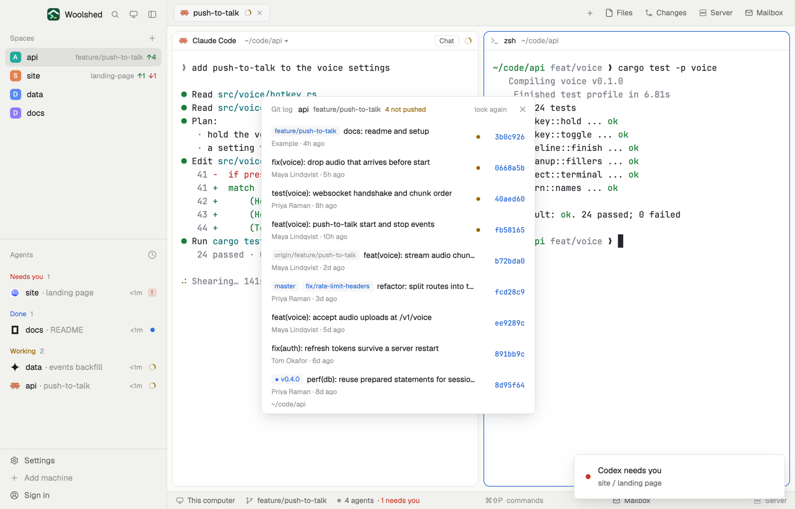

# Git log

The last 30 commits of the branch you're in, as a plain list: subject, author, how long ago, the short sha, and the branches and tags that point at each. Commits not pushed yet are marked. Click one to copy its sha; Show opens `git show` in a new tab. It follows the pane you're in, on whichever machine it runs.

## What you see

A window 440 px wide (`ctrl-alt-g`) on the `popover` color, or a block in a layout (on `chrome`):

- **Header**, 40 px: "Git log" in 11.5 px `dim`, the repository's name in semibold, the branch in `muted` ("detached" without one), "3 not pushed" in the `working` color when some are, "look again" ("…" while reading) and ✕.
- **Rows**, one per commit, newest first: small labels on `raised` for what points at it (a branch in `accent`, a tag as "◆ v0.4.0" in the `done` color, a remote branch in `dim`, left out when a local branch of the same name is there), then the subject; below, "Maya Lindqvist · 3h ago" in 11 px `dim`. At the right a 6 px `working` dot for a commit not pushed yet, and the short sha in the code font, `accent`. On hover a "Show" button appears.
- **Footer**: the repository's folder in 11 px `dim` (`~` for your home), "· on <machine>" for another machine.

In the window the list scrolls past 440 px. Outside a repository it says "Not a git repository"; a repository with no commits says "No commits yet. The first one shows here."; without git, "git isn't installed on this machine…" in the `blocked` color; with no space, "Open a space to see its history".

## How it behaves

- It follows the focused pane's folder (a focused terminal block's, else the space's folder). A new folder is noticed within 2.5 seconds; git runs again every 20 seconds and on "look again", never twice at once.
- Clicking a row copies the full 40-character sha; the short sha reads "copied" in the `done` color for 1.4 seconds.
- Show runs `tab.new` in that space: a tab named "show a1b2c3d" in the repository's folder running `git show <sha>`.
- "Not pushed" is `git rev-list @{upstream}..HEAD`; with no upstream nothing is marked. It never fetches.

## Built from

- `mods/git-log/main.js` and `parse.js` (reads the log records and `%D` ref lists; `since`; `explain` turns git errors into sentences).
- Programs, read-only, with `--no-optional-locks -c core.fsmonitor=false -c diff.autoRefreshIndex=false -c color.ui=false -c core.quotePath=false` and a 10-second limit: `git rev-parse --show-toplevel`, `git symbolic-ref --quiet --short HEAD`, `git remote`, `git log -n30 --format=%H%x1f%h%x1f%an%x1f%ct%x1f%D%x1f%s%x1e`, `git rev-list -n30 @{upstream}..HEAD`.
- `woolshed` functions: `spaces`, `panes`, `focused`, `exec` (with `on` for another machine), `run` (`tab.new`), `home`, `theme`, `settings` (the code font), `props`, `closeOverlay`.
- `mod.json`: a kept window (`key: "git-log"`). `keys.json`: `"ctrl-alt-g": "mod.open:git-log"`.

## Watch out

- It's `git log`'s own order (newest first, commits of merged branches included) without a graph: a merge is an ordinary row.
- Commit fields are split on 0x1f and records on 0x1e, so subjects with any text survive.
- Show's tab runs git's pager; quit it with `q` and the shell stays.
- `preview.png` is a screenshot of Woolshed in light mode, running example agents.

## Done when

- `woolshed check` passes on this folder and `ctrl-alt-g` opens it.
- In a repository it lists up to 30 commits, newest first, with tags and branches labelled; committing makes the new one appear within 20 seconds.
- Clicking a row puts the sha on the clipboard; Show opens a tab with `git show`.
- With a local commit not pushed, that row has the dot and the header says "1 not pushed".
- Outside git it says "Not a git repository".
