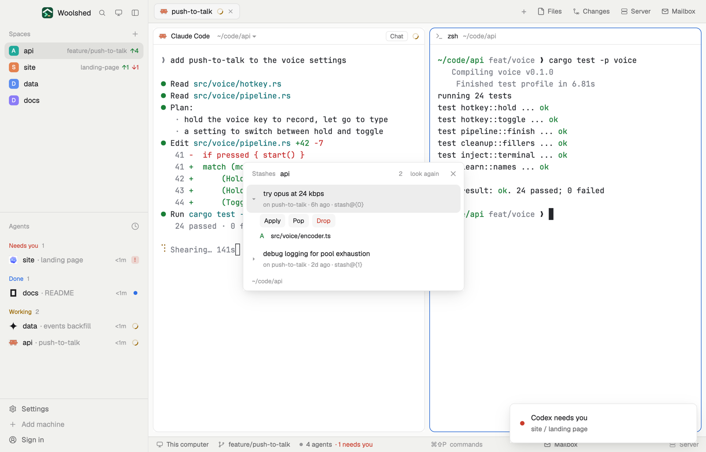

# Git stash

The stashes of the repository you're in, newest first, with their message, the branch they came from and how old they are. Open one to see its files, then Apply it, Pop it or Drop it (Drop asks first). Handy when an agent stashed something and you want to know what.

## What you see

A window 400 px wide on the `popover` color, or a block in a layout (on `chrome`):

- **Header**, 40 px: "Stashes" in 11.5 px `dim`, the repository's name in semibold, how many, "look again" and ✕.
- **Rows**, one per stash: ▸ (▾ when open), the message, and below in 11 px `dim` "on feature/push-to-talk · 2d ago · stash@{1}" ("WIP on …" for one made without a message). The open row sits on `selected`.
- **Open stash**: buttons Apply, Pop and Drop (Drop's text in `blocked`) on `raised`, then its files: a status letter (M `working`, A green `ansi2`, D `blocked`, R `accent`) and the path, up to 40 ("and 3 more").
- Asking to drop: "Drop this stash? Its changes are gone from the list for good." with Cancel and a solid Drop.
- **Footer**: the folder in 11 px `dim`, or what the last action did ("Applied “try opus at 24 kbps”; it stays in the list"), in `blocked` when it failed.

With none: "No stashes. Changes you or an agent put aside with git stash show here." Outside a repository: "Not a git repository"; without git, "git isn't installed on this machine…".

## How it behaves

- The newest stash opens by itself the first time; a click opens or closes one.
- Apply runs `git stash apply`, Pop `git stash pop`, Drop (after asking) `git stash drop`. Each finds the stash's ref again by its commit first, since indexes move when another is dropped. Conflicts say "Applied with conflicts: fix them in the files, then git add. The stash was kept."
- It follows the focused pane's folder on that space's machine; reads every 20 seconds, after each action, and on "look again".

## Built from

- `mods/git-stash/main.js` and `parse.js` (`parseStashes`, `parseSubject`, `parseNameStatus`, `refFor`, `since`, `explain`).
- Reads, with `--no-optional-locks -c core.fsmonitor=false -c diff.autoRefreshIndex=false -c color.ui=false -c core.quotePath=false` and a 10-second limit: `git rev-parse --show-toplevel`, `git stash list --format=%gd%x1f%H%x1f%ct%x1f%gs%x1e`, `git stash show --name-status -z --include-untracked <sha>` (without `--include-untracked` when git is older than 2.32).
- Changes, only on a click (30-second limit): `git stash apply|pop|drop stash@{n}`.
- `woolshed` functions: `spaces`, `panes`, `focused`, `exec` (with `on`), `home`, `theme`, `props`, `closeOverlay`.
- `mod.json`: a kept window (`key: "git-stash"`), opened with `mod.open:git-stash`; no keys of its own.

## Watch out

- Stashes belong to the repository, not the worktree: every worktree of it shows the same list.
- A dropped stash can only be found again by its sha with `git fsck`; that's why Drop asks.
- `preview.png` is a screenshot of Woolshed in light mode, running example agents.

## Done when

- `woolshed check` passes on this folder and `mod.open:git-stash` opens it.
- After `git stash push -m "try it"` the stash shows within 20 seconds, open, with its files.
- Apply keeps it in the list and the changes come back; Pop removes it; Drop asks, then removes it.
