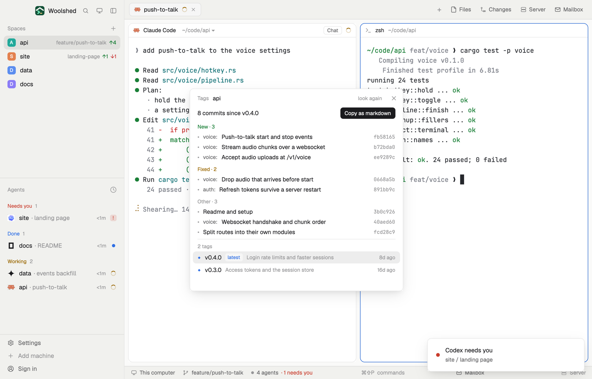

# Git tags

The tags of the repository you're in with their dates, and the commits since the latest one on your branch: the start of the next changelog, sorted into New, Fixed and Other when the commits use prefixes like `feat:` and `fix:`. Copy it as markdown in one click, or pick an older tag to see everything since then.



## What you see

A window 460 px wide on the `popover` color, or a block in a layout (on `chrome`):

- **Header**, 40 px: "Tags" in 11.5 px `dim`, the repository's name in semibold, "look again" and ✕.
- **Summary**: "7 commits since v0.4.0" (or "No tags yet: every commit (3)") and a solid "Copy as markdown" button ("Copied" in `done` on `raised` for 1.6 seconds).
- **Commits**, in sections "New · 3" (green `ansi2`), "Fixed · 2" (`working`), "Faster" (`accent`, for `perf:`), "Other" (`dim`): 22 px rows with a •, the scope in semibold `muted` ("voice:"), "breaking" in `blocked` for `feat!:`, the subject without its prefix and capitalised, and the short sha in the code font, `dim`. Without prefixes they're one "Changes" list. The list scrolls past 250 px.
- **Tags**, under a 1 px `border` line: "2 tags", then 26 px rows: ◆ (`done` when the tag is on this branch, else `dim`), the name in semibold, a "latest" tag, "elsewhere" for a tag not on this branch, the annotation's subject in `dim`, and the age ("8d ago"; hover for the date). The chosen tag's row sits on `selected`. The list scrolls past 150 px.
- **Footer**: the folder in 11 px `dim`.

With no tags: "No tags. git tag -a v0.1.0 -m "First release" makes one." Outside a repository: "Not a git repository"; without git, "git isn't installed on this machine…".

## How it behaves

- It starts from the latest tag on this branch (`git describe --tags --abbrev=0`); clicking any tag lists the commits since it instead. Merge commits are left out; up to 200 commits.
- Copy as markdown puts this on the clipboard:

  ```
  ## Since v0.4.0

  ### New

  - **voice:** Push-to-talk start and stop events (74bda33)
  ```

- It follows the focused pane's folder on that space's machine; reads every 30 seconds and on "look again"; only ever reads.

## Built from

- `mods/git-tags/main.js` and `parse.js` (`parseTags`, `parseCommits`, `conventional`, `sections`, `changelog`, `since`, `day`, `explain`).
- Programs, read-only, with `--no-optional-locks -c core.fsmonitor=false -c diff.autoRefreshIndex=false -c color.ui=false` and a 10-second limit: `git rev-parse --show-toplevel`, `git for-each-ref --sort=-creatordate --count=60 --format=%(refname:short)%1f%(creatordate:unix)%1f%(objecttype)%1f%(objectname)%1f%(*objectname)%1f%(contents:subject)%1e refs/tags`, `git describe --tags --abbrev=0 HEAD`, `git tag --merged HEAD`, `git log --no-merges -n200 --format=%H%x1f%h%x1f%an%x1f%ct%x1f%s%x1e refs/tags/<tag>..HEAD`.
- `woolshed` functions: `spaces`, `panes`, `focused`, `exec` (with `on`), `home`, `theme`, `settings` (the code font), `props`, `closeOverlay`.
- `mod.json`: a kept window (`key: "git-tags"`), opened with `mod.open:git-tags`; no keys of its own.

## Watch out

- It shows the 60 newest tags.
- The sections come from the subject's prefix only; a commit without one goes under Other.
- `preview.png` is a screenshot of Woolshed in light mode, running example agents.

## Done when

- `woolshed check` passes on this folder and `mod.open:git-tags` opens it.
- After `git tag -a v1.0.0 -m "First"` and two commits (`feat: a`, `fix: b`), it says "2 commits since v1.0.0" with one under New and one under Fixed.
- Copy as markdown puts "## Since v1.0.0" and both lines on the clipboard; clicking an older tag lists more commits.
