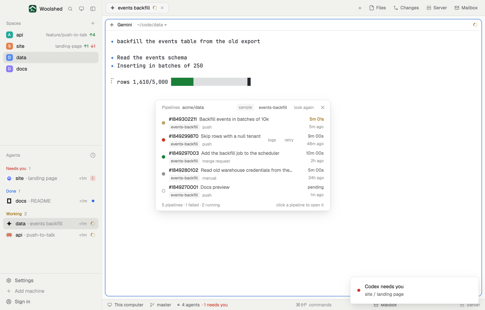

# GitLab pipelines

The last 15 GitLab CI pipelines of the project you're in: each commit's title, branch and source, a colored dot for how it went, how long it took and when. A failed pipeline's failed jobs' logs open in a new tab, and Retry asks before it retries anything. It uses your own GitLab CLI and sign-in.

## What you see

A window 460 px wide on the `popover` color (`mod.open:gitlab-pipelines`), or a block in a layout:

- **Header**, 38 px: "Pipelines" in 11.5 px `dim`, the project path in `muted`, "sample" in sample mode, the branch scope ("events-backfill", or "all branches"), "look again", ✕.
- **Rows**, 44 px, newest first: a 9 px dot (`ansi2` success, `blocked` failed, `working` running and pulsing, a ring while pending or created, `dim` canceled, skipped or manual); "#1849302211" in semibold and the commit's title in `muted` (the pipeline's name when it has one, else the short sha); under them the branch tag, the source ("push", "merge request", "scheduled", "manual", "child", …) and "waiting for a manual job" in `working` for a manual one. At the right, the time taken over the age.
- A failed row also has "logs" and "retry".
- **Foot**: "8 pipelines · 2 failed · 2 running" and "click a pipeline to open it".
- Problems: "GitLab CLI isn't installed." with "Install glab (brew install glab, or gitlab.com/gitlab-org/cli) and run glab auth login.", "Not signed in to GitLab.", "origin is on github.com, not GitLab." (pointing at ci-runs), and the rest as in the GitHub mods.

## How it behaves

- It follows the shown space (noticed within 2.5 seconds) and lists again every 60 seconds while it's open, and on "look again". The scope choice is remembered.
- Clicking a row opens the pipeline in GitLab.
- "logs" asks GitLab for the pipeline's failed jobs and opens a tab in the repo's folder that runs `glab ci trace <job>` for each, with its stage and name before it.
- "retry" shows a strip, "Retry the failed jobs of pipeline #… on main?", with Cancel and a red Retry. Only Retry posts `projects/<path>/pipelines/<id>/retry`; a toast says so, and the list looks again 4 seconds later.

## Built from

- `mods/gitlab-pipelines/main.js`; `parse.js` (pipelines, commit subjects, failed jobs, the trace line); `common.js` and `kit.js` (shared with the GitHub mods).
- Programs: the git reads of the space's repo; `glab ci list -R <project URL> -F json -P 15 [-r <branch>]`; `git log --no-walk --ignore-missing --format=%H%x1f%s <shas>` (titles from this clone, read-only); on a click, `glab api --hostname <host> projects/<path>/pipelines/<id>/jobs?scope[]=failed`; after your yes, `glab api -X POST … /pipelines/<id>/retry`. glab runs in your login shell like gh in the other mods.
- `woolshed` functions: `spaces`, `panes`, `focused`, `exec`, `readTextFile`, `appHome`, `run` (`tab.new`, `app.settings`), `notify`, `theme`, `props`, `closeOverlay`.
- `mod.json`: a kept window (`key: "gitlab-pipelines"`). No keys.

## Watch out

- GitLab's pipeline list has no start and finish times, so the time shown is from created to last updated: it includes time spent waiting for a runner.
- A remote counts as GitLab when its host is gitlab.com or starts with `gitlab.`; self-managed GitLab elsewhere isn't recognised.
- Built and tested against sample data only: this build had no GitLab sign-in to try it live.
- Sample mode, a demo and preview aid: `data/gitlab-pipelines/sample.json` under the app's home (`{ "repo", "pipelines": [ …GitLab pipeline objects… ], "subjects": { "<sha>": "title" } }`) is shown instead of GitLab, tagged "sample"; logs and retry only toast "nothing was run". Delete it to see your own.
- `preview.png` is a screenshot of Woolshed in light mode, running example agents.

## Done when

- `woolshed check` passes on this folder and `mod.open:gitlab-pipelines` opens it.
- In a GitLab project with CI it lists the pipelines with the right colors; the scope button changes the list.
- "retry" asks first; Retry starts the failed jobs again (visible in GitLab).
- "logs" opens a tab printing the failed jobs' logs.
