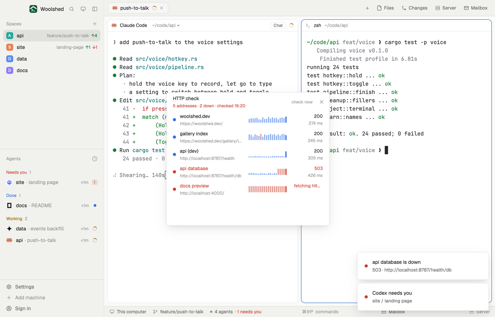

# HTTP check

A short list of addresses you care about (staging, production, your local dev server), each checked every minute while it's open: its status, how long it took, the last 20 results as little bars, and a red dot when it's down. A toast tells you when one goes down and when it comes back.

## What you see

A window 420 px wide on the `popover` color, or a block in a layout (on `chrome`):

- **Header**, 48 px: "HTTP check" in semibold; below in 11 px "5 addresses · 1 down · checked 14:05" (`blocked` when one is down, else `dim`); "check now" ("checking…") and ✕.
- **Rows**, 44 px: an 8 px dot (`done` up, `working` for a 4xx answer, `blocked` down, `unknown` not checked yet); the name in medium `foreground` (`blocked` when down) with the address below in 11 px `dim`; 20 bars 3 px wide, as tall as each check took (full height and `blocked` when it was down), the latest one solid; at the right the status ("200", "503", "connection refused", "timed out") and the time ("142 ms"). On hover the bars give way to ✕, which takes it off the list.
- **Add**: a 30 px input ("staging https://staging.example.com/health") and a solid Add button; below in 10.5 px `dim` "A name, then the address. The list is ~/.config/woolshed/data/http-check/urls.txt", or what was wrong in `blocked`.
- With an empty list: "Nothing on the list yet. Add staging, production or your local dev server below."

The list scrolls past 400 px.

## How it behaves

- Every 60 seconds while it's open, and on "check now", it reads the list and sends one plain GET to each address at once, each with a 10-second limit. Never two rounds at once.
- Up is any 2xx or 3xx answer; a 4xx is shown in `working` but counts as answering; 5xx, no answer, a refused connection or a timeout is down.
- When one goes from answering to down, a toast: "api (dev) is down" with the status and address (an error toast, 12 s). When it answers again: "api (dev) is back" with the status and time (8 s). The first check after opening says nothing.
- Click a row to open the address in your browser. Hover for "19 of 20 up · last checked 12 s ago".
- Typed addresses get `https://`, or `http://` for localhost, private addresses, `.local`, `.test` and anything with a port; the name defaults to the host and path.
- The list is a text file (`name url` per line, `#` comments), so an agent can add a line; it's read at each round. The last 20 results per address are kept in `history.json` beside it, so the bars and the up/down state survive a restart.

## Built from

- `mods/http-check/main.js` and `parse.js` (the list file, what a status means, when to toast).
- `fetch` (GET, no headers, no body) raced with `cx.sleep(10000)`.
- `woolshed` functions: `appHome`, `home`, `readTextFile`, `writeTextFile` (with the text it expects), `notify`, `theme`, `props`, `closeOverlay`. `fs/promises` `mkdir` for `data/http-check/`.
- Files: `data/http-check/urls.txt` and `data/http-check/history.json` under the app folder.
- `mod.json`: a kept window (`key: "http-check"`). No keys.

## Watch out

- It checks only while its window (or block) is open; closed, nothing is fetched and no toast comes.
- Redirects are followed: a page that redirects to a login screen counts as up.
- The time includes connecting and reading the answer, from this computer.
- `preview.png` is a screenshot of Woolshed in light mode, running example agents.

## Done when

- `woolshed check` passes on this folder and `mod.open http-check` opens it.
- Adding `localhost:3000` with a dev server running shows a green dot and a time within a second.
- Stopping the server shows a red dot and a "… is down" toast at the next check; starting it again brings "… is back".
- A line added to `urls.txt` by hand shows at the next check.
