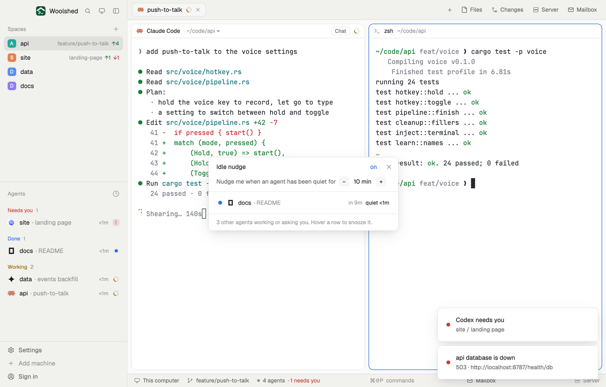

# Idle nudge

A gentle tap when an agent has finished and sat waiting for you too long. After the minutes you choose, a toast names the agent; click it to go there. Snooze one for half an hour or an hour, or skip it until it has worked again.

## What you see

A window 400 px wide on the `popover` color (`mod.open idle-nudge`), or a strip in a layout block:

- **Header**, 40 px: "Idle nudge" in 13 px semibold, "on" (in `done`) or "off" (`dim`), and ✕.
- **The wait**: "Nudge me when an agent has been quiet for", a 22 px − button, "10 min" in semibold, and +. The steps: 2, 5, 10, 15, 20, 30, 45, 60, 90, 120 minutes.
- A 1 px `border` line, then a 34 px row per quiet agent (done or idle), longest quiet first: its status mark (a `done` dot, or an `idle` ring), the program's 14 px icon, the space name and "· what it's about" in `dim`, then on the right "in 6m" (until its nudge), "due" or "nudged" (in `done`) and "quiet 4m" in semibold. A snoozed one says "snoozed till 15:20" and "undo". Hovered, the right side becomes the links "30m", "1h" and "not this time".
- **Footer**, 11.5 px `dim`: "2 other agents working or asking you. Hover a row to snooze it."
- With nobody quiet: "Every agent is busy. Nothing is sitting idle."; with no agents, what it does.
- **The strip**: an 8 px dot (`done` with quiet agents, a ring otherwise) and "2 quiet agents · next nudge in 6m", "Nothing idle" or "Nudges off"; a click opens the window.
- **The nudge**: Woolshed's toast with "docs · README is waiting for you" and "Finished 10m ago. Click to go to it."

## How it behaves

- An agent's quiet time starts when it finishes (done) and keeps going when you look and it turns idle; it ends when it works again or asks you something.
- Each quiet stretch gets one nudge, when it reaches the wait. Clicking the toast runs `agent.focus` on it.
- 30m and 1h snooze that agent: no nudge until then, and one when it ends if it's still quiet. "not this time" skips it for this stretch. undo ends a snooze.
- At most three toasts at once; more become one "3 more agents quiet for 10 min".
- It checks every 15 seconds and at once when a status changes. Clicking a row goes to that agent.

## Built from

- `mods/idle-nudge/main.js`: with `props().overlay` the window, else the strip. `woolshed` functions `agents`, `run`, `notify`, `theme`, `props`, `closeOverlay`, `shared`, `setShared`. Commands: `agent.focus` (rows and the toast's action), `mod.open`.
- `nudge.js`: the quiet stretches (`quietStep`) and who is due (`due`).
- Shared state: `idle-nudge.settings` (`{ after, on }`) and `idle-nudge.state` (`{ since, nudged, snooze }` by address), so a window and a strip agree and nudge once.
- `mod.json`: a kept window (`key: "idle-nudge"`, `keep: true`). No keys. Runs no programs. Art: `spinner.svg`.

## Watch out

- Nudges come only while a copy runs: keep the window open (it comes back on the next start) or put the strip in a layout, `{ "type": "block", "size": { "px": 28 }, "content": { "mod": "idle-nudge" } }`.
- Quiet time is counted from when a copy first saw the agent quiet: after a restart, an agent that was already idle starts from zero.
- Woolshed's own toast still appears when an agent finishes while you're elsewhere; this one comes later, as a reminder.
- `preview.png` is a screenshot of Woolshed in light mode, running example agents.

## Done when

- `woolshed check` passes on this folder and `mod.open idle-nudge` opens the window.
- With the wait at 2 min, a finished agent gets a toast after two minutes; clicking it focuses that agent.
- It doesn't nudge the same stretch twice; after it works and finishes again, it does.
- Snooze 30m on a row shows "snoozed till" with the time, and no toast comes before then.
