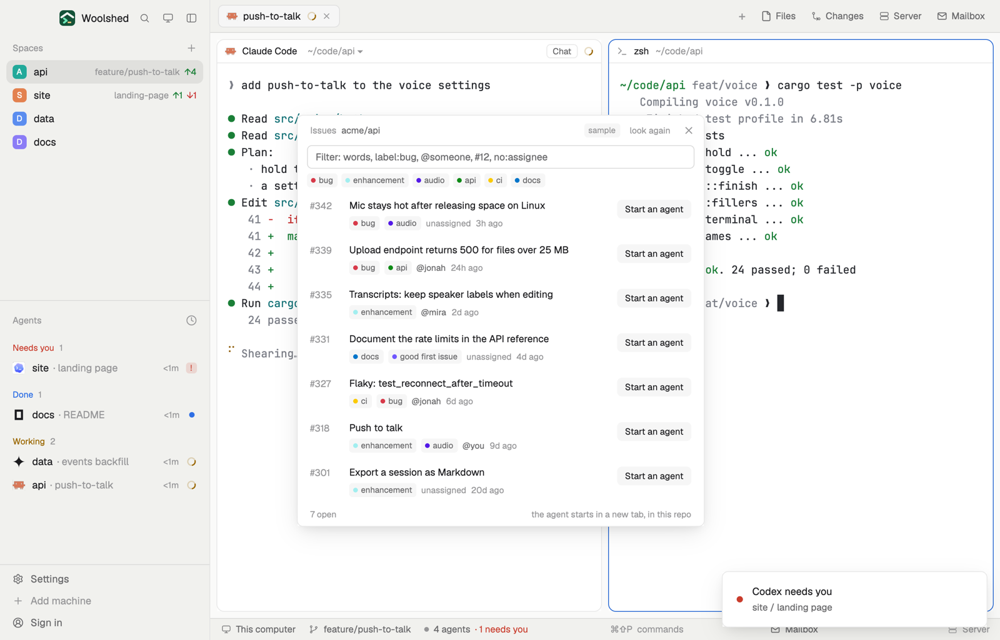

# Issues

The open issues of the repo you're in, with their labels and who has them, and a filter box that understands labels, people and numbers. Pick one and press Start: an agent opens in a new tab with the issue's title and description as its first message.

## What you see

A window 520 px wide on the `popover` color (`mod.open:issues`), or a block in a layout:

- **Header**, 38 px: "Issues" in 11.5 px `dim`, the repo in `muted`, "sample" in sample mode, "look again", ✕.
- **Filter**: a 30 px box on `background` with an `input` border (`accent` while typing), "Filter: words, label:bug, @someone, #12, no:assignee"; under it the six most used labels as small tags on `raised`, each with a 6 px dot in the label's own GitHub color, and "clear" while filtering.
- **Rows**: "#342" in 12 px semibold `dim`; the title in semibold; up to three label tags, the assignees ("@jonah", or "unassigned" in `dim`) and the age. At the right, "Start an agent" on `raised`, a solid "Start Claude Code" under the pointer.
- **Foot**: "7 open" (or "3 of 7 open") and "the agent starts in a new tab, in this repo".
- "No open issues. Nice.", "No issue matches the filter.", "Issues are turned off for this repo.", and the other GitHub mods' problems.

## How it behaves

- It follows the shown space (noticed within 2.5 seconds) and lists again every 60 seconds while it's open, and on "look again".
- The filter keeps issues matching every part: plain words (title or description), `label:bug` or `label:"good first issue"`, `@login` (assignee or author), `#12`, `no:assignee`. Clicking a label tag filters by it.
- Clicking a row opens the issue on github.com.
- "Start …" runs only when clicked: a new tab in the shown space, in the repo's folder, named "#342 Mic stays hot after releasi…", with Claude Code (else the first installed agent) and this first message: "Work on issue #342 in acme/api: <title>", the link, the description (up to 6,000 characters), and "Read the code it touches first and tell me your plan before large changes. Work on a branch; don't push, open a pull request or comment on the issue unless I ask."

## Built from

- `mods/issues/main.js`; `parse.js` (rows, the filter, top labels, the task); `common.js` and `kit.js` (shared with the other GitHub and GitLab mods).
- Programs, read-only: the git reads of the space's repo; `gh issue list --repo <owner/repo> --state open --limit 100 --json number,title,url,labels,assignees,author,createdAt,updatedAt,body`.
- `woolshed` functions: `knownAgents`, `spaces`, `panes`, `focused`, `exec`, `readTextFile`, `appHome`, `run` (`tab.new`, `app.settings`), `theme`, `props`, `closeOverlay`. `InputState` and `Input` from gpui-base.
- `mod.json`: a kept window (`key: "issues"`). No keys.

## Watch out

- The label dots use the colors GitHub gives each label (data, not the theme); everything else is theme colors.
- At most 100 issues are read; pull requests aren't issues here.
- Sample mode, a demo and preview aid: `data/issues/sample.json` under the app's home (`{ "repo", "issues": [ …gh issue list objects… ] }`) is shown instead of GitHub, tagged "sample", and Start only toasts "nothing was run". Delete it to see your own.
- `preview.png` is a screenshot of Woolshed in light mode, running example agents.

## Done when

- `woolshed check` passes on this folder and `mod.open:issues` opens it.
- It lists the repo's open issues; typing `label:bug` keeps only those, and clicking a label tag does the same.
- "Start …" opens one tab with the agent, whose first message is the issue's title and description.
