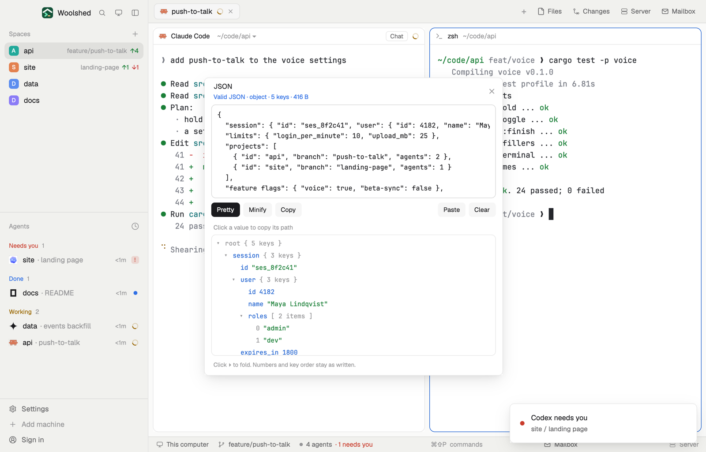

# JSON tool

Paste JSON to check it, with the line and column of the first mistake and a caret under it. Pretty print or minify it (numbers and key order stay exactly as written), and find a value's path in a tree: click it to copy a path like `.projects[1].branch`.

## What you see

A window 540 px wide on the `popover` color, or a block in a layout (on `chrome`):

- **Header**, 48 px: "JSON" in semibold; below in 11 px "Valid JSON · object · 5 keys · 412 B" in `done`, "Line 3, column 14: Expected ',' or '}', found '\"'" in `blocked`, or "Paste JSON to check it"; ✕.
- **The box**, 170 px, in the terminal font at 12 px on `background`, lines not wrapped; its border turns `blocked` when the JSON is broken.
- **Buttons**, 26 px: a solid Pretty, Minify and Copy (dimmed when there's nothing to do), and at the right Paste and Clear.
- **The mistake**, when there is one: its line (cut to 60 characters around the spot) in the terminal font, with a `blocked` caret ^ under the column.
- **The tree**, 220 px on `background`, 22 px rows indented 14 px a level: ▾/▸ for objects and arrays, the key in `accent` (array indexes and "root" in `dim`), and the value: strings in `ansi2`, numbers in `ansi4`, true, false and null in `ansi5`, containers as "{ 3 keys }" or "[ 2 items ]" in `dim`.
- **Foot**, 10.5 px: "Click ▸ to fold. Numbers and key order stay as written.", "Copied .projects[1].branch", or "Showing the first 3000 values of 5210."

## How it behaves

- It checks as you type (120 ms after you stop; 400 ms for text over 50,000 characters) with its own strict parser, which names the mistake: a trailing comma, keys or strings in single quotes, unquoted keys, comments, leading zeros, a raw line break in a string, a bad escape, something after the end.
- Pretty puts the JSON back indented by 2; Minify on one line. Both keep numbers as written (`12345678901234567890` stays) and keep duplicate keys and key order.
- Click a tree row to copy its path: `.name` for plain keys, `["feature flags"]` for others, `[2]` for array items, `.` for the whole thing. Click the ▸/▾ to fold or open; "open all" opens everything.
- Paste puts the clipboard's text in the box; Clear empties it.
- The text is kept in this mod's `localStorage` (up to 256 KB) for next time. On first open, if `data/json-tool/example.json` exists under the app folder, it fills the box.

## Built from

- `mods/json-tool/main.js` and `parse.js` (the parser with positions, the printer, paths and rows).
- `gpui-base` `TextareaState`/`Textarea` (soft wrap off), `gpui-kit` `list` for the tree with `on_item_click` (its `local_position.x` tells a fold click from a copy).
- `woolshed` functions: `appHome`, `readTextFile`, `settings` (the terminal font), `theme`, `props`, `closeOverlay`.
- No programs, no network.
- `mod.json`: a kept window (`key: "json-tool"`). No keys.

## Watch out

- The tree shows at most 3000 values; the rest are counted in the foot.
- Pretty and Minify replace the box's text; there is no undo past that, so copy first if the layout matters.
- `preview.png` is a screenshot of Woolshed in light mode, running example agents.

## Done when

- `woolshed check` passes on this folder and `mod.open json-tool` opens it.
- Pasting `{"a": 1,}` says "Line 1, column 9: Trailing comma before '}'" with the caret under the `}`.
- Pretty then Minify gives back the same one-line JSON, big numbers intact.
- Clicking a nested value copies its path, and pasting that path into `jq` finds it.
