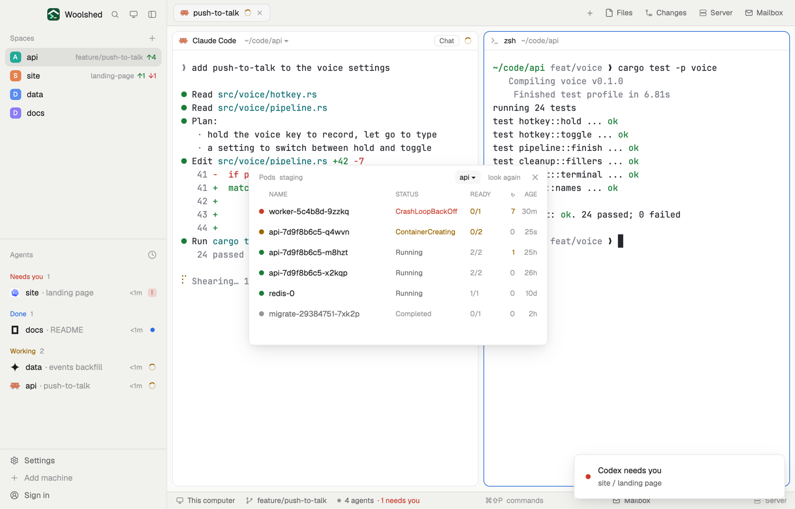

# Kubernetes pods

The pods in kubectl's current context, in a namespace you pick, the way `kubectl get pods` shows them: status, ready containers, restarts and age, with the crash-looping and stuck ones first. Open any pod's logs in a new tab beside your agents. It never changes kubectl's settings.

## What you see

A window 480 px wide on the `popover` color:

- **Header**, 38 px: "Pods" in 11.5 px `dim`, the current context ("staging") in 11 px `dim`, the namespace as a chip on `raised` ("api ▾"), "look again" ("…" while asking) and ✕.
- **The namespace picker**, under the header when the chip is clicked: on a faint panel, "Namespace" and a chip per namespace (the chosen one on `selected`), wrapping, scrolling past 120 px.
- **Columns**, 10.5 px `dim`: NAME, STATUS, READY, ↻ (restarts), AGE.
- **A row per pod**, 32 px, rounded 8 px, `hover` on hover: a dot (`blocked` for CrashLoopBackOff, ImagePullBackOff, Error, OOMKilled and other failures; `working` for Pending, ContainerCreating, Init, Terminating or running but not ready; `ansi2` running and ready; `dim` Completed), the pod name, the status (`muted` when fine, else the dot's color), "2/2" (`working` when not all ready), the restarts (`working` above 0) and the age ("30m", "26h", "10d"). On hover, restarts and age give way to a Logs button. Troubled pods sort first.
- A footer: "6 pods · hover one for its logs".
- Without kubectl: "kubectl isn't installed here. Install it (`brew install kubectl`, or with your cloud's CLI), then look again." Without a context: "kubectl has no current context. Pick one with `kubectl config use-context <name>`." A cluster that doesn't answer: "Can't reach the cluster for staging: …" (`blocked`); signed out: "The cluster said no: …". An empty namespace: "No pods in api."

In a layout block it's a strip: "Pods", ready over total ("5/6", `blocked` when any pod is failing), a dot per pod and the namespace; "no kubectl", "no context" or "unreachable" otherwise.

## How it behaves

- Every 15 seconds and on "look again", never twice at once: `kubectl config current-context`, then `kubectl --context <ctx> -n <ns> get pods -o json --request-timeout=10s` (12-second limit). When the context changes it reads the context's namespace once (`kubectl config view --minify -o jsonpath={..namespace}`), else `default`.
- The status follows `kubectl get pods`: a pod being deleted is Terminating; an unfinished init container gives Init or Init:<reason>; a waiting container's reason (CrashLoopBackOff) or a terminated one's (Error, OOMKilled, ExitCode:n) wins over the phase.
- The picker lists namespaces with `kubectl get namespaces` the first time it opens for a context ("Couldn't list namespaces (you may not be allowed to)." when that's refused). The choice is remembered per context in this copy's `localStorage` (`k8s-pods.ns.<context>`), not in kubeconfig.
- Logs opens a tab "logs: worker-5c4b8d-9zzkq" in the shown space running `kubectl --context <ctx> -n <ns> logs -f --tail=200 --all-containers --prefix <pod>` (a new space "kubernetes" when there's none).
- After a failed look the last pods stay, with "Last look failed: …" above them.

## Built from

- `mods/k8s-pods/main.js` and `parse.js` (`parsePods`, `statusOf`, `toneOf`, `age`, `failure`; pure, tested on a pod list with Running, CrashLoopBackOff, Completed, ContainerCreating, Terminating and Init pods, and kubectl's error messages).
- `woolshed` functions: `exec`, `run` (`tab.new`, `space.new`), `spaces`, `theme`, `props`, `closeOverlay`.
- `mod.json`: a kept window (`key: "k8s-pods"`, `keep: true`), opened with `mod.open:k8s-pods`. No keys.

## Watch out

- It follows kubectl's current context: switch with `kubectl config use-context`, and the window follows at the next look.
- It reads; it never deletes, restarts or scales a pod.
- The preview runs against a stand-in `kubectl` that answers like an example staging cluster; on a real machine the pods are yours.
- `preview.png` is a screenshot of Woolshed in light mode, running example agents.

## Done when

- `woolshed check` passes on this folder and `woolshed do mod.open --name k8s-pods` opens the window.
- With a working context its pods match `kubectl get pods -n <ns>` (status, ready, restarts).
- Picking another namespace lists its pods and is still picked after reopening; Logs opens a tab following the pod's log.
