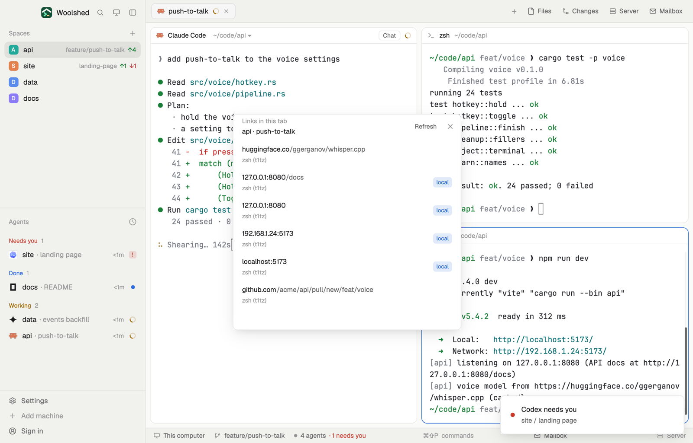

# Links in terminals

Every link that showed up in the terminals of the tab you're looking at, in one list: the dev server's localhost address, the pull request link a push printed, the docs page an agent mentioned. Newest first, each once, local ones marked. Click one to open it in your browser instead of hunting through scrollback.

## What you see

A window 420 px wide on the `popover` color, or a block in a layout (on `chrome`):

- **Header**, 44 px: "Links in this tab" in 11.5 px `dim` over the tab, "api · push-to-talk", in 12.5 px semibold; "Refresh" ("Reading…" while it reads) and ✕.
- **Rows**: the host in medium `foreground` and the rest of the address in `muted` ("localhost:5173" + "/admin"), and below in 11 px `dim` the terminals it was seen in ("Claude Code, zsh"). Local addresses get a "local" badge in `accent` on a light `accent` tint. On hover the row turns `hover` and shows Copy. The full address is the row's tooltip.
- **Footer** in 11 px `dim`: "7 links from 3 terminals · read 14:32", "Copied localhost:5173" in `done` after a copy, or an error in `blocked`. "Couldn't read zsh" in `blocked` above it when a terminal didn't answer.
- Empty: "No links in this tab's terminals yet. When a server or an agent prints one, Refresh."; "This tab has no terminals."; with no space open, "Open a space to see the links in its terminals."

The list scrolls past 420 px in the window.

## How it behaves

- It reads the shown tab's terminals when it opens, whenever another tab is shown, and on Refresh: nothing in the background.
- It finds `http://` and `https://` addresses, and bare local ones a server prints without a scheme (`localhost:5173`, `127.0.0.1:8080/health`, `0.0.0.0:3000`, `[::1]:8000`). Sentence punctuation and closing brackets that aren't part of the address are left off.
- The same address seen twice (or with and without a trailing `/`) is one row, listing every terminal it was in. Newest first means closest to the end of its terminal's text.
- Local means `localhost`, `127.0.0.1`, `0.0.0.0`, `[::1]`, `*.localhost`, `*.test` and private network addresses (`192.168.*`, `10.*`, `172.16–31.*`).
- Click opens it with the system's browser; `0.0.0.0` is opened as `localhost`. Copy puts the address on the clipboard.

## Built from

- `mods/links-in-terminals/main.js` and `mods/links-in-terminals/parse.js` (finding, trimming, deduplicating and ordering links; pure functions). `woolshed` functions: `focused`, `spaces`, `panes`, `hc`, `theme`, `props`, `closeOverlay`; `cx.open_url`, `cx.write_to_clipboard`.
- Program: `hc read <terminal> --json --lines 200` for each terminal pane of the shown tab (the screen plus 200 lines of history), only at the moments above.
- `mod.json`: a kept window (`key: "links-in-terminals"`). No keys of its own (open it with `mod.open:links-in-terminals`). No storage, no network.

## Watch out

- A link the terminal wrapped onto two lines is read as two pieces; only the first is a link.
- Only the last 200 lines above the screen are read, and only terminals that have a pane in the tab (not sub-agents without one).
- Programs that draw full screen (an editor, a pager) show what's on screen now, not their history.
- `preview.png` is a screenshot of Woolshed in light mode, running example agents.

## Done when

- `woolshed check` passes on this folder and `mod.open:links-in-terminals` opens it.
- With `echo https://example.com/docs` run in a terminal of the shown tab, Refresh lists `example.com` with "/docs", and clicking it opens the browser.
- A dev server printing `http://localhost:5173/` shows it once with a "local" badge, even when printed twice.
- Showing another tab reads that tab's terminals.
