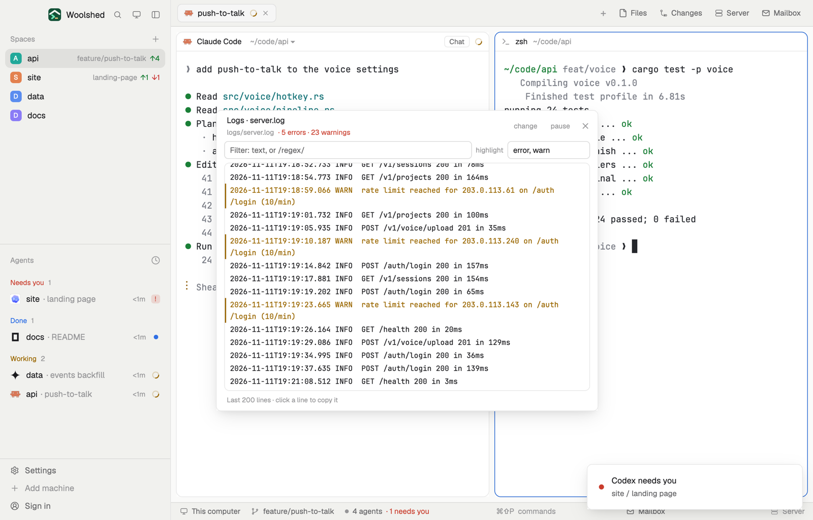

# Logs tail

Follow a log file of the project you're in, with errors and warnings picked out so they're hard to miss. Pick one of the project's `.log` files or type any path, filter the lines by text or a regex, and click a line to copy it. It keeps up as the file grows and remembers the file for each project.

## What you see

A window 600 px wide on the `popover` color, or a block in a layout (on `chrome`):

- **Header**, 48 px: "Logs · server.log" in semibold; below in 11 px `dim` the path (relative to the project, else `~/…`) and "· 5 errors · 23 warnings" (`blocked` when there are errors, `working` for warnings); "change" and "pause" (or "follow"), and ✕.
- **File picker**, when no file is chosen yet or after "change": the project's `.log` files, newest first, as 26 px rows (the name, its folder in `dim`), and an input "Or type a path: logs/app.log, ~/…, /var/log/…".
- **Filter row**: "Filter: text, or /regex/" (its border turns `blocked` for a broken regex) and "highlight" with a 130 px input, "error, warn" by default.
- **The lines**, 360 px tall on the `background` color, in the terminal font at 11.5 px: error lines in `blocked` with a 2 px `blocked` bar at the left and a `selection` tint, warning lines in `working` with a `working` bar, other highlight words in `accent`, the rest in `foreground`. Long lines wrap.
- **Foot**, 10.5 px `dim`: "Last 200 lines · 5 shown · click a line to copy it", "paused" in `working`, or "Copied the line."
- Empty and error states: "No *.log files in this project. Type a path below.", "There's no ~/code/api/logs/x.log (yet).", "The file is empty.", "No line matches the filter."

## How it behaves

- It follows the space this window shows. With nothing chosen for that project it picks the newest `.log` file there.
- While it's open it reads the last 200 lines with `tail -n 200`: at once when the file's folder changes (`watchFolder`, this computer only) and every 5 seconds regardless. "pause" stops reading; "follow" reads at once and carries on.
- The list follows the end while you're scrolled there; scroll up to read and it stays put.
- Highlight words are matched at the start of a word in any case ("warn" matches "WARN" and "warning"). error, fatal, fail, panic, exception, crit and similar words count as errors; words starting with "warn" as warnings; any other word you add is simply picked out in `accent`. The counts in the header cover all 200 lines, not just the filtered ones.
- The filter matches text anywhere, in any case; `/pattern/flags` is a regex. A broken regex is matched as text and the foot says why.
- A typed path is relative to the project; `~/` is your home.

## Built from

- `mods/logs-tail/main.js` and `parse.js` (highlighting, the filter, paths).
- Programs, read-only: `find . -maxdepth 4 -type f -name '*.log' -not -path '*/node_modules/*' -not -path '*/.git/*'` and `ls -1t <files>` (newest first) in the project, and `tail -n 200 <file>`, each with a 5–8 second limit; on another machine they run there (`exec` with `on`). On Windows it reads the file with `readTextFile` instead of `tail`.
- `woolshed` functions: `exec`, `spaces`, `focused`, `home`, `readTextFile`, `watchFolder`, `settings` (the terminal font), `theme`, `props`, `closeOverlay`, `window`. `list(…, { align: "bottom" })` for the lines, with `on_item_click` to copy.
- `localStorage`: the file per project and the highlight words.
- `mod.json`: a kept window (`key: "logs-tail"`). No keys.

## Watch out

- It shows the last 200 lines only; a burst bigger than that between reads is skipped.
- On Linux, `watchFolder` skips git-ignored folders (where logs often live), so there the 5-second read does the work.
- On Windows `readTextFile` reads at most 1 MiB, so a bigger log can't be shown.
- `preview.png` is a screenshot of Woolshed in light mode, running example agents.

## Done when

- `woolshed check` passes on this folder and `mod.open logs-tail` opens it.
- In a project with `logs/server.log` it opens on that file, and a line appended with `echo "ERROR boom" >> logs/server.log` shows in red within 5 seconds.
- Typing `/5\d\d/` in the filter leaves only the lines with a 5xx status.
- Clicking a line puts it on the clipboard.
