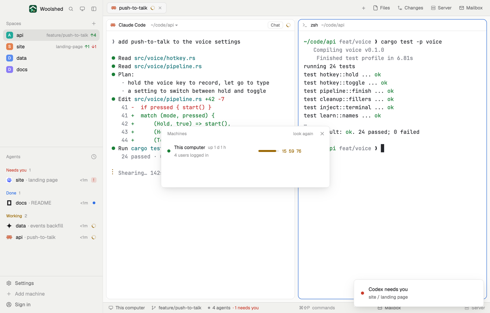

# Machines health

This computer and every other machine Woolshed knows, at a glance: which are reachable, which need a login or are down and why, and each one's load against its cores and its uptime, so you know where there's room for another agent. Open a shell on any of them from its row.

## What you see

A window 440 px wide on the `popover` color:

- **Header**, 38 px: "Machines" in 11.5 px `dim`, "look again" ("…" while asking) and ✕.
- **This computer**, always first, then **a row per machine** (scrolling past 380 px), rounded 8 px, `hover` on hover: a dot (`ansi2` reachable, `working` connecting, needing a login or an update, `blocked` unreachable), the name in semibold with "up 3 d 4 h" in `dim`; below in 11.5 px `dim`: its host name if it differs, "reachable" (or "connecting…", "needs a login", "needs an update") and "short-lived" for a temporary machine; an unreachable one in `blocked`: "unreachable since 10:12 · ssh: connect to host … timed out".
- For a reachable machine, at the right: a 54×5 px bar of the 1-minute load over its cores (`accent`, `working` above 70%, `blocked` above 100%) and the three loads, "0.42  0.37  0.31" (in the bar's color when busy); "…" until measured, or why it couldn't be ("no uptime there", "didn't answer in 15 s"). On hover, a Shell button.
- With no other machines: "No other machines yet. Add one you reach with ssh, and its load shows here." and a solid "Add a machine" button.
- "Load: 1, 5 and 15 minutes · updates every minute" in 11 px `dim`.

In a layout block it's a strip: "Machines", a dot per machine and "3 reachable" (or "1 unreachable" in `blocked`, "2 busy" in `working`, "only this one"). Hovering lists each machine's state.

## How it behaves

- Every 60 seconds and on "look again", never twice at once: `hc machine ls --json`, then on this computer and each connected machine at once, `sh -c "uptime; nproc 2>/dev/null || sysctl -n hw.ncpu 2>/dev/null"` (through Woolshed Core with `exec` `on`, 15-second limit). Machines that aren't connected aren't asked.
- The uptime line is read in its Linux, macOS and BusyBox forms ("up 3 days,  4:05", "up 18:15", "up 5 mins", "load average(s)").
- Shell runs `space.new {machine}`: a new space on that machine, its shell in its home.
- Add a machine opens Woolshed's own Add machine dialog (`mod.open machine-add`).

## Built from

- `mods/machines-health/main.js` and `parse.js` (`parseMachines`, `parseUptime`, `upMinutes`, `since`, `strain`; pure, tested on `hc machine ls --json` shapes, real macOS `uptime` and Linux and BusyBox forms).
- `woolshed` functions: `hc`, `exec` (with `on`), `run` (`space.new`, `mod.open`), `theme`, `props`, `closeOverlay`.
- `mod.json`: a kept window (`key: "machines-health"`, `keep: true`), opened with `mod.open:machines-health`. No keys.

## Watch out

- A Windows machine has no `sh` or `uptime`: its row shows "no uptime there" instead of a load.
- Each look runs one short command on every connected machine; that's all it sends there.
- macOS load averages count waiting threads and run high on a busy Mac.
- The preview's throwaway core has no other machines, so it shows this computer and the Add a machine hint.
- `preview.png` is a screenshot of Woolshed in light mode, running example agents.

## Done when

- `woolshed check` passes on this folder and `woolshed do mod.open --name machines-health` opens the window.
- This computer's loads match `uptime`; each machine in `hc machine ls` has a row with its state.
- A machine you switch off turns `blocked` with "unreachable since …" within a minute or two; Shell on a reachable one opens a space there.
