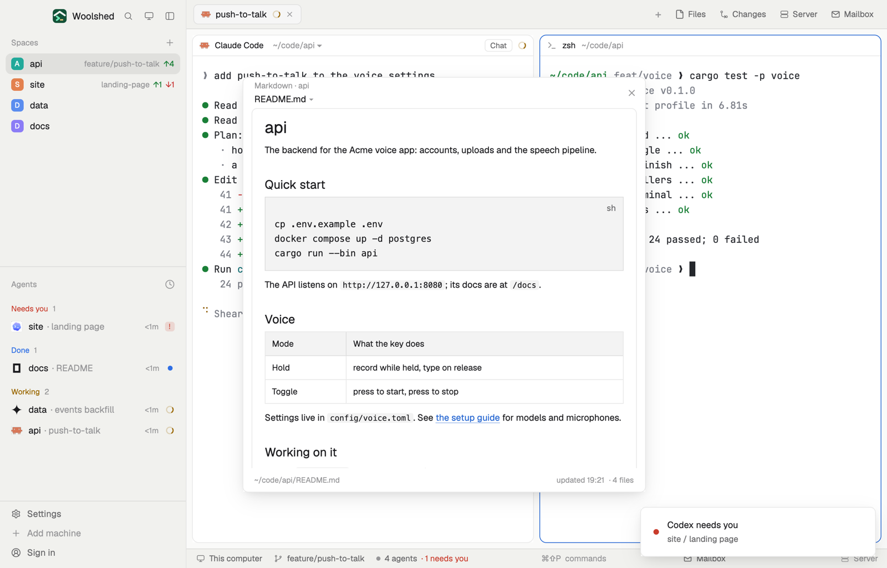

# Markdown view

The README of the project you're in, rendered, next to your agents: headings, lists, tables and code as they're meant to look. Pick any other markdown file in the repository from a list, follow links between them, and watch the page update as an agent edits it.

## What you see

A window 580 px wide on the `popover` color, or a block or pane in a layout (on `chrome`):

- **Header**, 44 px: "Markdown · api" in 11.5 px `dim`, and below it the file, "README.md ▾", in 13 px semibold (`accent` on hover); ✕ at the right.
- **The file list** (click the file name): a filter field and the repository's markdown files, the name in 12.5 px and its folder in 11 px `dim`; the shown one on `selected`. Up to 240 px, then it scrolls.
- **The page**: the file rendered, 13 px, on `background` with a `border` line and 8 px corners; 520 px tall in the window, filling the block otherwise. Text can be selected.
- **Footer** in 11 px `dim`: the file's path ("~/code/api/README.md"), "updated 14:31" and "· 6 files"; a note or error in `blocked`.
- Empty and error states: "Open a space to read its markdown.", "No markdown files in ~/code/api.", "docs/old.md isn't there any more.", "Reading…".

## How it behaves

- It follows the shown space: the folder of its focused terminal when that terminal is in the space, else the space's folder. The repository is that folder's `git rev-parse --show-toplevel`.
- The list is the repository's markdown files (`.md`, `.markdown`, `.mdx`), tracked or new but not ignored, shallow ones first. It shows the remembered file for that repository, else the top `README.md`, else the shallowest README, else the first file.
- The file is read again every 5 seconds (15 on another machine) and the page redraws only when its text changed.
- A link to another markdown file in the repository opens it here; a web link opens in the browser; anything else says "Can't open … from here."
- Outside a git repository it lists the folder's own markdown files; without git installed it says so in the footer and does the same.
- As a pane, `pane.split {direction: "right", mod: "markdown-view", props: {file: "/abs/path/NOTES.md"}}` shows that file instead of following the space.

## Built from

- `mods/markdown-view/main.js` and `mods/markdown-view/parse.js` (the file list, the default file, link targets; pure functions). `woolshed` functions: `spaces`, `panes`, `focused`, `exec` (with `on` for a space on another machine), `readTextFile`, `home`, `theme`, `props`, `closeOverlay`; `TextView.markdown` from `gpui-base`, `cx.open_url`.
- Programs: `git rev-parse --show-toplevel` and `git ls-files -z --cached --others --exclude-standard -- '*.md' '*.markdown' '*.mdx'` when the space (or its folder) changes and when the list opens; `ls -1A` outside a repository. 10-second timeouts.
- The picked file per repository is kept in `localStorage`. `mod.json`: a kept window (`key: "markdown-view"`). No keys of its own (open it with `mod.open:markdown-view`). No network.

## Watch out

- Images with relative paths may not show: the page is rendered from its text, not opened from the repository's folder.
- Files over 1 MiB can't be read.
- It shows the file as saved: an agent's unsaved edit in an editor isn't there yet.
- `preview.png` is a screenshot of Woolshed in light mode, running example agents.

## Done when

- `woolshed check` passes on this folder and `mod.open:markdown-view` shows the shown space's README rendered.
- Picking `docs/setup.md` from the list shows it, and opening the window again in that repository shows it again.
- Adding a line to the shown file elsewhere shows it within 5 seconds.
- A link from the README to `docs/setup.md` opens that file in the view.
