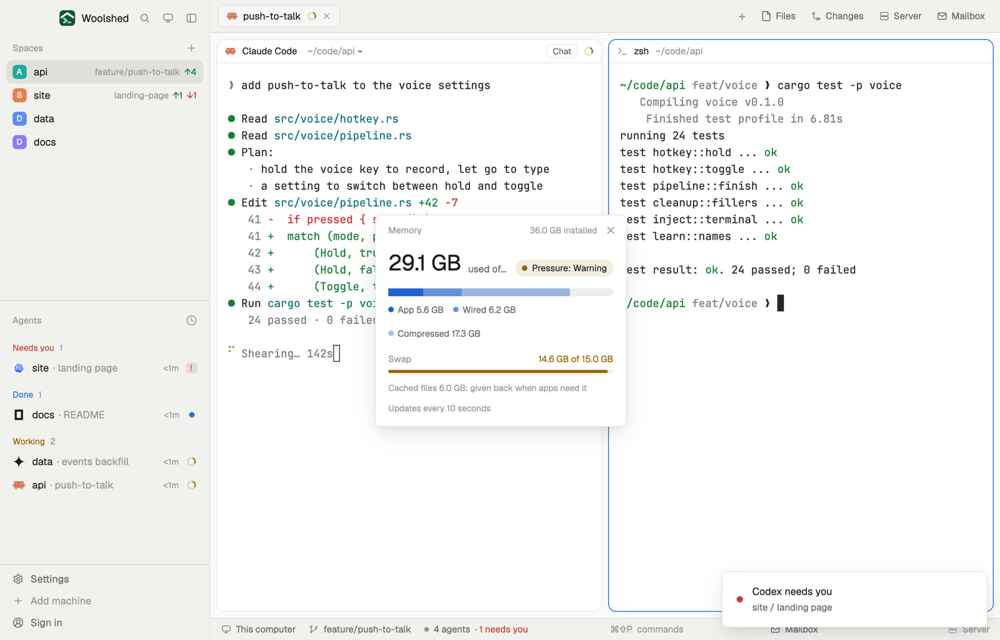

# Memory meter

How much memory is in use and by what, how hard the system is squeezing for more, and how much is swapped out, so you know before a third agent and a test run tip the computer over. A small window you can leave open; a one-line strip in a layout block.

## What you see

A window 320 px wide on the `popover` color:

- **Header**, 38 px: "Memory" in 11.5 px `dim`, "36.0 GB installed" at the right, and ✕.
- **Used**: "31.1 GB" in 28 px semibold, "used of 36.0 GB" in `muted`, and at the right a pill, "Pressure: Normal" (Warning, Critical), with a dot in the `ansi2` (green), `working` or `blocked` color on a faint wash of the same.
- **The bar**, 10 px, rounded: the used memory as stacked parts in shades of `accent`. On macOS: App, Wired and Compressed; on Linux one part, Used. Below, a legend of dots: "App 7.4 GB · Wired 6.8 GB · Compressed 16.9 GB".
- **Swap**: "Swap" and "14.9 GB of 17.0 GB" (or "none in use") with a 4 px bar, in the `working` color when more than three quarters is used.
- "Cached files 3.9 GB: given back when apps need it" and "Updates every 10 seconds" in 11 px `dim`.

In a layout block it's a strip: "Memory", the share used in semibold ("86%"), a 64 px bar, the pressure dot and "31.1 GB of 36.0 GB"; under 200 px wide only the share and the dot. Hovering it shows the pressure and swap.

## How it behaves

- It reads every 10 seconds, never twice at once.
- macOS: `vm_stat` and `sysctl -n hw.memsize vm.swapusage kern.memorystatus_vm_pressure_level`. Used is what Activity Monitor calls Memory Used: app memory (anonymous pages less purgeable) + wired + compressed. Pressure is the kernel's level: 1 Normal, 2 Warning, 4 Critical.
- Linux: `cat /proc/meminfo` and `cat /proc/pressure/memory`. Used is MemTotal − MemAvailable; cached is Cached + Buffers + SReclaimable. Pressure comes from PSI's `some avg10` (5% and up Warning, 25% Critical); without PSI, from how full memory is (85%, 95%).
- Windows: "The memory meter isn't on Windows yet."
- Read-only; nothing to click but ✕.

## Built from

- `mods/memory-meter/main.js` and `parse.js` (`readMac`, `readLinux`, `pressureOf`, `size`; pure, tested on real `vm_stat` output and a Linux `/proc/meminfo`).
- `woolshed` functions: `exec`, `theme`, `props`, `closeOverlay`, `window`.
- `mod.json`: a kept window (`key: "memory-meter"`, `keep: true`), opened with `mod.open:memory-meter`. No keys.

## Watch out

- Sizes are binary gigabytes (GiB), as Activity Monitor and `free -h` show them.
- macOS's used memory leaves out file cache on purpose: the cache line shows it.
- A strip in a hidden block keeps reading every 10 seconds.
- `preview.png` is a screenshot of Woolshed in light mode, running example agents.

## Done when

- `woolshed check` passes on this folder and `woolshed do mod.open --name memory-meter` opens the window.
- Its used figure is within a few percent of Activity Monitor's Memory Used (or `free -h`'s used).
- Opening a large program raises the bar within 10 seconds.
