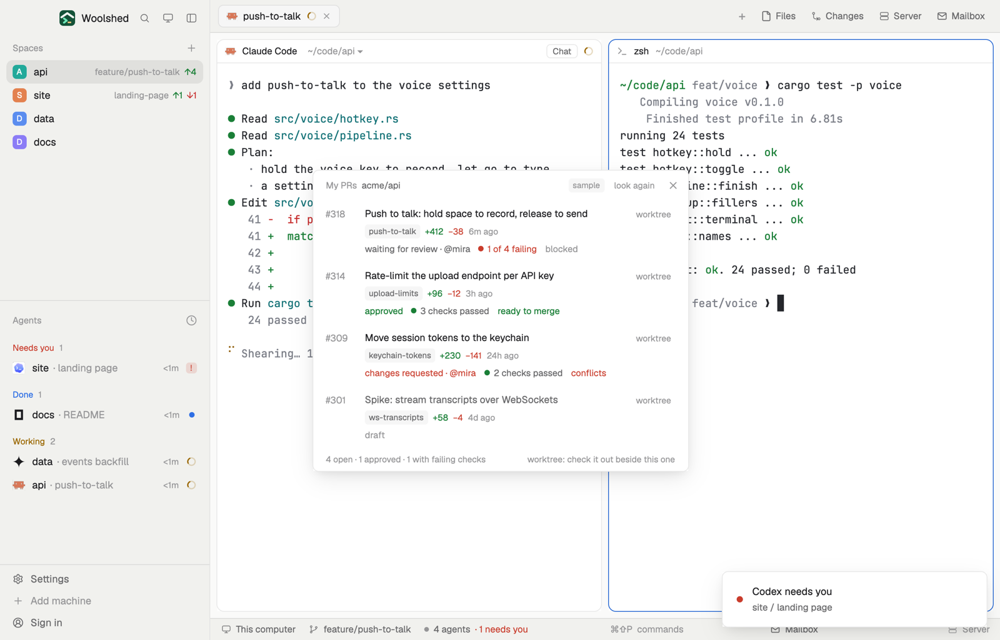

# My PRs

Your open pull requests in the repo you're in, each with where its review stands, how its checks are doing and whether it can merge. One click checks a pull request out into its own worktree and opens it as a new space, so an agent can fix it without touching the branch you're on (it asks first).

## What you see

A window 480 px wide (`ctrl-alt-p`) on the `popover` color, or a block in a layout:

- **Header**, 38 px: "My PRs" in 11.5 px `dim`, the repo in `muted`, "sample" in sample mode, "look again", ✕.
- **Rows**, most recently updated first: "#318" in 12 px semibold `dim`; the title in semibold (`muted` for a draft); the branch tag, "+412" in `ansi2`, "−38" in `blocked`, and the age; then the review ("waiting for review · @mira" in `muted`, "approved" in `ansi2`, "changes requested · @mira" in `blocked`, "draft", "needs a reviewer"), the checks (a dot and "1 of 4 failing", "1 of 4 running" or "3 checks passed") and whether it merges ("ready to merge" in `ansi2`, "conflicts" or "checks failing" in `blocked`, "behind base", "blocked").
- At the right, "worktree" (brighter under the pointer), or "checking out…" in `working` while it works.
- **Foot**: "4 open · 1 approved · 1 with failing checks" and "worktree: check it out beside this one".
- None open: "You have no open pull requests here. When an agent opens one (gh pr create), it shows here." Problems as in the other GitHub mods.

## How it behaves

- It follows the shown space (noticed within 2.5 seconds) and lists again every 60 seconds while it's open, and on "look again".
- Clicking a row opens the pull request on github.com.
- "worktree" first works out the checkout. If a worktree already has that branch, it shows its space (or opens one there) at once. Otherwise a strip asks "Fetch push-to-talk and check it out in ~/.woolshed/worktrees/api/push-to-talk, then open it as a space?" with Cancel and Check out. Check out runs `git fetch <remote> <branch>` and `git worktree add --track -b <branch> <path> <remote>/<branch>` (or `git worktree add <path> <branch>` when the branch exists here), then `space.new` in that folder, left unnamed so the sidebar names it after the checkout and nests it under the repo. A pull request from a fork fetches `pull/<n>/head` into a branch `pr-<n>`. A failure shows as a toast with git's last line.
- It never merges, approves or comments.

## Built from

- `mods/my-prs/main.js`; `parse.js` (rows, the checks rollup, review and merge words, the worktree plan); `common.js` and `kit.js` (shared with the other GitHub and GitLab mods).
- Programs: the git reads of the space's repo; `gh pr list --repo <owner/repo> --author @me --state open --limit 30 --json number,title,url,headRefName,baseRefName,isDraft,reviewDecision,mergeable,mergeStateStatus,statusCheckRollup,updatedAt,isCrossRepository,headRepositoryOwner,additions,deletions,reviewRequests,latestReviews`; for a checkout, `git worktree list --porcelain`, `git show-ref --verify --quiet refs/heads/<b>`, and after your yes `git fetch` and `git worktree add` (5-minute limit each).
- Checkouts go to `~/.woolshed/worktrees/<repo>/<branch, slashes as dashes>`, the same place as the shipped worktree mod's, so the spaces sidebar nests them under the repo.
- `woolshed` functions: `spaces`, `panes`, `focused`, `exec`, `home`, `readTextFile`, `appHome`, `run` (`space.new`, `space.select`, `app.settings`), `notify`, `theme`, `props`, `closeOverlay`.
- `mod.json`: a kept window (`key: "my-prs"`). `keys.json`: `"ctrl-alt-p": "mod.open:my-prs"`.

## Watch out

- "Open" here means the repo of the shown space; pull requests you opened elsewhere aren't listed.
- The fetch uses git's own sign-in (`gh auth setup-git` sets it up); with none, it fails with git's message.
- Sample mode, a demo and preview aid: `data/my-prs/sample.json` under the app's home (`{ "repo", "prs": [ …gh pr list objects… ] }`) is shown instead of GitHub, tagged "sample", and "worktree" only asks, then toasts "nothing was run". Delete it to see your own.
- `preview.png` is a screenshot of Woolshed in light mode, running example agents.

## Done when

- `woolshed check` passes on this folder and `ctrl-alt-p` opens it.
- It lists your open pull requests with review, checks and merge state that match github.com.
- "worktree" asks first; Check out makes the worktree and a space opens there on the pull request's branch; doing it again goes to that space instead.
