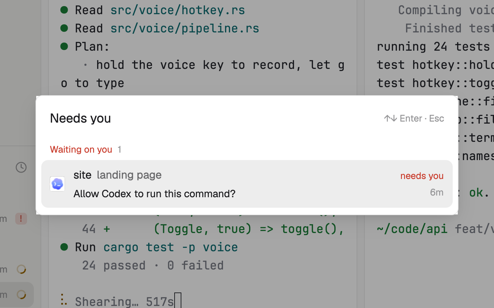

# Needs you

Every agent waiting on you, and the quickest way to it. Press a key for a list of them with the question each one is asking; Enter takes you there. Put it in a layout and it's a small chip that says how many are waiting.

## What you see

- **The list** (`ctrl-shift-j`, a dialog 500 px wide over the dimmed window, on the `popover` color): "Needs you" in 15 px semibold with "↑↓ Enter · Esc" in 11 px `dim` at the right. Two sections, each headed in 11 px with its count: "Waiting on you" (the `blocked` color) and "Finished while you were away" (the `done` color). A row: the program's 18 px icon; the space name (medium) and what it's about (`muted`); for a waiting agent, below, the question it's asking in 12 px (or "Reading its question…" for a moment); at the right "needs you" or "finished" and how long ago. The chosen row has the `selected` background.
- **The chip** (in a layout block, about 28 px tall): "Nothing needs you" with a small ring when all is calm; otherwise a pill in the `blocked` color at low strength with "2 need you", then "3 finished" with a `done` dot, then "webapp · fix login" for the one that has waited longest.

## How it behaves

- In the list, ↑ and ↓ move, Enter or a click goes to that agent (its space and tab open, `pane.focus`) and closes the list; Esc closes it.
- Waiting agents come longest-waiting first; finished ones newest first.
- The chip's click goes to the agent that has waited longest; clicked again while you're on one, it goes to the next. With nobody waiting, it goes to the finished ones.
- Questions are read from the waiting agents' screens every 5 seconds (and at once when a new one starts waiting).

## Built from

- `mods/needs-you/main.js`: with `props().overlay` it draws the list, else the chip. `woolshed` functions: `agents`, `focused`, `run`, `hc`, `theme`, `props`, `closeOverlay`. Commands: `pane.focus` (or `agent.focus` for an agent without a pane).
- Program: `hc read <address>` for waiting agents only, at most 8. The question is the last line ending in "?" among the bottom 24, with box drawing and prompt marks removed; else the last line of text.
- `mod.json`: `{ "place": "none", "overlay": { "kind": "dialog", "width": 500 } }`, so `mod.open needs-you` opens the list.
- `keys.json`: `"ctrl-shift-j": "mod.open:needs-you"` in `global`.
- When each agent entered its state is kept in the mod's local storage (for the "4m").

## Watch out

- It reads the screens of waiting agents to show their questions; that text stays in your window.
- The times start when this mod first saw the agent in that state.
- To put the chip in a layout, give it a block: `{ "type": "block", "size": { "px": 30 }, "content": { "mod": "needs-you" } }`.
- `preview.png` is a screenshot of Woolshed in light mode, running example agents.

## Done when

- `woolshed check` passes on this folder and `ctrl-shift-j` opens the list.
- An agent asking a question shows in Waiting on you with its question; Enter on it opens its tab.
- With nobody waiting the list says so, and the chip says "Nothing needs you".
