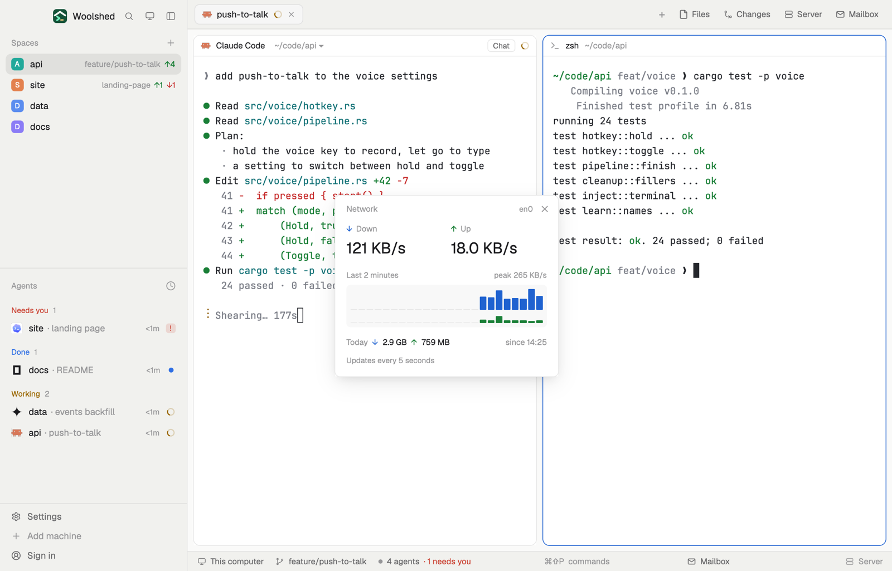

# Network meter

Download and upload speed right now, a two-minute sparkline of each, and how much this computer has moved today, so you can tell an agent's big download or a stuck upload at a glance. A small window you can leave open; a one-line strip in a layout block.

## What you see

A window 320 px wide on the `popover` color:

- **Header**, 38 px: "Network" in 11.5 px `dim`, the interfaces carrying traffic ("en0") at the right, and ✕.
- **Now**: two columns, "↓ Down" (arrow in `accent`) and "↑ Up" (arrow in `ansi2`, green), each rate in 22 px semibold: "1.2 MB/s", "48 KB/s".
- **Last 2 minutes**: an 11 px `dim` label with "peak 4.1 MB/s", over a faint panel (`foreground` at 3%) with 24 download bars 30 px tall in `accent` and 24 upload bars 16 px tall in `ansi2`, oldest left. Bars scale with the square root of the rate against the two minutes' peak, so small traffic still shows; slots not sampled yet are flat lines.
- **Today**: "Today ↓ 1.8 GB ↑ 240 MB" and at the right "since 09:12" in `dim`; hovering says it counts from when it first looked today.
- "Updates every 5 seconds" in 11 px `dim`.

In a layout block it's a strip: "↓ 1.2 MB/s ↑ 48 KB/s" and, when wider than 230 px, a sparkline of the last minute's downloads (12 bars, 14 px). Hovering shows today's totals.

## How it behaves

- It reads the interface counters every 5 seconds, never twice at once, and shows the change per second; the first rates appear 5 seconds in.
- macOS: `netstat -ib`, the `<Link#n>` row of each `en*` and `pdp_ip*` interface (Wi-Fi, Ethernet, tethering, cellular). Linux: `cat /proc/net/dev`, every interface but loopback, bridges, containers and tunnels (`lo`, `docker*`, `veth*`, `br-*`, `virbr*`, `tun*`, `wg*`, `tailscale*`, ...), whose traffic also crosses a real one.
- Today's totals are kept in this copy's `localStorage` (`net-meter.today`, saved at most every 30 seconds) with the last counters, so the next time it opens the same day it adds what moved while it was closed. Counters that go back (a reboot, an interface that came back) count from zero; a new day starts at zero.
- Windows: "The network meter isn't on Windows yet." Read-only; nothing to click but ✕.

## Built from

- `mods/net-meter/main.js` and `parse.js` (`parseNetstat`, `parseProcNetDev`, `moved`, `accrue`, `bytes`, `rate`; pure, tested on two real `netstat -ib` readings and two Linux `/proc/net/dev` ones).
- `woolshed` functions: `exec`, `theme`, `props`, `closeOverlay`, `window`.
- `mod.json`: a kept window (`key: "net-meter"`, `keep: true`), opened with `mod.open:net-meter`. No keys.

## Watch out

- Rates and totals are decimal (1 MB = 1,000,000 bytes) and include everything on the interface, not only your agents.
- A VPN's traffic is counted once, on the real interface, not again on its tunnel.
- "Today" starts when it first looked today; after a reboot the time before it opened isn't known.
- `preview.png` is a screenshot of Woolshed in light mode, running example agents.

## Done when

- `woolshed check` passes on this folder and `woolshed do mod.open --name net-meter` opens the window.
- Downloading a large file shows its speed within 10 seconds, close to what the browser says.
- Closing and reopening it later the same day keeps today's totals and adds what moved in between.
