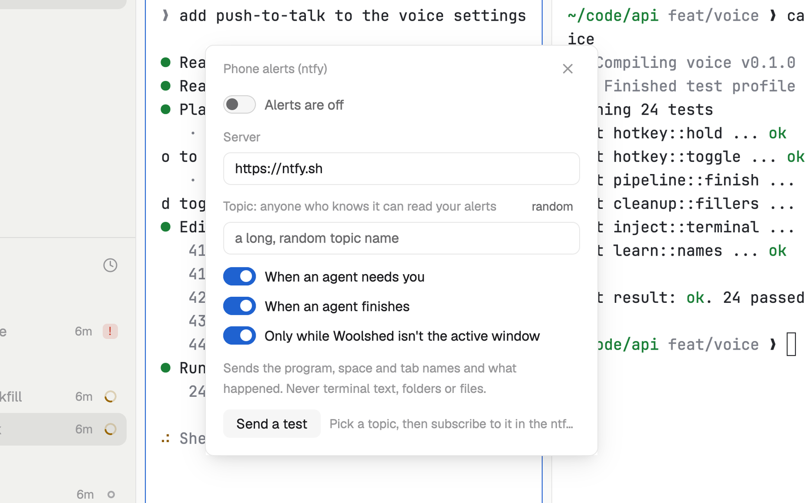

# Phone alerts

A push to your phone when an agent needs you or finishes, through ntfy (ntfy.sh or a server you run). It's off until you turn it on and pick a topic, and it sends only names, never what's in your terminals.

## What you see

A window 360 px wide (`ctrl-shift-y`) on the `popover` color:

- "Phone alerts (ntfy)" in 11.5 px `dim`, and ✕.
- A switch (30 × 17 px, the `accent` color when on): "Alerts are off" or "Sending alerts".
- **Server** (`https://ntfy.sh` to start with) and **Topic**, labelled "anyone who knows it can read your alerts", with "random" at the right.
- Three switches, all on at first: "When an agent needs you", "When an agent finishes", "Only while Woolshed isn't the active window".
- A line saying what is sent, then "Send a test" and a status: "Last sent 14:02: Claude Code needs you", "Nothing sent yet", or an error in the `blocked` color.

In a block taller than 300 px it shows the same panel; smaller, a chip: a 7 px dot (`done` when alerts go out, else `dim`) and "Phone alerts on · <topic>" or "Phone alerts off". Clicking the chip opens the window.

## How it behaves

- Each time it redraws it compares every agent's state with what it saw last. An agent that turns to needing you, or to finished, is an alert; one seen for the first time isn't.
- Alerts are kept only while it's on, has a topic and (with the last switch on) Woolshed's window isn't active. Every 4 seconds what's kept goes out as one push.
- One alert: title "Claude Code needs you" (or "Codex finished"), text "webapp · fix login", ntfy tag `warning` and priority 4 (finished: `white_check_mark`, priority 3). Several: "2 need you, 1 finished" with up to 6 lines, then "and 3 more".
- The tab name is used unless it's only a number; then the program's name.
- "random" fills in `woolshed-` and 22 random letters and digits. Typing saves 700 ms after you stop, or when you leave the field.
- "Send a test" sends "Woolshed test": "Alerts from Woolshed will look like this."

## Built from

- `mods/notify-ntfy/main.js`. `woolshed` functions: `agents`, `shared`, `setShared`, `window`, `theme`, `props`, `closeOverlay`, `openOverlay`.
- Network: `fetch` POST to the server's address with JSON `{ topic, title, message, tags, priority }`. No other calls.
- Storage: shared `notify-ntfy` (`on`, `server`, `topic`, `blocked`, `done`, `away`) and `notify-ntfy.seen` (each agent's last state, so two copies send once).
- `mod.json`: a kept window (`key: "notify-ntfy"`, `keep: true`). `keys.json`: `"ctrl-shift-y": "mod.open:notify-ntfy"`.

## Watch out

- This sends data off your computer: the program, space and tab names and what happened go to the ntfy server you set, and anyone who knows the topic can read them. Use "random", or run your own server.
- It sends no login, so a server that needs one answers with an error. The server may start with `http://` too; then pushes travel unencrypted.
- It only watches while a copy runs: keep its window open or give it a block in a layout.
- A push that fails isn't sent again; the error shows under "Send a test".
- `preview.png` is a screenshot of Woolshed in light mode, running example agents.

## Done when

- `woolshed check` passes on this folder and `ctrl-shift-y` opens the window.
- With the ntfy app subscribed to the topic, "Send a test" arrives on the phone.
- With Woolshed in the background, an agent asking a question sends "… needs you" within a few seconds.
