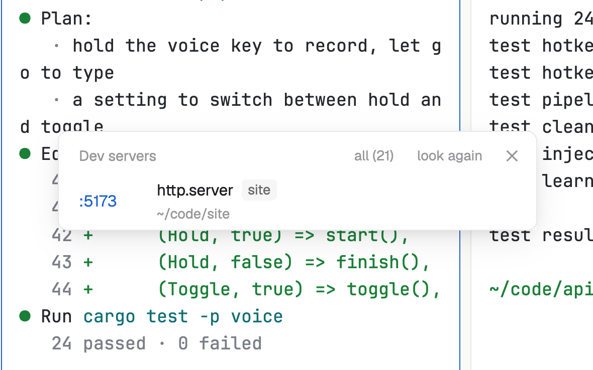

# Ports

The servers listening on this computer, so the dev server an agent started is one click away. By default it shows only dev servers, run from a project folder, and tags each with its space. It only ever lists; it never stops anything.

## What you see

A window 380 px wide (`ctrl-shift-i`) on the `popover` color, or a block in a layout:

- **Header**, 38 px: "Dev servers" (or "Listening ports") in 11.5 px `dim`; "all (11)" (or "dev only") when some are hidden; "look again" ("…" while looking); ✕.
- **Rows**, 34 px, by port: ":5173" in semibold, the `accent` color; what it runs ("vite", "next-server", "manage runserver") with the space's name in a small 11 px tag on `raised`; below, its folder in 11 px `dim` (`~` for your home). "network" at the right when it also listens beyond localhost; on hover, "copy".
- With nothing to show: "No dev servers running. When an agent starts one, it shows here." (or "Nothing is listening."). Errors show in the `blocked` color.

In the window the list scrolls past 360 px.

## How it behaves

- It lists every 10 seconds while it's open, and when you click "look again", never twice at once.
- A dev server is one whose folder is under your home (not home itself, nor `Library`, `.cache`, `.local`, `.config`, `snap`, `AppData`, `.vscode`, `.cursor`), or inside a space's or a pane's folder. With no folder to judge by (Windows), everything but system services shows. "all" shows every listening port.
- Clicking a row opens `http://localhost:<port>/` in your browser; "copy" puts that address on the clipboard.
- For node, bun, deno, python, ruby, php, java, dotnet and perl it names the script: `node …/.bin/vite` shows "vite".
- The space tag is the space with the deepest folder holding the server's folder, else the space of a pane in it.

## Built from

- `mods/ports/main.js` and `parse.js` (reads the listings below).
- Programs, read-only, each with a 10-second limit. macOS and Linux: `lsof -nP -iTCP -sTCP:LISTEN -Fpcn +c 0`, `lsof -a -d cwd -p <pids> -Fpn`, `ps -o pid= -o args= -p <pids>`. Linux without lsof: `ss -ltnpH` and `readlink /proc/<pid>/cwd` (at most 40). Windows: `netstat -ano -p tcp`, `tasklist /fo csv /nh`.
- `woolshed` functions: `exec`, `spaces`, `panes`, `home`, `window`, `theme`, `props`, `closeOverlay`.
- `mod.json`: a kept window (`key: "ports"`). `keys.json`: `"ctrl-shift-i": "mod.open:ports"`.

## Watch out

- It lists this computer only, even for spaces on another machine.
- A click always opens `localhost`, whatever address the server listens on.
- On Windows there are no folders, so no space tags and no folder lines.
- `preview.png` is a screenshot of Woolshed in light mode, running example agents.

## Done when

- `woolshed check` passes on this folder and `ctrl-shift-i` opens it.
- Starting a dev server in a project shows its port within 10 seconds, tagged with its space; clicking it opens the page.
- "all" shows the other listening ports too, and stopping the server removes its row.
