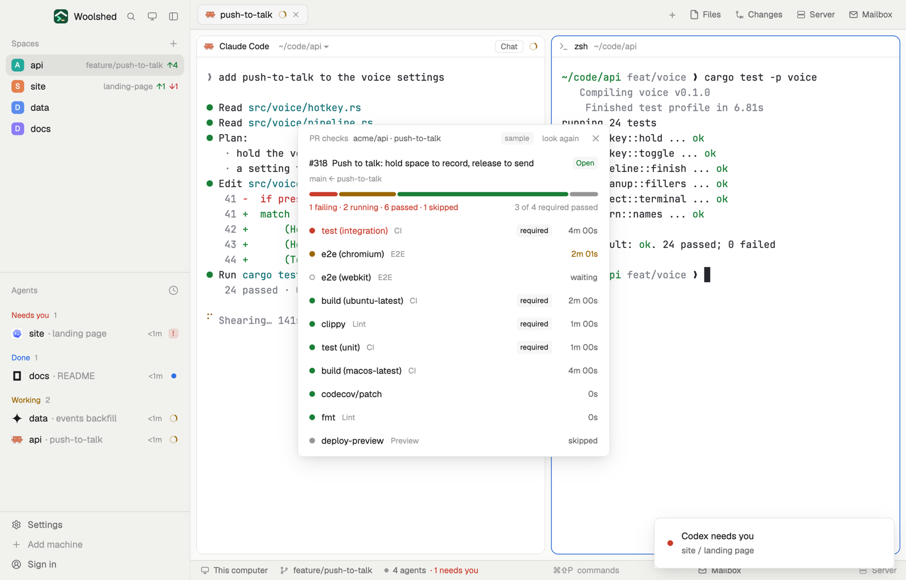

# PR checks

Every check on your branch's pull request, one per line: which failed, which are still running and for how long, which are required to merge, and a click to open any of them. The status bar says "1 of 10 checks failing"; this says which one.

## What you see

A window 440 px wide on the `popover` color (`mod.open:pr-checks`), or a block in a layout:

- **Header**, 38 px: "PR checks" in 11.5 px `dim`, "acme/api · push-to-talk" in `muted`, "sample" in sample mode, "look again", ✕.
- **The pull request**: "#318" in semibold, its title, and a state tag (Open in `ansi2`, Draft in `dim`, Merged in `done`, Closed in `blocked`); under it "main ← push-to-talk" in 11 px `dim`. Click to open it.
- **A 6 px bar** split by count: failing (`blocked`), running (`working`, pulsing), passed (`ansi2`), skipped (`dim`); under it "1 failing · 2 running · 6 passed · 1 skipped" (`blocked` when something fails) and "3 of 4 required passed" at the right.
- **Checks**, 32 px rows: failing first, then running, waiting, cancelled, passed, skipped, required ones first in each; an 8 px dot, the name (`blocked` when it failed), its workflow in 11 px `dim`, a "required" tag, and its time at the right ("4m 00s", "waiting", "skipped").
- No pull request: "No pull request for push-to-talk yet." and how to open one. No checks: "No checks on this pull request." Problems as in the other GitHub mods.

## How it behaves

- It follows the shown space's folder and branch (noticed within 2.5 seconds) and looks again every 60 seconds while it's open, and on "look again".
- Clicking a check opens its link (the job's log, or the app's page such as a coverage report); its description shows as the tooltip.
- `gh pr checks` exits 8 while checks run and 1 when one fails; the JSON is read either way.
- Read-only: it never re-runs or merges.

## Built from

- `mods/pr-checks/main.js`; `parse.js` (the pull request, the checks sorted and marked, the tally); `common.js` and `kit.js` (shared with the other GitHub and GitLab mods).
- Programs, read-only: the git reads of the space's repo; `gh pr view <branch> --repo <owner/repo> --json number,title,url,state,isDraft,headRefName,baseRefName`; `gh pr checks <n> --repo … --json name,workflow,state,bucket,startedAt,completedAt,link,description,event`; `gh pr checks <n> --repo … --required --json name,workflow` (a check is required when its name and workflow are in that list).
- `woolshed` functions: `spaces`, `panes`, `focused`, `exec`, `readTextFile`, `appHome`, `run` (`app.settings`), `theme`, `props`, `closeOverlay`.
- `mod.json`: a kept window (`key: "pr-checks"`). No keys.

## Watch out

- The pull request is found by the branch's name on the GitHub remote; a branch pushed under another name isn't found.
- GitLab repos are pointed at gitlab-pipelines.
- Sample mode, a demo and preview aid: `data/pr-checks/sample.json` under the app's home (`{ "repo", "pr", "checks", "required" }` in gh's shapes) is shown instead of GitHub, tagged "sample". Delete it to see your own.
- `preview.png` is a screenshot of Woolshed in light mode, running example agents.

## Done when

- `woolshed check` passes on this folder and `mod.open:pr-checks` opens it.
- On a branch with an open pull request it lists every check with the right dot and time, and marks the required ones.
- A failing check sorts to the top and the tally says "1 failing"; clicking it opens its log.
- On a branch with no pull request it says so.
