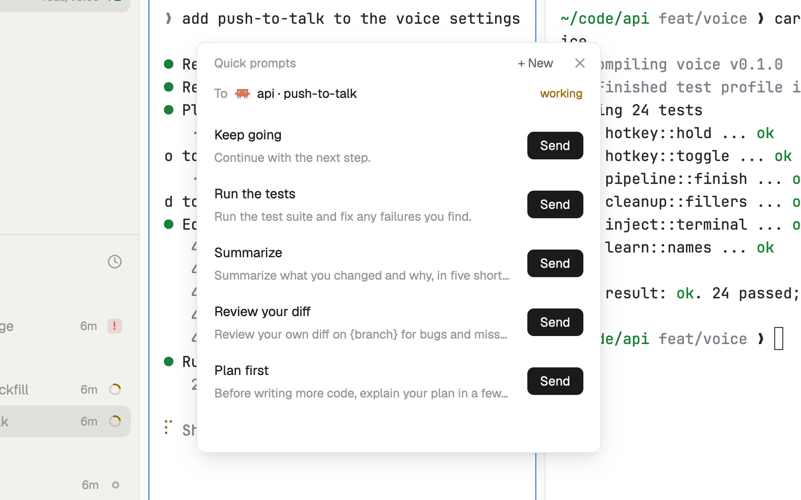

# Quick prompts

Your saved prompts, one click from the agent you're looking at. Nothing is sent by itself: only Send does it, and never to an agent that is asking you something. The list is a JSON file that you or an agent can edit too.

## What you see

A window 380 px wide (`ctrl-shift-q`) on the `popover` color, or a block in a layout:

- **Header**, 38 px: "Quick prompts" in 11.5 px `dim`, "+ New" and ✕.
- **To**: the agent's 14 px program icon and "api · tests", with "asking you: answer it first" in the `blocked` color or "working" in the `working` color. With no agent: "Focus an agent's pane (or show one) to send to it."
- **Rows**: the title (medium) over the first line of the prompt in 11.5 px `dim`, and a 26 px Send button on `solid` (on `raised`, `dim`, when it can't send). On hover, Edit and Delete; Delete asks again with "Delete it" in the `blocked` color.
- **The form** (+ New or Edit): a Title field, a 96 px text box, Cancel and Save.
- **Footer**: "Sent "Run the tests" to api · Pi" in the `done` color, or an error in `blocked`, for 6 seconds; otherwise "Send pastes the prompt into the agent and presses Enter."

In the window the list scrolls past 380 px.

## How it behaves

- The agent is the one an agent block in the layout shows, else the focused pane's.
- Send fills `{space}`, `{tab}`, `{folder}` and `{branch}` (the pane's folder and branch, else the space's), then runs `hc send`, which pastes the text and presses Enter. If it refuses, the first line of its answer shows.
- The first time, five prompts are written: Keep going, Run the tests, Summarize, Review your diff, Plan first.
- A prompt with no title takes the first 40 characters of its text; one with no text isn't saved.
- Edits to the file elsewhere show up at once. Save and Delete read it fresh and write only if nobody changed it meanwhile.

## Built from

- `mods/quick-prompts/main.js`. `woolshed` functions: `agents`, `panes`, `spaces`, `focused`, `layout`, `hc`, `appHome`, `readTextFile`, `writeTextFile`, `watchFolder`, `theme`, `props`, `closeOverlay`.
- Program: `hc send <address> <text>`, only on Send.
- Storage: `data/quick-prompts/prompts.json` under the app folder, as `{ "prompts": [{ "id", "title", "text" }] }` (a bare list is read too).
- `mod.json`: a kept window (`key: "quick-prompts"`). `keys.json`: `"ctrl-shift-q": "mod.open:quick-prompts"`.

## Watch out

- Send goes to the agent shown in the To line: check it before you click.
- A placeholder with nothing to fill in becomes its own name ("space"); `{branch}` becomes "this branch".
- If `prompts.json` isn't valid JSON it says so and keeps the last good list until you fix or delete the file.
- `preview.png` is a screenshot of Woolshed in light mode, running example agents.

## Done when

- `woolshed check` passes on this folder and `ctrl-shift-q` opens it with the five prompts.
- With an agent's pane focused, Send on "Keep going" types it into that agent and the footer says "Sent".
- An agent asking a question can't be sent to; a prompt added in the file shows up in the window.
