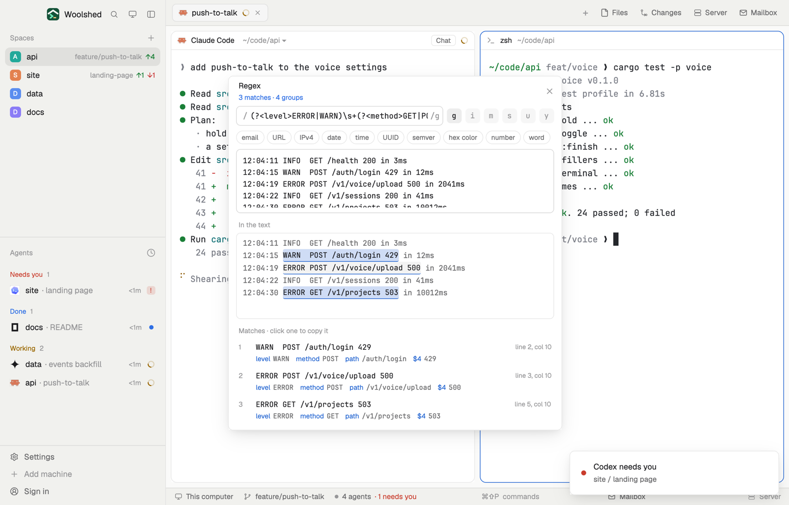

# Regex tester

Try a regular expression on some text and see what it catches: the matches light up in the text and each one is listed with its capture groups, named ones by name. Common patterns (email, URL, IPv4, date, UUID, semver and more) are a click away, and pasting `/pattern/flags` fills in both.

## What you see

A window 540 px wide on the `popover` color, or a block in a layout (on `chrome`):

- **Header**, 48 px: "Regex" in semibold; below in 11 px "3 matches · 4 groups" in `done`, "No match" in `working`, the error ("missing )") in `blocked`, or a hint in `dim`; ✕.
- **Pattern row**: a 32 px field in the terminal font, "/ pattern /gi" with the slashes and flags in `dim` (its border turns `blocked` when the pattern doesn't compile), then six 24 px flag chips g i m s u y (`selected` and semibold when on; each says what it does on hover).
- **Snippets**: 22 px rounded chips email, URL, IPv4, date, time, UUID, semver, hex color, number, word; the one in use has an `accent` border.
- **Test text**, a 104 px box in the terminal font at 12 px.
- **In the text**: the text again, line by line in the terminal font, each match on `selection` (every other one on `hover`) with an `accent` underline; an empty match is a 2 px `accent` mark. At most 140 px, then it scrolls; past 80 lines, "… 12 more lines".
- **Matches**: rows with the number in `dim`, the match in the terminal font (line breaks as ⏎, tabs as ⇥), "line 2, col 7" at the right, and under it each group: its name (or `$2`) in `accent` and its text in `muted` ("undefined" in `dim` when it didn't take part).
- Foot, 10.5 px `dim`: "JavaScript regex syntax. Paste /pattern/flags to fill both.", "Copied match 2.", or "Only the first 20000 characters are tested."

## How it behaves

- It tests 120 ms after you stop typing. Without `g` only the first match counts ("first only (add g for all)"); `y` matches only from where the last match ended.
- It stops at 500 matches (the count shows "500+"), lists the first 200, and tests the first 20,000 characters.
- Empty matches move on by one character, so a pattern like `x*` ends.
- Click a match to copy it. Click a snippet to use it.
- The pattern, flags and text are kept in this mod's `localStorage`. On first open, if `data/regex-tester/example.json` exists under the app folder (`{ "pattern", "flags", "text" }`), it fills them in.

## Built from

- `mods/regex-tester/main.js` and `parse.js` (flags, snippets, `compile` with the `d` flag for group positions, `findMatches`, `groupNames`, `pieces` for highlighting).
- `woolshed` functions: `appHome`, `readTextFile`, `settings` (the terminal font), `theme`, `props`, `closeOverlay`.
- No programs, no network.
- `mod.json`: a kept window (`key: "regex-tester"`). No keys.

## Watch out

- It uses this app's JavaScript engine: lookbehind, named groups, `\p{…}` with `u` all work, but other languages' regexes (PCRE, Go, Python) differ in places.
- A pattern with catastrophic backtracking on a long text can stall the window while it runs; keep test texts short.
- Lines in the highlighted copy don't wrap; long ones are cut at the edge.
- `preview.png` is a screenshot of Woolshed in light mode, running example agents.

## Done when

- `woolshed check` passes on this folder and `mod.open regex-tester` opens it.
- `(?<year>\d{4})-(\d{2})` on "2024-05 and 2025-11" shows 2 matches with `year` 2024 and `$2` 05 for the first.
- Removing `g` leaves one match; typing `(` says the pattern is broken in red.
- Pasting `/\bfoo\b/i` sets the pattern to `\bfoo\b` and turns on `i` only.
