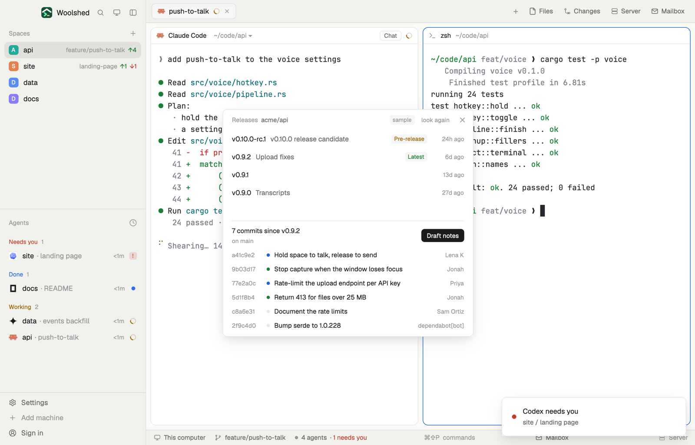

# Releases

The repo's GitHub releases, which one is latest, and every commit since it on your branch, sorted into new, fixed and other by their conventional-commit prefixes. Draft notes copies them to the clipboard as a markdown list, ready to paste into a release or a changelog.



## What you see

A window 460 px wide on the `popover` color (`mod.open:releases`), or a block in a layout:

- **Header**, 38 px: "Releases" in 11.5 px `dim`, the repo in `muted`, "sample" in sample mode, "look again", ✕.
- **Releases**, 32 px rows (up to 10, scrolling past 170 px): the tag in semibold, its name in `muted` when it differs, tags for "Latest" (`ansi2`), "Pre-release" (`working`) and "Draft" (`dim`), and the age.
- A line in `border`, then "7 commits since v0.9.2" in 12 px semibold, where they came from ("on main") in 11 px `dim`, and a solid "Draft notes" button.
- **Commits**, 26 px rows: the short sha in `dim`, a 6 px dot (`accent` new, `ansi2` fixed, `border` other), the subject without its prefix, capitalised ("Hold space to talk, release to send"), and the author.
- "No releases yet. gh release create v0.1.0 makes the first." (then the last 50 commits); "Nothing new since v0.9.2."; problems as in the other GitHub mods.

## How it behaves

- It follows the shown space (noticed within 2.5 seconds) and looks again every 60 seconds while it's open, and on "look again".
- The latest release is the one GitHub marks Latest, else the newest that is neither a draft nor a pre-release.
- Commits come from this clone (`git log <tag>..HEAD`, merges left out, up to 300) when it has the tag; otherwise from GitHub's compare of the tag with the default branch, and the line says "from GitHub (fetch tags to use this clone)".
- Clicking a release opens its page.
- "Draft notes" copies, and a toast says how many lines:

  ```
  ## Since v0.9.2

  ### New
  - Hold space to talk, release to send (a41c9e2)

  ### Fixed
  - Stop capture when the window loses focus (9b03d17)

  ### Other
  - Document the rate limits (c8a6e31)
  ```

  `feat`/`feature`/`add` are New, `fix`/`bugfix`/`hotfix`/`perf` are Fixed, the rest Other; merge and release commits are left out.
- It never makes, edits or publishes a release.

## Built from

- `mods/releases/main.js`; `parse.js` (releases, git log and compare output, the notes); `common.js` and `kit.js` (shared with the other GitHub and GitLab mods).
- Programs, read-only: the git reads of the space's repo; `gh release list --repo <owner/repo> --limit 10 --json tagName,name,isLatest,isDraft,isPrerelease,publishedAt,createdAt`; `git rev-parse --verify --quiet refs/tags/<tag>^{commit}` and `git log --no-merges -n 300 --format=%h%x1f%s%x1f%an%x1f%cI <tag>..HEAD`; without the tag, `gh repo view <owner/repo> --json defaultBranchRef` and `gh api repos/<owner/repo>/compare/<tag>...<branch>`.
- `woolshed` functions: `spaces`, `panes`, `focused`, `exec`, `readTextFile`, `appHome`, `notify`, `run` (`app.settings`), `theme`, `props`, `closeOverlay`; `cx.write_to_clipboard`.
- `mod.json`: a kept window (`key: "releases"`). No keys.

## Watch out

- GitHub's compare lists at most 250 commits.
- Sample mode, a demo and preview aid: `data/releases/sample.json` under the app's home (`{ "repo", "releases": [ …gh release list objects… ], "log": [ "sha\u001fsubject\u001fauthor\u001ftime", … ] }`) is shown instead, tagged "sample"; Draft notes still copies (it only writes the clipboard). Delete it to see your own.
- `preview.png` is a screenshot of Woolshed in light mode, running example agents.

## Done when

- `woolshed check` passes on this folder and `mod.open:releases` opens it.
- In a repo with releases it marks the latest and counts the commits since it on this branch.
- "Draft notes" puts the markdown list above on the clipboard.
