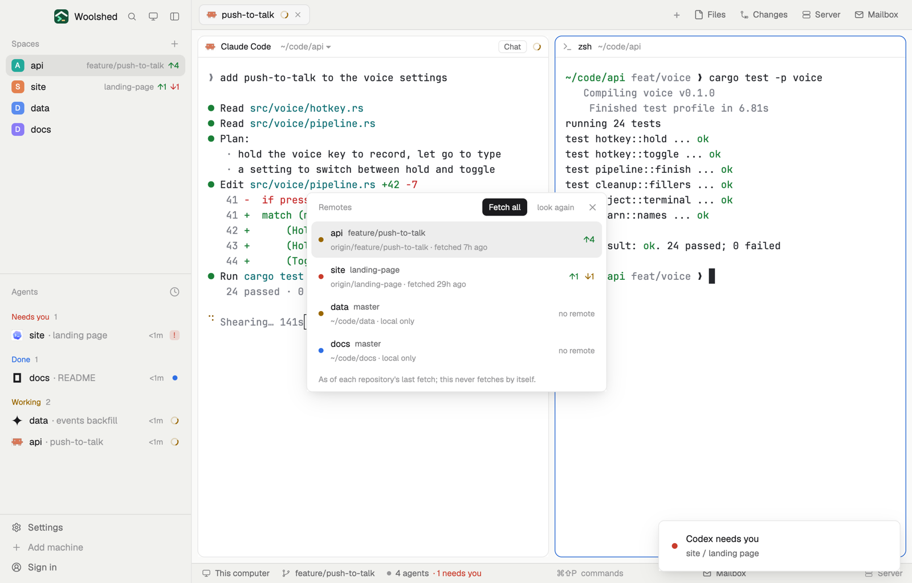

# Remote check

For every space's repository: how far its branch is ahead of and behind its upstream, and when it last fetched. It never fetches by itself; press Fetch all to bring every repository up to date in one go, each on its own machine, then see what needs pushing or pulling.

## What you see

A window 420 px wide on the `popover` color, or a block in a layout (on `chrome`):

- **Header**, 40 px: "Remotes" in 11.5 px `dim`, a solid "Fetch all" button ("Fetching…" on `raised` while it runs), "look again" and ✕.
- **Rows**, one per repository (spaces in the same one share a row, names joined): a 7 px dot in the space's status color, the space's name in semibold, the branch in `muted`, a machine tag on `raised` for another machine. Below in 11 px `dim`: "origin/landing-page · fetched 24h ago" (or "never fetched"), "fetching…" in `working`, a failure in `blocked`, or "~/code/data · local only" for a repository without a remote. At the right: "↑1" in the green terminal color (`ansi2`) and "↓1" in `working`, "in sync", "no upstream" or "no remote"; a `done` ✓ after a good fetch. The space you're in sits on `selected`.
- **Footer**: "As of each repository's last fetch; this never fetches by itself. Fetch all: 3m ago." in 11 px `dim`.

With no spaces: "No spaces yet. Each space's repository shows here." Without git: "git isn't installed on this machine…" in `blocked`, and "no git" on its rows.

## How it behaves

- Clicking a row runs `space.select` for its space.
- Fetch all runs `git fetch --all --prune --quiet` in every repository with a remote, three at a time, at most a minute each, with `GIT_TERMINAL_PROMPT=0` so nothing waits for a password ("the remote wouldn't let it in (sign in once from a terminal)"). Then it reads again.
- The fetch time is the repository's `FETCH_HEAD` file's age (so fetches from a terminal count too), or Fetch all's own time, whichever is newer.
- It reads (never fetches) every 30 seconds, when the spaces or their folders change (checked every 2.5 seconds) and on "look again". Each space's repository is where its first terminal is, on the space's machine.

## Built from

- `mods/remote-check/main.js` and `parse.js` (`parseCounts`, `parseMtime`, `absolute`, `fetchedLabel`, `byRepo`, `explain`).
- Reads, with `--no-optional-locks -c core.fsmonitor=false -c diff.autoRefreshIndex=false -c color.ui=false` and a 10-second limit: `git rev-parse --show-toplevel`, `git symbolic-ref --quiet --short HEAD`, `git rev-parse --abbrev-ref --symbolic-full-name @{upstream}`, `git remote`, `git rev-parse --git-path FETCH_HEAD`, `git rev-list --left-right --count @{upstream}...HEAD`, and `sh -c 'stat -c %Y "$1" || stat -f %m "$1"'` for the file's age (not on Windows).
- On a click: `env GIT_TERMINAL_PROMPT=0 git -c color.ui=false fetch --all --prune --quiet` (plain `git` on Windows), 60-second limit.
- `woolshed` functions: `spaces`, `panes`, `focused`, `exec` (with `on`), `run` (`space.select`), `home`, `theme`, `window` (the platform), `props`, `closeOverlay`; `localStorage` for Fetch all's times.
- `mod.json`: a kept window (`key: "remote-check"`), opened with `mod.open:remote-check`; no keys of its own.

## Watch out

- A remote that needs a password or an ssh key passphrase fails here: fetch once in a terminal, or use a credential helper or ssh agent.
- `--prune` removes remote-tracking branches deleted on the remote, as `git fetch --prune` does.
- `preview.png` is a screenshot of Woolshed in light mode, running example agents.

## Done when

- `woolshed check` passes on this folder and `mod.open:remote-check` opens it.
- A repository one commit ahead of its upstream shows "↑1"; after someone pushes and you press Fetch all, it shows "↓1" too and "fetched just now".
- Opening it never runs `git fetch` by itself.
