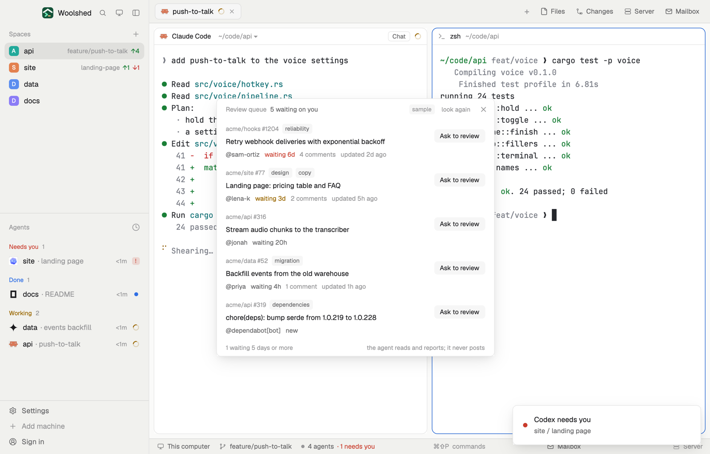

# Review queue

Every open pull request waiting for your review, on any repo, oldest first, with how long each has waited. One button hands a pull request to an agent in a new tab: it reads the diff and tells you what it would say in a review, and never posts anything itself.

## What you see

A window 500 px wide on the `popover` color (`mod.open:review-queue`), or a block in a layout:

- **Header**, 38 px: "Review queue" in 11.5 px `dim`, "5 waiting on you" in `muted`, "sample" in sample mode, "look again", ✕.
- **Rows**, oldest request first: "acme/hooks #1204" in 11 px `dim`, a "draft" tag and up to two label tags; the title in semibold; "@sam-ortiz", the wait ("waiting 6d" in `blocked` from 5 days, "waiting 3d" in `working` from 2 days, else `muted`; "new" under an hour), the comment count and "updated 2d ago".
- At the right of each row, "Ask to review" on `raised`; under the pointer it becomes a solid "Ask Claude Code to review" (the agent's own name).
- **Foot**: "1 waiting 5 days or more" (or "oldest first") and "the agent reads and reports; it never posts".
- Nothing waiting: "Nobody is waiting on your review." Problems (no gh, signed out, network) as in the other GitHub mods.

## How it behaves

- It searches every 60 seconds while it's open, and on "look again". It doesn't need a space or a repo.
- Clicking a row opens the pull request.
- "Ask … to review" starts the agent only when clicked: Claude Code when it's installed, else the first installed agent Woolshed knows (`knownAgents`). It opens a tab named "review #1204" in a space on this computer whose GitHub remote is that repo; else in the shown space, in your home folder; with no space at all, a new space "reviews". The agent's first message names the pull request and its link, says to read it with `gh pr view <url> --comments` and `gh pr diff <url>`, to change nothing, to report blocking issues first then suggestions with file and line, and not to post a review or comments, approve, request changes or merge.

## Built from

- `mods/review-queue/main.js`; `parse.js` (rows, the wait, the task text, which agent); `common.js` and `kit.js` (shared with the other GitHub and GitLab mods).
- Programs, read-only: `gh search prs --review-requested=@me --state=open --sort created --order asc --limit 40 --json number,title,url,repository,author,createdAt,updatedAt,isDraft,labels,commentsCount`; on a click, `git -C <space folder> remote -v` for each local space (5 s each) to find the repo's space.
- `woolshed` functions: `knownAgents`, `spaces`, `exec`, `home`, `readTextFile`, `appHome`, `run` (`tab.new`, `space.new`, `app.settings`), `notify`, `theme`, `props`, `closeOverlay`.
- `mod.json`: a kept window (`key: "review-queue"`). No keys.

## Watch out

- GitHub's search finds requests to you and to your teams; at most 40 are listed.
- The agent works with your gh sign-in, so it can read private repos you can.
- Sample mode, a demo and preview aid: `data/review-queue/sample.json` under the app's home (`{ "prs": [ …gh search prs objects… ] }`) is shown instead of GitHub, tagged "sample", and the button only toasts "nothing was run". Delete it to see your own.
- `preview.png` is a screenshot of Woolshed in light mode, running example agents.

## Done when

- `woolshed check` passes on this folder and `mod.open:review-queue` opens it.
- It lists the pull requests github.com shows under "Review requests", oldest first, with their waits colored.
- Clicking "Ask … to review" opens one tab with the agent and the review task; nothing is posted on GitHub.
