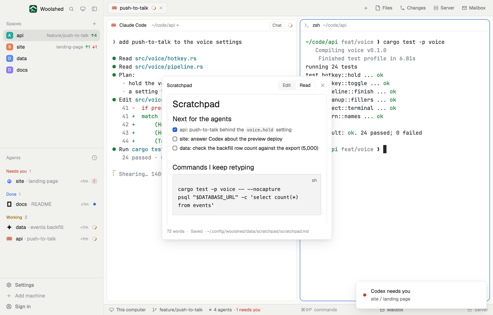

# Scratchpad

One markdown page for everything you want at hand in every space: the command you keep retyping, a half-formed idea, what to tell an agent next. It saves as you type, counts your words, and shows the page rendered when you switch to Read. It's a plain file, so an agent can read it or add to it, and the window follows.

## What you see

A window 440 px wide (`ctrl-alt-n`) on the `popover` color, or a block in a layout (on `chrome`):

- **Header**, 30 px: "Scratchpad" in semibold, an Edit | Read switch on a `raised` pill (the chosen side on `background`, medium weight), and ✕.
- **Edit**: a 340 px text box in 13 px on the `background` color with a `border` line, and "Anything to keep: commands, ideas, what to tell an agent next…" while empty.
- **Read**: the same box with the page rendered as markdown (headings, lists, task boxes, code blocks, links), scrolling when long; "Nothing here yet. Edit to start." when empty.
- **When the file changed elsewhere** while you were typing: "The file changed somewhere else." in the `working` color, with "Use theirs" and "Keep mine".
- **Footer** in 11 px `dim`: "312 words · Saved 14:31 · …/data/scratchpad/scratchpad.md" ("New", "Loading…", "Saving…", or "Unsaved" in `working`; an error in `blocked`).

## How it behaves

- It saves 800 ms after you stop typing, when you leave the text box, and when you switch to Read. An empty new page makes no file.
- The word count leaves out markdown marks (`#`, `-`, `>`, table bars, fence lines); a word is anything with a letter or digit.
- Read opens web links (`http`, `https`) in the browser; other links do nothing.
- Edits made elsewhere (an agent appending a line) load at once when you have nothing unsaved. A save writes only if the file is as it was loaded; if not, "Keep mine" writes your text over it and "Use theirs" loads the file.
- Edit or Read is remembered. Key commands for a shown copy: `scratchpad.edit`, `scratchpad.read`, `scratchpad.toggle`.

## Built from

- `mods/scratchpad/main.js` and `mods/scratchpad/parse.js` (word count, web-link check; pure functions). `gpui-base`: `TextareaState`, `Textarea`, `TextView.markdown`. `woolshed` functions: `appHome`, `home`, `readTextFile`, `writeTextFile` (with the text it expects to replace), `watchFolder`, `theme`, `props`, `closeOverlay`, `nextCommand`.
- Storage: `data/scratchpad/scratchpad.md` under the app folder. No programs and no network.
- `mod.json`: a kept window (`key: "scratchpad"`). `keys.json`: `"ctrl-alt-n": "mod.open:scratchpad"`.

## Watch out

- It's one page for every space; for notes per project, use Space notes.
- The page is a plain file: anything that can read the app folder can read it, which is the point for agents. Don't keep secrets in it.
- Files over 1 MiB can't be read or saved.
- `ctrl-alt-n` types a character on some keyboards (AltGr on Windows): bind another key if so.
- `preview.png` is a screenshot of Woolshed in light mode, running example agents.

## Done when

- `woolshed check` passes on this folder and `ctrl-alt-n` opens the scratchpad.
- Typing shows "Saved" with the time within a second, and `scratchpad.md` holds the text.
- Read shows the page rendered, and the word count matches what you wrote.
- A line added to the file elsewhere shows up in the window.
