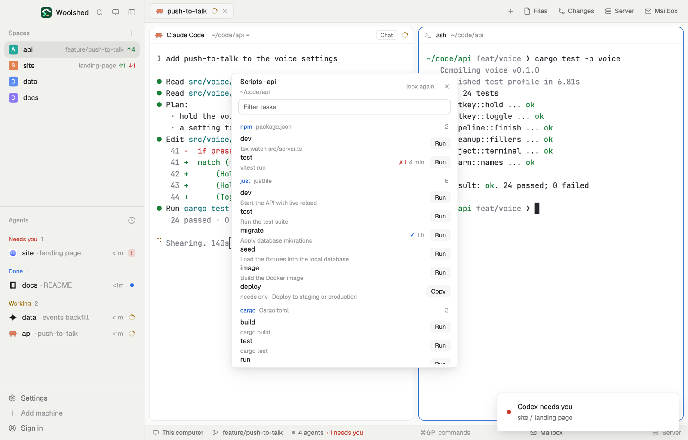

# Scripts

Every task the project you're in can run, in one list: package.json scripts (run with npm, pnpm, yarn or bun, whichever the project uses), justfile recipes, Makefile targets, Cargo's build, test and run, and pyproject scripts. Run opens the task in a new tab of that space where you can watch it, and the list remembers whether it passed last time.

## What you see

A window 420 px wide (`ctrl-alt-j`) on the `popover` color, or a block in a layout (on `chrome`):

- **Header**, 48 px: "Scripts · api" in semibold `foreground`, the folder below in 11 px `dim` (`~` for your home, the machine's name first for a remote space); "look again" ("…" while reading) and ✕.
- **Filter**, a 28 px input ("Filter tasks"), only when there are more than 8 tasks.
- **Groups**, one per file: a 26 px heading with the tool in semibold `accent` ("npm", "pnpm", "just", "make", "cargo", "python"), the file in `dim` and the count at the right.
- **Rows**, 34 px: the task's name in medium `foreground`; below it in 11 px `dim` what it runs (the script's command, the recipe's doc comment or first line, a Makefile `## help` note). At the right the last result, "✓ 4 min" in the `done` color or "✗ 1 4 min" in `blocked` (a spinner and "running" in `working` while it runs), and a 22 px **Run** button on `raised` that turns `solid` on hover.
- A recipe that needs arguments says "needs env" and has **Copy** instead of Run (it copies `just deploy ` to finish in a terminal); so do all recipes when `just` isn't installed, with "just isn't installed here: brew install just, cargo install just, or see just.systems" in `working`.
- Empty states in `dim`: "No space open…", "This space is in your home folder…", "No package.json, justfile, Makefile, Cargo.toml or pyproject.toml here." A package.json that doesn't parse says so in `blocked` under its heading.

The list scrolls past 460 px.

## How it behaves

- It follows the space this window shows: its folder, or at home the focused pane's folder.
- It reads the files when the space changes, every 30 seconds while open, and on "look again", never twice at once.
- The package manager comes from package.json's `packageManager`, else the lockfile (`pnpm-lock.yaml`, `yarn.lock`, `bun.lock`/`bun.lockb`), else npm; scripts run as `<pm> run <name>`.
- Justfile recipes are the ones `just --summary` lists, in the justfile's order; private ones (`_name`, `[private]`) are left out. Makefile targets skip `.PHONY` and other special targets, pattern rules and variables. Cargo shows build and test, and run when there's a `[package]` or `[[bin]]`. pyproject.toml: `[project.scripts]` (through `uv run`, `poetry run` or `pdm run` by lockfile), `[tool.poetry.scripts]`, `[tool.pdm.scripts]` and `[tool.poe.tasks]`.
- **Run** runs `tab.new` with the space, the folder, a tab name like "npm test" and the task. Nothing runs without that click.
- On this computer (macOS, Linux) the task runs inside `sh -c 'trap : INT; <task>; c=$?; … printf "%s %s\n" "$c" "$(date +%s)" > <file>; exit $c'`, so its exit code lands in `data/scripts/<hash>.exit` under the app folder (Ctrl-C still stops the task and is recorded as 130). While the tab is open it checks for that file every 5 seconds; closing the tab first lets it go.

## Built from

- `mods/scripts/main.js` and `parse.js` (the file readers, the shell line, the exit files).
- `woolshed` functions: `spaces`, `focused`, `home`, `appHome`, `readTextFile` (with `on` for a remote space), `exec`, `run` (`tab.new`), `theme`, `props`, `closeOverlay`, `window`. `fs/promises` `readdir` lists the folder here; `ls -1A` lists it on another machine.
- Programs: `just --summary` (10-second limit), and `ls -1A` for remote spaces. Nothing else runs until you click Run.
- `mod.json`: a kept window (`key: "scripts"`). `keys.json`: `"ctrl-alt-j": "mod.open:scripts"`.

## Watch out

- Exit codes aren't recorded for spaces on another machine or on Windows (the task runs as is); the list says so at its foot.
- The justfile and Makefile readers aren't full parsers: odd syntax (a Makefile `.RECIPEPREFIX`, imported justfiles) may hide a task or its note; `just --summary` still decides which recipes there are.
- A Makefile target that needs variables runs without them; the tab shows make's error.
- `preview.png` is a screenshot of Woolshed in light mode, running example agents.

## Done when

- `woolshed check` passes on this folder and `ctrl-alt-j` opens it.
- In a project with a package.json and a justfile, both groups list their tasks, and the right package manager shows.
- Run opens a new tab running the task; when it finishes, its row shows ✓ or ✗ with the code within 5 seconds.
- Switching spaces switches the list; a space at home says so.
