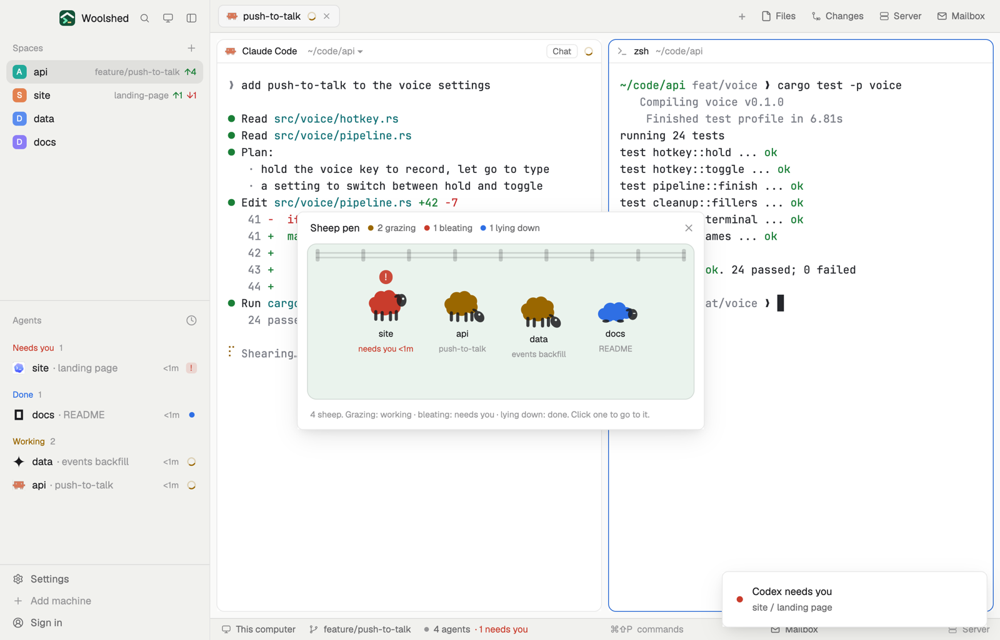

# Sheep pen

Your agents as a small flock in a paddock, each sheep's wool in its status color. Working ones graze, one that needs you bleats with a "!" over its head, finished ones lie down, idle ones stand about. Hover a sheep to see whose it is; click it to go there.

## What you see

A window 520 px wide on the `popover` color (`mod.open sheep-pen`), or a panel in a layout block on `chrome`:

- **Header**, 40 px: "Sheep pen" in 13 px semibold, then a count per state with a 7 px dot in its color: "2 grazing", "1 bleating", "1 lying down", "1 idle" (an `idle` ring), only those there are, and ✕.
- **The paddock**, at least 200 px tall, 12 px corners, a 1 px faint `foreground` border, filled with the theme's green (`ansi2`) at about a tenth strength. Along its top a fence: two 2 px rails and nine 5×16 px posts in faint `foreground`.
- **Sheep**, 92 px apart in rows, centered, each one a little higher or lower than its neighbor (0, 7 or 14 px, steady per agent): a 60×50 px sheep drawn as two tinted SVG layers, its wool in the status color (`working`, `blocked`, `done`; idle in a softer `idle`) and its face, ear and legs in `foreground`, with the eye cut out. Under it the space name in 11.5 px and what it's about in 10.5 px `dim` ("needs you 4m" in `blocked` for a bleating one).
  - working: grazing, head down, nodding slowly as it eats;
  - needs you: standing, with an 18 px `blocked` bubble holding a bold "!" in `background`, pulsing;
  - done: lying down, legs tucked, eye closed;
  - idle: standing.
- **Footer**, 11 px `dim`: "5 sheep. Grazing: working · bleating: needs you · lying down: done. Click one to go to it."
- An empty pen: "The pen is empty. Start an agent and it wanders in."

## How it behaves

- Hover a sheep: a soft highlight and a tooltip, "api · push-to-talk · Claude Code" and "grazing (working) for 12m".
- Click a sheep to go to that agent (`agent.focus`).
- Sheep that need you come first in the flock, then working, done and idle; within a state the order is steady per agent.
- The nod and the bubble's pulse are native motion (`.loop`), so nothing redraws for them. Times move every minute.

## Built from

- `mods/sheep-pen/main.js`: `woolshed` functions `agents`, `spaces` (each tab's `working_since`), `run`, `theme`, `props`, `closeOverlay`. Command: `agent.focus`.
- Art, 48×40 SVGs in `currentColor`, each pose in two layers stacked with `absolute()`: `stand-wool.svg` + `stand-face.svg`, `graze-wool.svg` + `graze-face.svg` (head down), `lie-wool.svg` + `lie-face.svg`. The wool is a cloud of circles; the face layer's eye is an even-odd hole.
- `words.js` (times, what an agent is about, when each entered its state, kept in the mod's local storage), `ui.js`.
- `mod.json`: a kept window (`key: "sheep-pen"`, `keep: true`). No keys, no programs.

## Watch out

- The paddock's green is the theme's `ansi2`; a theme whose green is odd gives an odd field.
- A tinted SVG takes one color, hence two layers per pose; draw new poses the same way.
- Tooltips hold two lines; very long space names truncate under the sheep.
- `preview.png` is a screenshot of Woolshed in light mode, running example agents.

## Done when

- `woolshed check` passes on this folder and `mod.open sheep-pen` opens the pen.
- A working agent is a grazing sheep in the `working` color; one asking a question has the "!" bubble; a finished one lies down.
- Hovering a sheep names its space, tab and program; clicking it focuses that agent.
- With no agents the pen says it's empty.
