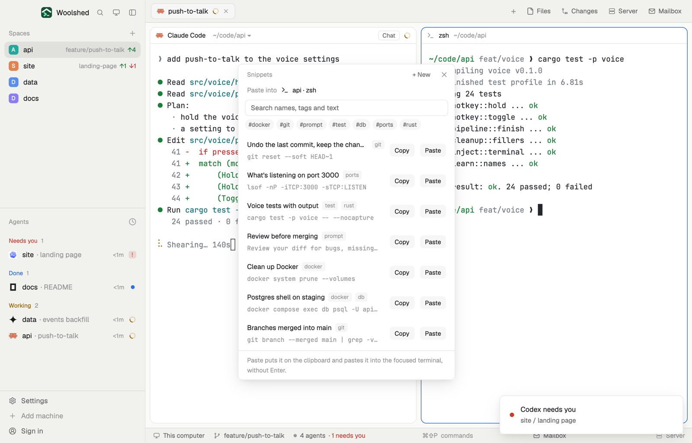

# Snippets

The commands and prompts you keep looking up, with names and tags, a search away. Copy puts one on the clipboard; Paste also pastes it into the terminal you're in, without pressing Enter, so you can check it first. It never pastes into an agent that is asking you something. The list is a JSON file that you or an agent can edit too.

## What you see

A window 400 px wide (`ctrl-alt-s`) on the `popover` color, or a block in a layout (on `chrome`):

- **Header**, 38 px: "Snippets" in 11.5 px `dim`, "+ New" and ✕.
- **Paste into**: the focused terminal's 14 px program icon and "api · Claude Code", with "asking you: answer it first" in the `blocked` color. With no terminal focused: "Focus a terminal to paste into it."
- **Search**: a 30 px field, "Search names, tags and text", on `background`; under it the tags as 20 px round chips ("#git"), `raised` with `muted` text, `accent` when chosen. At most 12, the most used first.
- **Rows**: the name in medium weight with up to three tags in 10.5 px `dim` on `raised`, and the first line of the text in the terminal font, 11.5 px `dim` ("…" when there's more). At the right, 24 px Copy and Paste buttons on `raised`; Paste is faded when it can't paste. On hover, Edit and Delete; Delete asks again with "Delete it" in the `blocked` color.
- **The form** (+ New or Edit): Name, Tags ("git, docker"), a 110 px text box in the terminal font, Cancel and Save on `solid`.
- **Footer** in 11.5 px: "Pasted "Tests with coverage" into api · zsh" or "Copied …" in the `done` color for 5 seconds, an error in `blocked`, else "Paste puts it on the clipboard and pastes it into the focused terminal, without Enter." in `dim`.

In the window the list scrolls past 400 px.

## How it behaves

- Search matches every word you type against the name, tags and text, ignoring case. Chosen tags must all be on a snippet.
- Copy writes the text to the clipboard. Paste does that and runs `terminal.paste`, which pastes into the focused terminal (bracketed, like Cmd-V or Ctrl-Shift-V) and presses nothing else.
- Paste is off with no terminal focused, and for an agent whose status is blocked: what it's asking needs your answer, not a snippet. Working, idle and done agents and plain shells can be pasted into.
- The first time, six snippets are written: undo the last commit keeping the changes, what's listening on port 3000, tests with coverage, clean up Docker, a review prompt, branches merged into main.
- A snippet with no name takes the first 40 characters of its text; one with no text isn't saved. Tags are lowercased, `#` and spaces dropped. New ones go to the top.
- Edits to the file elsewhere show up at once. Save and Delete read it fresh and write only if nobody changed it meanwhile, else read again and retry (three times).

## Built from

- `mods/snippets/main.js` and `mods/snippets/parse.js` (the file's shape, the seeds, tags and search; pure functions). `woolshed` functions: `agents`, `panes`, `spaces`, `focused`, `settings` (`font_family`), `appHome`, `readTextFile`, `writeTextFile` (with the text it expects to replace), `watchFolder`, `theme`, `props`, `closeOverlay`, `run` (`terminal.paste`, only on Paste). `cx.write_to_clipboard`.
- Storage: `data/snippets/snippets.json` under the app folder, as `{ "snippets": [{ "id", "name", "tags": ["git"], "text" }] }` (a bare list is read too). No programs and no network.
- `mod.json`: a kept window (`key: "snippets"`). `keys.json`: `"ctrl-alt-s": "mod.open:snippets"`.

## Watch out

- Paste replaces what was on the clipboard with the snippet.
- The paste goes where the keyboard is: the terminal shown in the "Paste into" line. Check it before you click.
- A pasted command still needs Enter in the terminal; that's on purpose.
- If `snippets.json` isn't valid JSON it says so, keeps the last good list and saves nothing until you fix or delete the file.
- `ctrl-alt-s` types a character on some keyboards (AltGr on Windows): bind another key if so.
- `preview.png` is a screenshot of Woolshed in light mode, running example agents.

## Done when

- `woolshed check` passes on this folder and `ctrl-alt-s` opens it with the six snippets.
- Typing "port" leaves only the port 3000 one; clicking "#git" leaves the git ones.
- With a shell focused, Paste on "Tests with coverage" puts `npm test -- --coverage` at its prompt without running it.
- With a blocked agent focused, Paste is faded and does nothing; a snippet added in the file shows up in the window.
