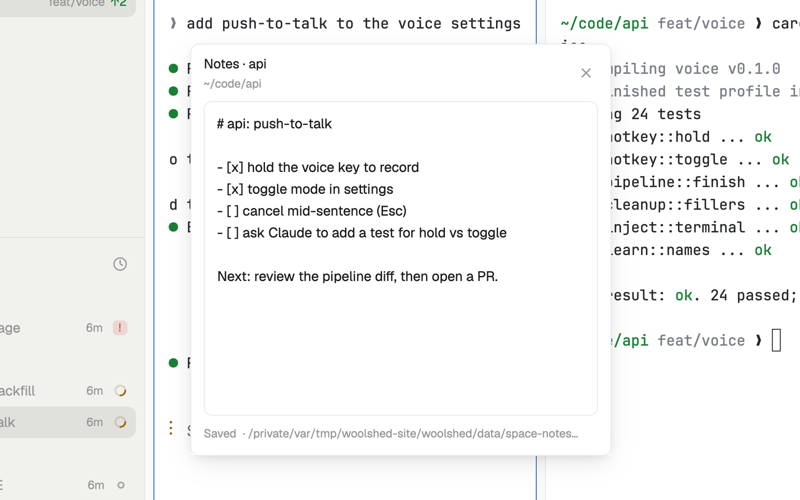

# Space notes

A scratchpad for each project. It shows the notes of the space you're in, kept as a markdown file per folder, so they're still there next week in a new space for the same folder, and an agent can read them too. It saves as you type.

## What you see

A window 400 px wide (`ctrl-shift-s`) on the `popover` color, or a block in a layout:

- **Header**: "Notes · webapp" in semibold, the folder below in 11 px `dim` (`~` for your home, "this space" without a folder, "No space open"), and ✕.
- **The editor**: 13 px text on the `background` color, 300 px tall in the window, with "Notes for this project: what you asked, what's next, what to check…" while empty.
- **When the file changed elsewhere** while you were typing: "The file changed somewhere else." in the `working` color, with "Use theirs" and "Keep mine".
- **Footer** in 11 px `dim`: "Saved 14:31" ("New", "Loading…", "Saving…", or "Unsaved" in `working`) and the note's file, "· ~/.config/woolshed/data/space-notes/webapp-3f9a1c.md".

## How it behaves

- It follows the active space. Switching saves what you typed first, then loads the other space's notes.
- It saves 800 ms after you stop typing, and when you leave the editor. An empty new note makes no file.
- One file per folder and machine: the folder's last name, a 6-character hash, `.md` (with the machine's name in front for a remote space). A space without a folder gets its own file.
- Edits made elsewhere (an agent adding a line) load at once when you have nothing unsaved.
- A save writes only if the file is as it was loaded. If not, "Keep mine" writes your text over it and "Use theirs" loads the file.

## Built from

- `mods/space-notes/main.js`. `woolshed` functions: `spaces`, `appHome`, `home`, `readTextFile`, `writeTextFile` (with the text it expects to replace), `watchFolder`, `theme`, `props`, `closeOverlay`.
- Storage: `data/space-notes/*.md` under the app folder. No programs and no network.
- `mod.json`: a kept window (`key: "space-notes"`). `keys.json`: `"ctrl-shift-s": "mod.open:space-notes"`.

## Watch out

- The notes are plain files: anything that can read the app folder can read them, which is the point for agents.
- Notes for a space on another machine are kept on this computer.
- A space without a folder keys its notes on the space itself, so they don't carry over to a new space.
- `preview.png` is a screenshot of Woolshed in light mode, running example agents.

## Done when

- `woolshed check` passes on this folder and `ctrl-shift-s` opens the active space's notes.
- Typing shows "Saved" with the time within a second, and the `.md` file holds the text.
- Switching spaces switches the notes; a line added to the file elsewhere shows up in the editor.
