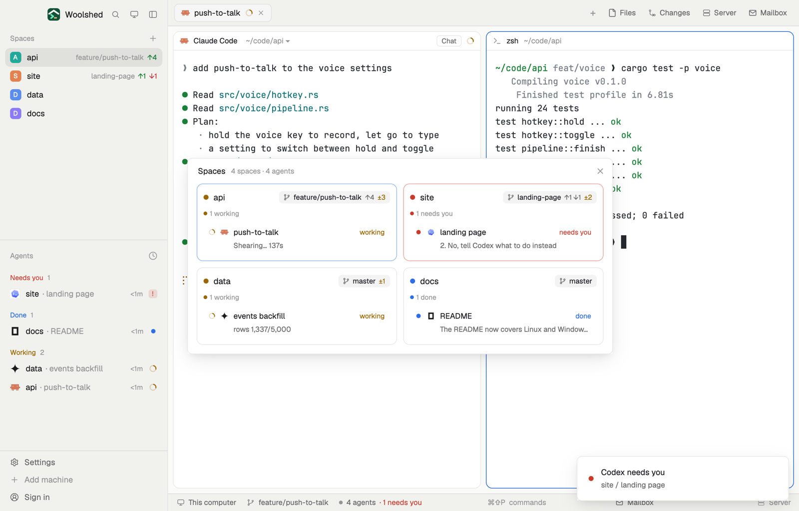

# Space overview

Every space on one card: its agents and what state each is in, the branch it's on with its uncommitted changes, and the last line each agent printed. Glance at what's happening everywhere without switching spaces.

## What you see

A window 680 px wide on the `popover` color (`mod.open space-overview`), or a panel in a layout block on `chrome`:

- **Header**, 40 px: "Spaces" in 13 px semibold, "4 spaces · 5 agents" in 11.5 px `dim`, and ✕.
- **Cards**, two columns 10 px apart (one when narrower than about 630 px), each with 10 px corners and padding, the terminal `background` and a 1 px `border` (`blocked` at half strength when someone in it needs you, `accent` at half strength for the shown space):
  - Top line: an 8 px dot in the space's status color (a ring when idle or empty), the space name in 13.5 px semibold, its machine (for a space on another computer) in `dim`, and a branch chip: 20 px tall on a faint `foreground`, a branch icon, the branch name, "↑2 ↓1" ahead and behind in `muted`, and "±3" uncommitted changes in `working`. "not a git repo" or "git failed" in `dim` otherwise.
  - Counts in 11 px `dim` with 6 px dots: "1 needs you", "1 working", or "No agents · 2 tabs".
  - A row per agent, needs you first: the status mark, the program's 13 px icon, what it's about, its state on the right in the status color, and under it in 11.5 px `muted` the last line on its screen ("Running cargo test -p voice", "24 passed · 0 failed").
- Up to 560 px tall in the window; it scrolls past that.
- With no spaces: "No spaces yet. Open a folder or start an agent, and each space gets a card here."
- Without git: a line in `blocked`, "git isn't installed here: install Git to see each space's branch."

## How it behaves

- Click a card's top line to show that space (`space.select`), an agent row to go to that agent (`agent.focus`).
- Every 30 seconds, for each space one after another: `git status --porcelain=v1 --branch` in its first terminal's live folder (else the folder it started in), on the space's machine (`exec` with `on`), with an 8 second timeout. Every 15 seconds: `hc read <address>` for up to 16 agents, keeping the last line of text without spinners, box drawing and prompt marks. Both run once at once when it opens.
- Agents, statuses and counts follow live; branches and lines update on those timers.

## Built from

- `mods/space-overview/main.js`: `woolshed` functions `agents`, `spaces`, `panes` (live folders), `exec`, `hc`, `home`, `run`, `theme`, `props`, `closeOverlay`. Commands: `space.select`, `agent.focus`.
- `git.js`: `parseStatus` reads the branch line (`## main...origin/main [ahead 2, behind 1]`, `No commits yet on main`, detached `HEAD`) and counts the changed files.
- `words.js` (`lastLine`, times, what an agent is about), `ui.js`. Art: `branch.svg`, `spinner.svg`.
- `mod.json`: a kept window (`key: "space-overview"`, `keep: true`). No keys.
- Programs: `git` (read-only `status`) and `hc read`, only while a copy runs.

## Watch out

- It reads your agents' screens to show their last line; that text stays in your window.
- In a layout block it keeps polling while hidden; the window polls only while it's open.
- A very large repo makes `git status` slow; each space's call stops after 8 seconds and shows "git failed".
- `preview.png` is a screenshot of Woolshed in light mode, running example agents.

## Done when

- `woolshed check` passes on this folder and `mod.open space-overview` shows a card per space.
- A space in a git repo shows its branch, and an edited file shows as "±1" within 30 seconds.
- Each agent row shows the last line its terminal printed, updated within 15 seconds.
- Clicking a card's name shows that space; clicking an agent focuses it.
