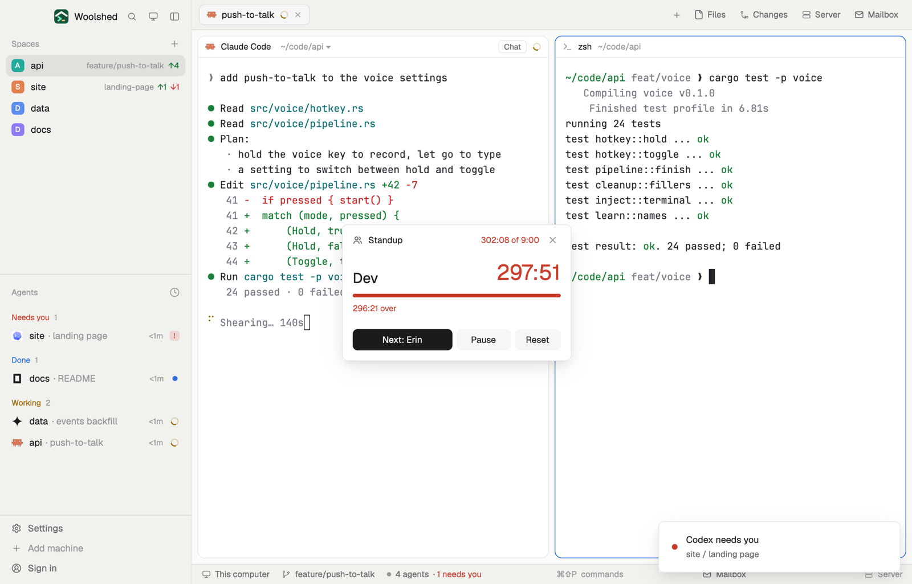

# Standup timer

Keep the daily standup to time: put in the names, give each person 90 seconds, and press Next as each one finishes. The speaker's bar fills and turns red when they run over, the list shows who took how long, and the total runs against everyone's boxes. The names are kept for tomorrow.

## What you see

A window 320 px wide (at most 600 px tall) on the `popover` color, opened with `mod.open standup-timer`:

- **Header**: a people icon, "Standup" in semibold, the total against the box in 11.5 px ("4:20 of 9:00", `blocked` when over), and ✕.
- **The speaker** during a round: their name in 20 px semibold and their time in 30 px ("0:53"); a 5 px bar filling over their box in the `working` color, the `blocked` color once over; under it "0:37 left of 1:30 min", "0:14 over" in `blocked`, or "Paused".
- **Before a round**: "6 people, 1:30 min each" (or "Add the people who speak, then Start."). **After**: "Done in 8:41" and "1 went over · 0:19 under the box" in `blocked`, or "Everyone kept to time" in `done`.
- **The names**, 26 px rows: a dot (filled `done` for those finished, `blocked` if they ran over, `working` for the speaker, a ring for those to come), the name, and their time in 11.5 px. The speaker's row is the `selected` color. Before and after a round each name has a ✕.
- **An "Add a name" field** before and after a round, errors under it in `blocked`.
- **Buttons**, 30 px: in a round a solid "Next: Dev" (the last one: "Finish"), Pause (Resume) and Reset; otherwise a solid Start (after a round: Again), Shuffle, and each person's time ("1:30 min").
- **As a strip** (a layout block): the icon, the speaker and their time (`blocked` when over) and "4 of 6"; before a round "Standup · 6 people". Click it for Next.

## How it behaves

- Start begins with the first name; Next keeps the speaker's time and hands over (while paused it stays paused); after the last, the round is done.
- Pause stops the speaker's clock; Reset ends the round, keeping the names.
- Shuffle puts the names in a random order; click the time to cycle each person's box: 30 s, 45 s, 1, 1:30, 2, 3 or 5 min.
- Enter in the field adds the name. Up to 30 names; the same name twice is refused.
- It redraws once a second only while the round runs. The round is shared, so a strip and the window show the same one, and it survives a restart.
- Key commands for a shown copy: `standup-timer.next`, `.start`, `.pause`, `.toggle`, `.reset`.

## Built from

- `mods/standup-timer/main.js`: the round and names in shared `standup-timer.state` (`names`, `seconds`, `phase`, `at`, `since`, `base`, `spent`); `woolshed` functions `shared`, `setShared`, `theme`, `props`, `closeOverlay`, `nextCommand`, `appHome`, `readTextFile`; `InputState`/`Input`.
- `mods/standup-timer/parse.js`: the round's steps, totals and name edits (tested on its own).
- `mod.json`: a kept window (`key: "standup-timer"`, `keep: true`). Art: `people.svg`. No keys, programs or network.

## Watch out

- Names can be edited only between rounds; editing resets the round.
- An example round for a first look: `data/standup-timer/example.json` under the app folder, `{ "names", "seconds", "spent": [seconds of those done], "turn": seconds into the current one }`, starts that round once each time the file changes. The preview uses it; nothing else writes it.
- `preview.png` is a screenshot of Woolshed in light mode, running example agents.

## Done when

- `woolshed check` passes on this folder and `mod.open standup-timer` opens the window.
- Three names and Start: the first one's time counts up; at 1:31 the bar and time turn red and the line says "0:01 over".
- Next three times ends the round with "Done in …" and each name's time.
- The names are still there after a restart.
