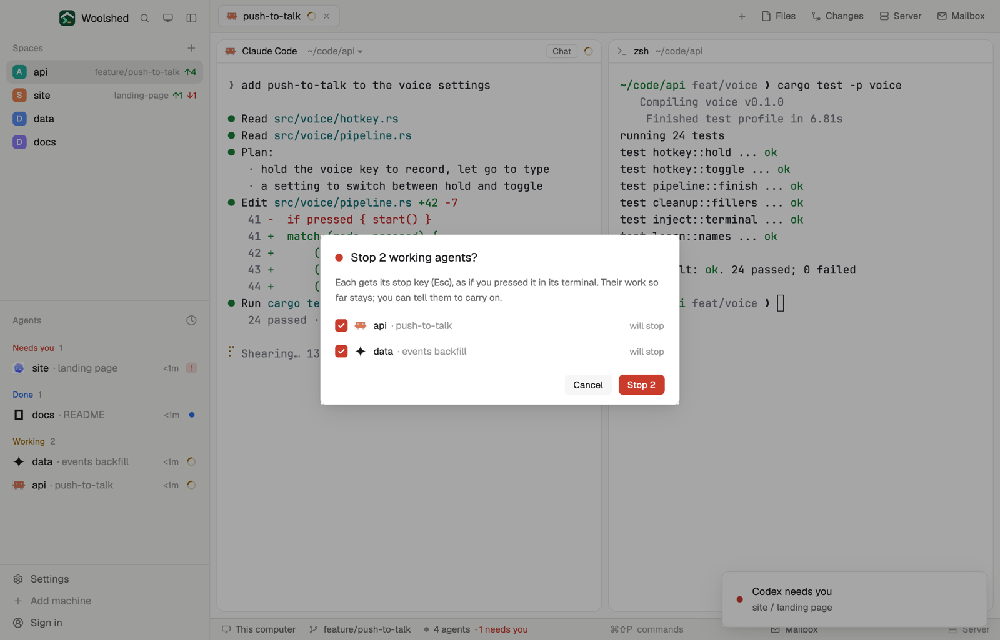

# Stop all

A panic button for when your agents are off in the wrong direction. Press `ctrl-alt-x` for a list of every working agent; Stop presses each one's stop key and shows what each reported, and what it says now. Nothing stops until you press Stop, and you can leave any of them running.

## What you see

- **The dialog** (`ctrl-alt-x`, 460 px wide over the dimmed window, on `popover`): a 10 px dot in the `blocked` color and "Stop 2 working agents?" in 15 px semibold; under it in 12 px `muted` what Stop does. One row per working agent: a 16 px tick box (filled `blocked` with a check in `background`), the program's 15 px icon, the space name (medium) and "· what it's about" in `dim`, and on the right "will stop" or "keeps running". Then Cancel and a solid "Stop 2" in the `blocked` color, 26 px tall.
- **While stopping**: "Stopping 2 agents…", each row with a red spinner and "stopping…".
- **After**: "Stopped 2 of 2 agents"; each row with its status mark and what it reported ("stopped" in `done`, "it exited" or "stop key sent" in `muted`, "still working" or an error in `blocked`), and under it, in quotes and `muted`, the last line on its screen. Back and Close.
- **Nothing working**: "Nothing is working" with a ring and Close.
- **In a layout block**: a strip with a 12 px square in `blocked` and "Stop all · 2 working" (or "Nothing working" in `dim`); a click opens the dialog.

## How it behaves

- Click a row before stopping to leave that agent running (its box empties, "keeps running"); Stop counts only the ticked ones and is off with none.
- Stop runs `hc interrupt --json --timeout 6 <address>` for every ticked agent at once: Woolshed Core presses the agent's stop key (Esc for agents) and watches for an effect. Then `hc read <address>` gives the last line on its screen.
- After stopping, click an agent to go to it (`agent.focus`); Back shows what's working now.
- Esc or Cancel closes it without doing anything.

## Built from

- `mods/stop-all/main.js`: with `props().overlay` it draws the dialog, else the strip. `woolshed` functions `agents`, `hc`, `run`, `theme`, `props`, `closeOverlay`, `openOverlay`. Command: `agent.focus`.
- `outcome.js`: reads `hc interrupt`'s JSON (`outcome`: `stopped`, `exited`, `still_working`, `unknown`).
- `words.js` (the last line of a screen, without spinners and box drawing), `ui.js`. Art: `check.svg`, `spinner.svg`.
- `mod.json`: `{ "place": "none", "overlay": { "kind": "dialog", "width": 460 } }`. `keys.json`: `"ctrl-alt-x": "mod.open:stop-all"`.
- Programs: `hc interrupt` and `hc read`, only after you press Stop.

## Watch out

- An interrupted agent keeps its conversation and the work it has done; it waits for you. Tell it what to do next (or use Broadcast).
- Agents waiting on you aren't working and aren't listed.
- The stop key is the program's own: an agent that ignores it shows "still working".
- `preview.png` is a screenshot of Woolshed in light mode, running example agents.

## Done when

- `woolshed check` passes on this folder and `ctrl-alt-x` opens the dialog listing exactly the working agents.
- Cancel and Esc stop nothing.
- Stop interrupts each ticked agent; its row says "stopped" and shows its last line; an unticked one keeps working.
- With nothing working the dialog says so.
