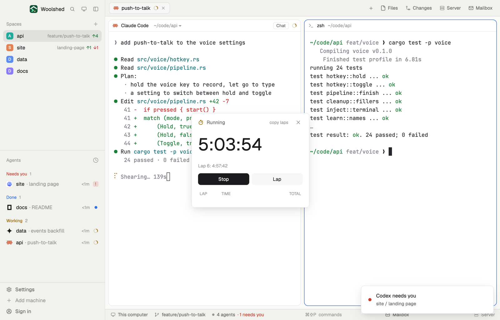

# Stopwatch

A stopwatch with laps for timing builds, test runs and anything else you want measured: start, stop, lap, with each lap's time and the running total listed and the best and slowest marked. Keys start, stop and lap it from anywhere, and it keeps counting across a restart.

## What you see

A window 300 px wide (at most 560 px tall) on the `popover` color, opened with `mod.open stopwatch`:

- **Header**: a stopwatch icon (the `working` color while running), "Running", "Stopped" or "Stopwatch" in `muted`, "copy laps" once there are laps (it reads "copied" in the `done` color for a moment), and ✕.
- **The time** in 44 px semibold, "6:52" (minutes and seconds; hours too past an hour, "1:02:03"). Stopped, the tenths follow in 20 px `dim`, ".3".
- With laps, the lap in progress in 11.5 px `dim`: "Lap 6: 0:40".
- **Buttons**, 30 px: a solid Start (Stop, Resume) and Lap while running, Reset while stopped (`dim` when there's nothing to reset).
- **Laps**, newest first, 26 px rows under a "LAP · TIME · TOTAL" heading in 10.5 px `dim`: the number, the lap's own time in semibold to a tenth ("1:08.9"), and the total at that lap in `muted`. With three laps or more the fastest is the `done` color with "best", the slowest the `blocked` color with "slowest".
- With no laps: "Laps show here, newest first" and the keys bound to it ("ctrl-alt-w start/stop · ctrl-alt-e lap").
- **As a strip** (a layout block): the icon, the time (with tenths when stopped) and "lap 3"; click to start or stop.

## How it behaves

- Start counts from that moment; Stop keeps the time; Resume carries on; Lap records the time so far; Reset clears it all.
- It counts from when it started, not by ticking, so it keeps going while Woolshed is closed and is right when it opens again.
- Running, it redraws as the shown second changes and at no other time (tenths show only when stopped).
- copy laps puts the laps on the clipboard as text: "Lap 1⇥1:14.1⇥1:14.1" a line, then "Total⇥…".
- Key commands for a shown copy: `stopwatch.toggle`, `stopwatch.start`, `stopwatch.stop`, `stopwatch.lap`, `stopwatch.reset`. A window and a strip both shown act on a key once.

## Built from

- `mods/stopwatch/main.js`: the watch in shared `stopwatch.state` (`{ running, startedAt, base, laps: [total at each lap] }`, the newest 200 laps); `woolshed` functions `shared`, `setShared`, `theme`, `props`, `closeOverlay`, `keys`, `nextCommand`, `appHome`, `readTextFile`; `cx.write_to_clipboard`.
- `mods/stopwatch/parse.js`: start, stop, lap, the clock text, the lap rows with best and slowest (tested on its own).
- `mod.json`: a kept window (`key: "stopwatch"`, `keep: true`). `keys.json`: `"ctrl-alt-w": "stopwatch.toggle"`, `"ctrl-alt-e": "stopwatch.lap"` in `global`.
- Art: `stopwatch.svg`. No programs, no network.

## Watch out

- The keys reach a shown copy only: with the window closed (and no strip), open it first.
- Changing the computer's clock while it runs changes the time it shows.
- An example watch for a first look: `data/stopwatch/example.json` under the app folder, `{ "running": true, "elapsed": ms, "laps": [each lap's ms] }`, is taken once each time that file changes. The preview uses it; nothing else writes it.
- `preview.png` is a screenshot of Woolshed in light mode, running example agents.

## Done when

- `woolshed check` passes on this folder and `mod.open stopwatch` opens the window.
- Start counts up each second; Stop shows the tenths; Resume carries on from there.
- Three laps of different lengths mark one "best" in green and one "slowest" in red.
- `ctrl-alt-w` starts and stops it while the window is open; quitting and reopening Woolshed keeps it counting.
