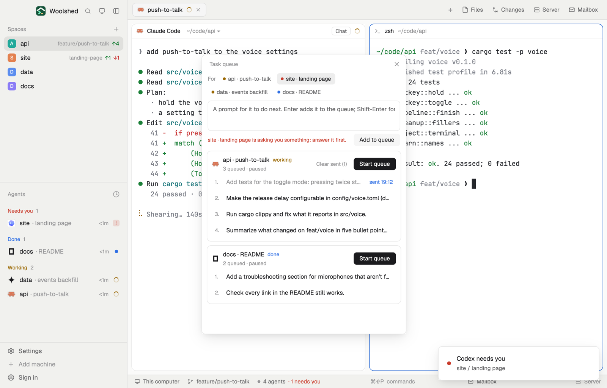

# Task queue

Line up the next few things for an agent and let them go one at a time. Write the prompts while it works; press Start queue and each one is sent when the agent has finished the one before. Nothing goes until you press Start, it never sends to an agent that's asking you something, and Pause stops it.

## What you see

A window 430 px wide on the `popover` color, or a block in a layout (on `chrome`):

- **Header**, 38 px: "Task queue" in 11.5 px `dim`, "1 running" in `accent` while any queue runs, and ✕.
- **For**: a row of chips, one per agent, each a 6 px dot in its status color (`working`, `blocked`, `done`, `idle`) and "api · push-to-talk"; the chosen one on `selected`. It starts on the agent you're looking at.
- **The prompt box**, 64 px, on `background`, and "Add to queue" on `raised`. Under it in 11 px `dim`: "Queues for api · push-to-talk", or "… is asking you something: answer it first." in `blocked`.
- **A card per agent with a queue**, on `background` with a `border` line (an `accent` one while it runs): the program icon, "api · push-to-talk" in semibold with its status word in its status color, and a line in 11 px: "3 queued · paused", "Sends the next one when it's done" (in `accent`), "Waiting: it's asking you something", or "Not running". At the right "Clear sent (2)" and a 26 px button: "Start queue" on `solid`, or "Pause" on `raised`.
- **Its prompts**, numbered: the first line in 12.5 px (`dim` once sent), and at the right "sent 14:02" in `done`, "sending…" in `working`, or "next" in `accent` for the one that goes next. A refusal shows under it in `blocked`. On hover a queued one shows ↑, ↓ and ✕; the whole prompt is its tooltip.
- **Footer** in 11 px: "Nothing is sent until you press Start queue, and never to an agent asking you something." in `dim`; "Queue done for api · push-to-talk." in `done`; reasons it paused in `blocked`.
- Empty: "No agents running. Start one, then queue prompts for it here." or "Nothing queued. Write a prompt above and add it; Start queue sends them one by one as the agent finishes each."

## How it behaves

- Enter adds the prompt to the chosen agent's queue (Shift-Enter is a new line). Prompts wait, in order, until you press Start queue on that card.
- While a queue runs it looks every 5 seconds. **working**: it waits (and notes it saw the agent work). **blocked**: it waits; nothing is ever sent to a question. **idle** or **done**: it asks Woolshed Core for the agent's state and turn count (`hc get`) and sends the next prompt with `hc send --if idle` (plain `hc send` when the core says done), which pastes it and presses Enter and refuses if the agent started working or hit a question meanwhile.
- After a send, the next one waits until the agent has taken it up: it was seen working, or the core counted a new turn, or two minutes passed with the agent idle.
- When the queue is empty it stops and a toast says "Queue done". If the agent ends, it pauses. Three refusals in a row pause it, with the reason.
- Pause stops after the current send. Closing the window pauses every queue; they're still there, paused, next time.
- Each prompt is marked "sending" in the file before it goes, so two open copies never send the same one. If a send never finished (the window closed mid-send), it pauses and says "Not sure this one went: check the agent, then Start again."
- Edits to the file elsewhere show up at once; every change reads it fresh and writes only if nobody changed it meanwhile.

## Built from

- `mods/task-queue/main.js` and `mods/task-queue/parse.js` (the file's shape, add, move, remove, clear sent, and `gate`, the rule for when the next prompt may go; pure functions). `woolshed` functions: `agents`, `focused`, `hc`, `notify`, `appHome`, `readTextFile`, `writeTextFile` (with the text it expects to replace), `watchFolder`, `theme`, `props`, `closeOverlay`.
- Programs, only while a queue runs: `hc get <terminal> --json` when its agent is idle or done, and `hc send --json [--if idle] <terminal> <prompt>` to send.
- Storage: `data/task-queue/queue.json` under the app folder, as `{ "queues": [{ "terminal", "label", "items": [{ "id", "text", "state": "queued" | "sending" | "sent", "at", "sent_at", "error" }] }] }`. Which queues run is kept in memory only.
- `mod.json`: a kept window (`key: "task-queue"`). No keys of its own (open it with `mod.open:task-queue`). No network.

## Watch out

- Start belongs to the window you pressed it in: a second copy (a block) shows the same queues but runs only those you start there.
- A queue is tied to the agent's terminal address; when that agent ends, its queue stays (paused) until you remove its prompts.
- Prompts are sent as written; nothing is filled in.
- `preview.png` is a screenshot of Woolshed in light mode, running example agents.

## Done when

- `woolshed check` passes on this folder and `mod.open:task-queue` opens it with a chip for each agent.
- Adding two prompts for an idle agent and pressing Start queue sends the first at once and the second only after the agent has worked on the first and is idle again.
- An agent asking a question gets nothing until it's answered; Pause stops a queue before its next prompt.
- `queue.json` shows each prompt as "sent" with the time.
